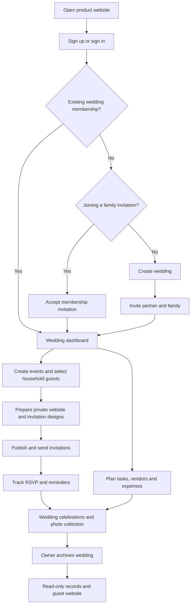
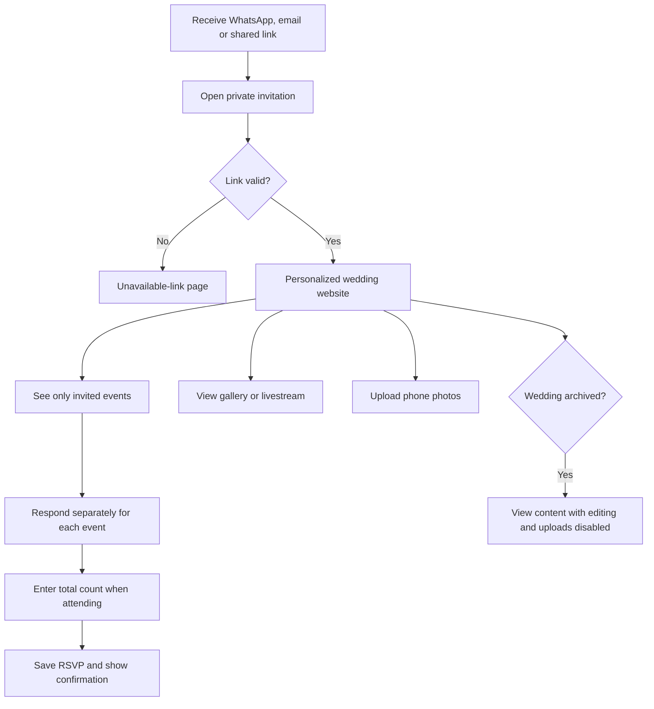
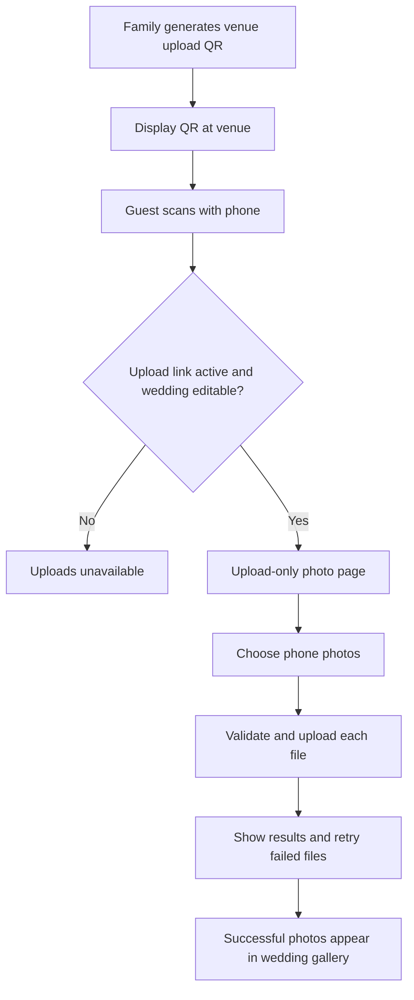

# Wedding Management Platform — Detailed PRD v2.2

**Date:** October 10, 2026  
**Status:** Agreed functional scope; implementation decisions pending  
**Audience:** Couples and families  
**Platform:** Mobile-friendly website, primarily in English  
**Business model:** Free initially  
**Initial scale:** Approximately 5 weddings with 500 guests per wedding

**Companion documents:** [UI Guidelines](Wedding-UI-Guidelines.md) and [Phase-by-Phase Development Plan](Wedding-Development-Plan.md). The UI guide provides a proposed visual direction; the plan expands the delivery stages into implementation work and completion checks.

**Revision:** Expands the agreed scope with screen definitions, application flows, data relationships, validation, and release criteria. Sections 1–18 capture the feature scope. Sections 20–30 specify proposed product behavior in greater detail; defaults not explicitly selected by the user are labeled as proposals.

## Document navigation

- [Product purpose and structure](#1-product-purpose)
- [Users and access](#3-users-and-access)
- [Feature requirements](#4-wedding-setup-and-family-collaboration)
- [Vendor management](#131-vendor-management)
- [Gallery and QR uploads](#14-livestream-and-gallery)
- [Core acceptance criteria](#16-core-acceptance-criteria)
- [Development order](#17-development-order)
- [Scope exclusions](#18-explicitly-out-of-scope)
- [Open implementation decisions](#19-remaining-implementation-decisions)
- [Goals and measurement](#20-product-goals-and-success-measures)
- [Screens and navigation](#21-information-architecture-and-screen-inventory)
- [Application flow diagrams](#22-application-flow-overview)
- [Detailed user journeys](#23-detailed-application-flows)
- [Permission matrix](#24-detailed-permission-matrix)
- [Data relationships](#25-conceptual-data-model)
- [States and validation](#26-state-transitions-and-validation-rules)
- [Notifications](#27-notification-behavior)
- [Quality requirements](#28-quality-and-operational-requirements)
- [Scenario acceptance tests](#29-end-to-end-acceptance-scenarios)
- [Release readiness](#30-release-readiness-and-decision-register)

## 1. Product purpose

Help couples and their families plan a wedding together, manage event-specific invitations, coordinate tasks and vendors, track expenses, and share the celebration through a private wedding website.

Anyone can register and create a wedding. The initial product is for couples and families, not professional wedding planners.

## 2. Product structure

Each wedding contains:

- One shared family planning workspace.
- Multiple events.
- A central guest directory with separate invitation lists for each event.
- Wedding-level and event-level tasks.
- Expense records.
- Wedding vendor records and event-specific service bookings.
- Announcements.
- A private guest-facing wedding website.
- Invitations, RSVPs, livestream links, and photo galleries.

**Core rule:** An invitation to one event never automatically grants access to another event.

For example, the Sharma household may be invited to the wedding and reception but not haldi. Their invitation website shows only the wedding and reception.

## 3. Users and access

| User | Access |
|---|---|
| Bride and groom | Primary owners; full planning access and authority to appoint managers. |
| Manager | An appointed family member who helps manage the wedding. |
| Family member | Can view and edit all planning information, including events, guests, tasks, vendors, and expenses. |
| Guest / household representative | Uses a private invitation link without an account, sees invited events, and submits household RSVPs. |
| Photographer | Can contribute photos without receiving family planning access. A dedicated upload link is the proposed mechanism. |

All family members can edit planning content. The proposed administrative boundary reserves ownership changes, member removal, and wedding deletion for owners; confirm this during implementation design.

A registered organizer belongs to only one wedding in the initial version. No multi-wedding switcher or professional planner workspace is required. Guest invitation links do not require organizer membership.

## 4. Wedding setup and family collaboration

The bride or groom can:

- Create a wedding after signing up.
- Enter the couple's names, wedding date, introduction, and cover photos.
- Invite the other partner as a co-owner.
- Invite family members to the shared workspace.
- Appoint family members as managers.
- Configure the private wedding website.

Both families work within the same workspace. Financial information is shared across the organizing family.

Planning changes should record who made the change and when, helping families resolve accidental edits.

## 5. Wedding dashboard

The dashboard summarizes:

- Wedding countdown.
- Upcoming events.
- Tasks due soon and overdue tasks.
- Invitation delivery status.
- RSVP totals for each event.
- Expected attendance for each event.
- Recorded expenses, paid amounts, and outstanding balances.
- Upcoming payment deadlines.
- Vendor bookings awaiting confirmation and upcoming vendor arrival times.
- Recent announcements.

Budgets are optional. If no budget is entered, expenses and balances remain available without requiring a budget.

**Counting rule:** Household invitations, individual attendance counts, and event attendance totals must be shown separately. Adding attendance across several events must not be labeled as the number of unique wedding guests.

## 6. Event management

Users can create custom events or start from templates such as haldi, mehendi, sangeet, wedding ceremony, reception, pre-wedding celebration, and post-wedding celebration.

| Field | Requirement |
|---|---|
| Name and description | Identify and explain the event. |
| Date and time | Start time and optional end time. |
| Venue | Venue name and address. |
| Map | Location link or map display. |
| Dress code | Optional guest instructions. |
| Contact person | Name and contact details. |
| Schedule note | Simple timing information; no detailed running-order planner. |
| Guest list | Independently select invited households. |
| Tasks | Tasks associated with the event. |
| Vendors | Service providers assigned to the event, with booking status and arrival details. |

Only invited guests can see an event on the private invitation website. A separate public information page may display organizer-selected event details; this never grants RSVP or private invitation access. All organizing family members can manage all events.

When a published event's time or venue changes, the platform notifies its invited households.

## 7. Guest and household management

Organizers can:

- Add guests manually.
- Import guest records from CSV.
- Add phone numbers and email addresses.
- Import contacts where supported, with manual and CSV entry as alternatives.
- Group guests using bride's side, groom's side, family, friends, colleagues, and custom tags.
- Edit and search guest records.
- Assign households to selected events.

Each invitation belongs to a household representative. It can cover one person or multiple family members.

All people covered by the same household invitation share the same event access. If different relatives need different invitations, organizers create separate household invitation records.

The platform should flag possible duplicate phone numbers or email addresses before creating duplicate invitations.

## 8. Invitation creation and delivery

The invitation system includes all three options:

1. Ready-made templates with editable text and photos.
2. Uploading a custom invitation image.
3. A full drag-and-drop invitation designer.

The designer should support:

- Text blocks and images.
- Backgrounds and colors.
- Fonts and text formatting.
- Moving and resizing elements.
- Saving drafts.
- Previewing invitations on mobile and desktop.

Each event can have its own invitation design and message.

### Delivery channels

- **WhatsApp:** Manual Share on WhatsApp button opens WhatsApp with prepared invitation text and the household's private link. The organizer reviews the recipient and taps Send in WhatsApp. No WhatsApp Business API integration is required for this scope.
- **Email:** Automated sending through a configured provider.
- **Manual sharing:** Copy and share a private invitation link.

SMS is excluded.

Organizers choose the event, intended households, design, and channel before sending. Automated email shows success or failure and delivery information where supported by its provider. WhatsApp sharing happens one household at a time; opening WhatsApp does not prove the message was sent, delivered, or read. The application can record a share action or an organizer's manually marked shared status, clearly distinguished from verified delivery.

The WhatsApp button prepares text and a private link; it does not automatically attach an invitation image. Organizers can separately download a design and attach it themselves. If WhatsApp cannot open, provide Copy message and Copy invitation link alternatives. RSVP tracking works normally after recipients open the private link.

An email delivery account, credentials, and any email provider charges are launch dependencies even while the product itself is free. There are no automatic WhatsApp sends, bulk sends, delivery receipts, or background WhatsApp reminders in this version. Organizers can manually share prepared reminder and event-update messages through the same button.

## 9. Private wedding website

The private guest website is accessible only through household invitation links. A separate public, view-only wedding information page is also included, as specified in section 9.1.

It includes:

- Couple's names, introduction, and photos.
- Wedding welcome message.
- The household's invited events.
- Dates, times, dress codes, venues, and maps.
- Event-specific RSVP forms.
- Relevant contact information.
- Livestream links or embeds.
- Wedding photo gallery.
- Upload Photos action for selecting and uploading photos directly from a guest's phone.

It must not expose internal tasks, expenses, family comments, guest directories, or uninvited events.

Gallery and livestream content are available to all wedding invitees. Event information remains restricted to each household's invitations.

Private links must be difficult to guess and revocable. Because guests do not log in, anyone receiving a forwarded link can access that invitation until it is revoked.

### 9.1 Public wedding information page

**Confirmed addition:** A separate public, view-only wedding website is included alongside the existing private invitation website.

Approved route pattern: `https://weddingapp.vercel.app/w/rakesh-and-priya`. The project domain is illustrative and depends on the actual Vercel deployment. Generate and reserve a unique page slug automatically; add a short suffix for duplicate names. Keep the page unpublished until the organizer selects public content and publishes it. The public address is not a secret or an invitation credential.

Organizers can explicitly select and publish:

- Couple names, selected introduction photos, and welcome/story text.
- Wedding date and countdown.
- Selected event names, timings, venues, map links, and dress codes.
- Contact details explicitly approved for public display.

Do not display RSVP controls, photo-upload controls, the shared guest gallery, livestream access, household identities, invitation tokens, guest lists, vendors, expenses, tasks, or internal comments on this page. Selected couple photos are public-page content, not public access to the wedding gallery.

Public publication is independent of publishing an event for invited guests. An event is private by default and appears publicly only when an organizer explicitly selects its permitted details. Publishing an event publicly does not add anyone to its guest list or enable RSVP. Uninvited events not chosen for public display remain hidden.

Flow: Family workspace → Website → Public information page → Select content/events/photos → Preview as a public visitor → Publish → Copy public URL. Maintain separate Public page and Private invitation preview modes. Organizers can edit and republish while active, and owners can unpublish at any time, including after archive as a privacy control. Archive otherwise preserves the existing page read-only; no automatic publication occurs.

Public content is visible to anyone and may be forwarded or copied. Default to search-engine noindex as a discoverability preference, not an access restriction. Unpublishing stops future application access but cannot recall downloaded copies or third-party caches.

Acceptance checks:

1. An anonymous visitor sees only explicitly published public fields and selected photos.
2. A public URL does not grant household identity, RSVP, gallery, upload, or realtime family access.
3. Publishing haldi for private invitees alone does not expose it publicly.
4. Household links retain personalized invited events and RSVP even when a public page exists.
5. After unpublishing, public page/API/media requests reveal no current protected content; previously downloaded copies cannot be revoked.

## 10. RSVP and reminders

Each household can respond separately to every invited event:

- Attending.
- Not attending.
- Maybe.

For an attending response, the representative enters only the total number attending.

Requirements:

- No fixed household attendance limit.
- No approval workflow for increasing the count.
- No adult/child breakdown or meal preference collection.
- One representative can respond for the entire household.
- Organizers can record or correct responses received by phone or in person.
- RSVP deadlines can be set per event.
- Automatic email reminders can target households that have not responded and have an eligible email address. WhatsApp reminders are prepared for manual sharing by an organizer.
- Upcoming-event reminders go only to the relevant invitees.
- Response updates modify the existing RSVP rather than creating duplicates.

Expected attendance counts include confirmed attendance, with Maybe responses displayed separately.

## 11. Task planning

Tasks can belong to the overall wedding or a particular event.

```text
Wedding
├── Prepare wedding invitation
├── Finalize wedding outfits
├── Haldi
│   ├── Buy turmeric
│   ├── Arrange decorations
│   └── Prepare the venue
└── Reception
    ├── Confirm food arrangements
    └── Prepare welcome signage
```

Each task supports:

- Title and description.
- Assignee.
- Due date.
- Priority.
- Status: To do, In progress, Done.
- Checklist.
- Attachments.
- Comments.

Users can filter tasks by event, assignee, status, and due date.

Ready-made checklists help families start planning based on the wedding date. Users can edit or remove template tasks. Task dependencies are excluded.

## 12. Announcements and comments

The family workspace supports:

- Wedding-wide announcements.
- Comments within tasks.
- Author and timestamp on posts and comments.
- Notifications for task assignments and relevant updates.

There is no separate group chat. Family announcements remain internal unless an organizer explicitly sends guest-facing communication.

## 13. Expense tracking

Users can record expenses without creating a budget.

Each expense supports:

- Title and category.
- Optional associated event.
- Optional linked vendor booking.
- Estimated cost.
- Agreed or final cost.
- Payment entries and payment dates.
- Who paid.
- Outstanding balance.
- Payment deadline.
- Receipt attachments.
- Notes.

Multiple payments can be recorded against one expense.

**Calculation:** Outstanding balance equals the agreed cost minus recorded payments. Estimated and agreed costs must not be added together as separate expenses. If an agreed cost has not been entered, its outstanding balance should be shown as undetermined rather than calculated from a missing value.

An optional overall wedding budget may be entered. Event budgets are not required.

All organizing family members can view and edit expenses. The platform records payments; it does not process or transfer money.

### 13.1 Vendor management

Vendor management is included following the updated requirement. Families can manage service providers such as mehendi artists, haldi service providers, and Pandit Ji. Additional categories can include decorators, caterers, makeup artists, photographers, and custom services.

The proposed initial implementation is a wedding-specific vendor directory managed by the family. A vendor record does not create a vendor login or grant access to the family workspace.

Each vendor record supports:

- Person or business name.
- Service category, including custom categories.
- Contact person, phone/WhatsApp number, and optional email.
- Address or service location, where useful.
- Notes and attachments such as quotations or agreed service details.

Each service booking supports:

- Linked vendor and one or more associated events, or the wedding overall.
- Description of the agreed service and requirements.
- Service date, arrival time, and venue where applicable.
- Responsible family member for coordination.
- Status: Shortlisted, Contacted, Confirmed, Completed, or Cancelled.
- Quoted cost and agreed cost through a linked expense record.
- Advance payments, later payments, due dates, receipts, and outstanding balance through the expense tracker.

The same vendor can serve multiple events without duplicating their contact record. A package covering several events can use one booking and one linked expense; separately priced services can use separate bookings.

Example: A family adds a mehendi artist, assigns the booking to the mehendi event, records the arrival time and agreed fee, assigns a family coordinator, and records an advance payment. Pandit Ji can be assigned to the wedding ceremony with a checklist of required ritual materials linked through a planning task.

All organizing family members can add, view, and edit vendors and bookings. Guest pages do not expose vendor records or financial details. Vendor records follow the wedding's read-only archive behavior.

**Financial consistency:** Vendor payment summaries read from linked expense records. Booking costs must not be added again to expense totals. Cancelling a booking preserves its recorded payments and financial history for reconciliation.

Vendor discovery, a public marketplace, and vendor self-service accounts are not assumed for this version; the scope is managing providers the family adds.

## 14. Livestream and gallery

### Livestream

- Add an external livestream URL.
- Embed the player where supported.
- Provide an external viewing link when embedding is unavailable.
- Make livestream access available to all wedding invitees.

Native video broadcasting is excluded.

### Gallery

- Organizers, photographers, and guests can upload photos.
- Guests can upload directly from their phones through either their private invitation website or a separate venue QR code. Neither guest upload route requires an account or login.
- Uploads appear without an approval queue.
- All wedding invitees can view the gallery.
- Organizers can remove unwanted photos.
- Gallery event labels must not expose restricted event details to uninvited households. Photos themselves are shared with all invitees under the agreed gallery policy.

The proposed photographer upload link grants contribution access without granting access to expenses, tasks, or guest lists.

### Guest photo-upload routes

Both routes are required:

1. **Private invitation link:** The guest opens their invitation website, selects Upload Photos, chooses photos from their phone, and uploads them to the wedding gallery.
2. **Venue QR code:** A family member generates and downloads a wedding-specific QR code for display at the venue. Scanning it opens a mobile-friendly, upload-only page where guests select and upload photos without logging in.

The venue QR code points to a separate, difficult-to-guess upload link, never to a household invitation. It grants photo-upload access only and does not reveal household invitations, RSVPs, guest lists, restricted event details, or the family planning workspace. Gallery viewing continues through the private invitation website.

The upload page shows upload progress and success or failure, with a retry option for failed uploads. Uploaded photos appear in the shared wedding gallery without approval. Family members can remove unwanted photos and disable or regenerate the venue upload link; regenerating it invalidates the old QR code and link.

Anyone holding the venue upload link or QR code can upload while it is active. File type, size, and upload-rate limits must be enforced by the server, with exact limits selected before launch. Archiving the wedding disables uploads through invitation links, venue QR links, and photographer contribution links.

This QR code is for photo uploads only; guest check-in remains out of scope.

## 15. Wedding archive

An owner can archive the wedding after the celebrations.

In the read-only archive:

- Planning records remain available to authorized family members.
- The guest website and gallery remain viewable through valid invitation links.
- Event editing, vendor and booking updates, RSVP changes, comments, and new uploads are disabled.
- Scheduled invitations and reminders stop.

Archiving does not automatically delete the wedding or its photos. Storage and retention limits must be defined before public launch.

## 16. Core acceptance criteria

The initial product is ready when:

1. A couple can create a wedding and invite family members.
2. Family members can collaboratively edit all planning information.
3. Organizers can create events from templates or from scratch.
4. A household invited to two events cannot view a third uninvited event, including through a direct URL.
5. A guest can submit separate household RSVPs without logging in.
6. Updating an RSVP updates the event attendance total correctly.
7. Organizers can use editable templates, upload invitation images, and create designs in the drag-and-drop editor.
8. Organizers can manually share invitations through WhatsApp and send automated email invitations. A WhatsApp share action is never reported as verified delivery.
9. Reminders target the correct households without creating duplicate sends.
10. Wedding-level and event-level tasks can be assigned and tracked.
11. Expenses support partial payments and accurate outstanding balances.
12. Guests and photographers can upload photos without accessing the family workspace.
13. Archived weddings reject edits and stop scheduled reminders.
14. Main organizer and guest flows work comfortably on mobile screens.
15. Data from one wedding cannot be accessed by members of another wedding.
16. Guest access remains restricted even when someone changes a URL or calls the underlying API directly.
17. Family members can add vendors, assign service bookings to events, and track booking status and arrival details.
18. One vendor can serve multiple events without duplicating contact records, and shared package costs are counted only once.
19. Vendor advances and remaining balances match the linked expense records, and cancellation preserves payment history.
20. Vendor details remain private to the organizing family and become read-only when the wedding is archived.
21. A guest can select and upload phone photos without logging in through either a private invitation website or the venue QR upload page.
22. The venue QR link grants upload-only access and cannot reveal a household's invitation, RSVP, restricted event details, or internal planning data.
23. Successful uploads appear without approval; failed uploads show a retry option, and family members can remove unwanted photos.
24. Disabled or replaced venue upload links reject new uploads, and all upload routes reject uploads after the wedding is archived.

## 17. Development order

All confirmed features remain in scope. This sequence makes implementation and testing manageable; it does not remove features from the agreed product.

| Stage | Deliverables |
|---|---|
| 1 — Planning foundation | Login, wedding creation, family membership, permissions, events, and dashboard foundation. |
| 2 — Guest experience | Guest imports, households, event invitations, private wedding website, and RSVP. |
| 3 — Family coordination | Tasks, checklist templates, comments, announcements, vendor management, service bookings, and linked expense tracking. |
| 4 — Invitations and messaging | Templates, image uploads, drag-and-drop designer, manual WhatsApp sharing, automated email delivery/reminders, and manual WhatsApp reminder actions. |
| 5 — Celebration and launch | Gallery, guest phone uploads through invitation links and venue QR codes, photographer uploads, livestream, archiving, access checks, and testing with real families. |

The first real-family trial can begin once planning and RSVP flows work, while the remaining confirmed features are completed. Real families are available for testing. No fixed launch date or development budget has been specified.

## 18. Explicitly out of scope

- Professional wedding planner accounts.
- Multiple weddings per organizer.
- Hotel rooms and accommodation allocation.
- Transport and pickup planning.
- Seating plans.
- Guest check-in, including QR-based check-in. Photo-upload QR codes are included.
- Public vendor marketplace and vendor self-service accounts (not included in the proposed initial vendor scope).
- Online payments.
- SMS.
- Automated WhatsApp delivery, WhatsApp Business API integration, and automatic WhatsApp reminders.
- Native livestream broadcasting.
- Group chat.
- Task dependencies.
- Mandatory budgets.
- Guest accounts.
- Public RSVP, public photo uploads, and automatic publication of private event details. A separate public information page is included.

## 19. Remaining implementation decisions

These decisions do not change the confirmed functional scope:

- Organizer login method and account recovery.
- Technology stack, hosting, and database.
- Email provider, setup requirements, and operating costs; WhatsApp uses manual sharing without a messaging provider integration.
- Storage quotas, permitted upload sizes, and retention policy.
- Supported contact-import mechanisms across browsers and devices.
- Exact invitation editor controls and template library.
- Reminder timing, RSVP deadline behavior, and notification preferences.
- Final owner-only administrative actions.
- Photographer upload-link lifecycle.
- Final vendor categories and booking fields; vendor management is confirmed, while the detailed workflow in section 13.1 is the proposed implementation.
- Expected simultaneous usage and measurable performance targets; the initial scale estimate specifies weddings and guests, not concurrency.

## 20. Product goals and success measures

### Problems to solve

Families currently need to coordinate event plans, household invitations, tasks, provider details, and payments across separate conversations and records. This product provides a shared source of information while keeping guest access simple and event-specific.

### Goals

| Goal | Evidence to collect during the real-family pilot |
|---|---|
| Start planning without training | Time and completion rate from registration to first event creation. |
| Keep household invitations accurate | Invitation assignment errors and accidental duplicate records reported by families. |
| Make RSVP easy on a phone | Completion rate from invitation opening to successful RSVP; failures by device. |
| Improve family coordination | Tasks assigned/completed and overdue tasks visible to family members. |
| Keep financial records consistent | Agreement between expense payments, vendor summaries, and dashboard totals. |
| Make photo contribution easy | Successful uploads through invitation links and venue QR codes; upload failure rate. |
| Keep access boundaries reliable | No unauthorized access in the cross-wedding and uninvited-event test suite. |

Numerical business targets will be set after the pilot baseline. Automated message delivery, RSVP completion, and event attendance are different metrics and must not be treated as interchangeable.

## 21. Information architecture and screen inventory

### Organizer navigation

```text
Public product landing page (no private wedding information)
  Sign up / Sign in
  Create wedding OR accept a family invitation
    Shared wedding workspace
      Dashboard
      Events → Event detail → Guests / Tasks / Vendors
      Guests → Household detail → Invited events / RSVP / Delivery history
      Invitations → Designs / Designer / Send / Delivery history
      Tasks → Task detail / Comments / Checklist
      Vendors → Vendor detail → Service bookings
      Expenses → Expense detail → Recorded payments / Receipts
      Announcements
      Wedding website → Edit / Guest preview / Publish
      Gallery → Photos / Uploads / Venue QR / Photographer links
      Livestream
      Family members
      Settings → Wedding details / Notification settings / Archive
```

The product landing page explains the application. A separate /w/:slug route displays each explicitly published public wedding information page. On mobile, navigation should use a compact menu with direct access to the dashboard and common actions.

| Screen | Main content | Primary actions / important states |
|---|---|---|
| Sign up / sign in | Organizer authentication and account recovery | Authenticate; preserve pending membership invitation. |
| Wedding setup | Couple names, wedding date, wedding timezone, cover photo | Save setup; invite partner. Date/photo may remain incomplete in draft. |
| Dashboard | Planning summaries and upcoming items | Add event, guest, task, expense; empty-state setup guidance. |
| Events | Event cards or list with date and status | Create from template or custom; filter; open details. |
| Event detail | Event information and related guest/task/vendor tabs | Edit, publish, notify changes; show cancelled state when relevant. |
| Guests | Household records, tags, contact details, event filters | Add, import, edit, assign invited events. |
| Household detail | Representative, event access, responses, message history | Change event selection, record RSVP, copy or revoke private link. |
| Invitation designer | Canvas, controls, templates, image upload | Edit, save draft, preview, publish design version. |
| Send invitations | Selected event, recipients, channel, design, message | Preview actual recipient scope; send; show missing contact details. |
| Tasks | List or board, filters, due dates | Add, assign, update status, open comments/checklist. |
| Vendors | Categories, contacts, bookings and status | Add provider, create booking, select coordinator. |
| Expenses | Agreed cost, paid total, remaining balance | Add expense/payment, attach receipt, filter by event/vendor. |
| Website editor | Couple information and guest-facing sections | Preview as a selected household; publish. |
| Gallery management | Photos and upload controls | Upload, remove, generate/download QR, revoke contribution links. |
| Family members | Owners, managers, members, pending invitations | Invite, resend; owner-only administration as proposed below. |
| Archive action | What becomes read-only and which reminders stop | Explicit archive confirmation; display archive state thereafter. |

### Guest and contributor screens

| Screen | Main content | Access |
|---|---|---|
| Private wedding home | Welcome, couple story, invited event cards | Valid household invitation link. |
| Invited event | Venue, time, map, dress code, contact, RSVP | Household assigned to that published event. |
| RSVP form | One response and total count per event | Valid household link; editable while allowed by wedding state. |
| Gallery | Wedding photos and upload action | Valid household invitation link. |
| Livestream | Embedded player or external viewing action | Valid household invitation link. |
| Venue upload | Wedding identity, photo picker, progress and results | Active upload-only QR link. No gallery or RSVP access. |
| Photographer upload | Photo picker and upload results | Active photographer contribution link. |
| Unavailable link | Plain explanation and contact guidance where safe | Invalid, revoked, or disabled link; no private records disclosed. |

## 22. Application flow overview

The diagrams use Mermaid; the numbered journeys in section 23 remain readable in Markdown viewers without diagram rendering.

### Organizer flow



### Guest flow



### Venue QR flow



## 23. Detailed application flows

### F01 — Couple creates a wedding

**Actor:** Bride or groom. **Precondition:** No existing wedding membership.

1. Open the product website and choose Create a wedding.
2. Register or authenticate using the selected login method.
3. Enter couple names and available wedding information. Store the wedding timezone so event dates and reminders are interpreted consistently.
4. Save the wedding as a planning workspace; incomplete guest-facing content remains unpublished.
5. Invite the partner as co-owner and other family members as members or managers.
6. Open the dashboard with clear next actions: create an event, add guests, and add planning tasks.

**Outcome:** A wedding workspace and owner membership exist. A guest website is not publicly exposed by creating a workspace.

**Exceptions:** A returning organizer with an existing wedding goes to that wedding. Repeated submission must not create duplicate weddings.

### F02 — Family member joins

1. The organizer creates a family invitation with the intended role.
2. The invitee opens the membership link and signs in or registers.
3. The application validates the invitation and confirms the wedding identity before acceptance.
4. The invitee accepts and enters the shared dashboard.
5. They can edit all planning content according to the agreed family permissions.

**Exceptions:** A revoked invitation is rejected. An invitee already belonging to a different wedding cannot join a second wedding; no automatic merge or account reassignment occurs. Handling a later move between weddings remains a product decision.

### F03 — Create and publish an event

1. Open Events and choose a template or Custom event.
2. Enter event details and save a draft. Drafts support incomplete planning.
3. Add event tasks and vendor bookings as needed.
4. Select the households invited to this event.
5. Preview the guest-visible event details.
6. Publish the event once its required guest-facing fields are valid.

**Proposed publication minimum:** Name, date/start time, venue name/address, and at least one organizer contact. Maps, dress code, end time, and description remain optional.

**Outcome:** Assigned households can see the published event through valid invitation links. Publishing does not automatically send invitations; the send flow is a separate action.

### F04 — Add or import households

1. Open Guests and choose Add household, CSV import, or supported contact import.
2. For manual entry, enter representative name, household label, available contact details, and tags.
3. For CSV, upload a file, map columns, preview rows, and show invalid or potential duplicate entries before saving.
4. Let the organizer correct rows or explicitly skip invalid rows. Do not silently discard data or merge households.
5. Select invited events for each household, individually or through a reviewed bulk selection.
6. Save records and show imported, skipped, and failed counts.

**Contact rule:** A household can exist without email or phone if the organizer will share its link manually. Automated email requires a valid email address. WhatsApp sharing can target a saved valid phone number or let the organizer select the recipient in WhatsApp, with Copy message/link as a fallback.

**Outcome:** Household records and explicit household-event assignments exist. Tags alone do not automatically grant event access.

### F05 — Design and send invitations

1. Open Invitations and select the event.
2. Choose a template, upload an existing invitation image, or create a design with the editor.
3. Edit text/photos and preview on mobile and desktop. Save draft changes without changing already published designs.
4. Publish the selected design version.
5. Select invited households and the desired channel.
6. Review recipient count, missing contacts, design, and message preview.
7. For email, confirm Send; the platform records delivery attempts and queues email messages. Review sent, failed, or provider-reported results and retry failures as appropriate.
8. For WhatsApp, open one household's Share on WhatsApp action. Review the prepared text/private link and recipient, then tap Send inside WhatsApp. Return to the application to share the next household's invitation if needed.
9. Optionally mark a household as manually shared. The application cannot verify WhatsApp delivery or whether the organizer completed the send.

**Outcome:** Each message contains the correct private household link and relevant event invitation. A household website may show its other invited events, but never unrelated events.

**Exceptions:** Missing email credentials or contacts produce actionable errors. Email provider acceptance must not be labeled delivered. WhatsApp opening must not be labeled sent or delivered. If opening WhatsApp fails, allow copying the message/link. Resending does not reset RSVP. Editing a design does not recall previously sent messages.

### F06 — Guest responds to an invitation

1. Open the private invitation link with no login.
2. See the household's published invited events.
3. For each event, select Attending, Not attending, or Maybe.
4. If Attending, enter a positive whole-number total for the household.
5. Save the response and show confirmation with the saved answer/count.
6. Reopen the same link to review or change the response while the wedding is active.

**Proposed deadline default:** RSVP deadlines are reminder targets, not hard locks. Late responses remain accepted and are labeled late until the wedding is archived. This avoids blocking real guest updates; final deadline policy remains configurable during design.

**Exceptions:** Counts cannot be negative, decimal, or blank for Attending. No business guest cap is imposed. Not attending and Maybe do not contribute to confirmed headcount.

### F07 — Organizer records a response or changes an invitation

1. Open a household record and select the event.
2. Record a phone/in-person RSVP with the same validation as the guest form.
3. Save the response source and actor; dashboards use the latest saved response.
4. When editing event assignments, show which access will be added or removed before saving.
5. Removing an assignment immediately removes guest access to that event and excludes it from current invitation and attendance totals; preserve response history internally.

**Proposed concurrency behavior:** Warn an editor if the RSVP changed since they loaded it, rather than silently replacing a newer response.

### F08 — Change or cancel an event

1. Edit a published event's venue or time.
2. Save the new details and record the change.
3. Queue an email change notification for currently invited households with eligible email addresses, and prepare WhatsApp update messages for manual sharing.
4. Show email delivery results and manual WhatsApp follow-up actions; opening a share action is not delivery confirmation.
5. Guests opening their link see the latest details immediately.

**Proposed cancellation behavior:** Mark a published event Cancelled, display that status to its invitees, stop its scheduled reminders, and notify them. Preserve RSVPs and expenses for history. Linked vendor bookings and recorded payments are not automatically cancelled or deleted; flag them for family follow-up.

### F09 — Plan and complete tasks

1. Add a wedding-level task or open an event and add an event task.
2. Enter title, assignee, priority, due date, and optional checklist/attachments.
3. Save and notify the assigned family member inside the workspace.
4. Family members update status, comments, and checklist progress.
5. Dashboard summaries reflect overdue and completed tasks.

**Template behavior:** Preview template tasks before adding them. Applying a template again should warn about likely duplicates. Changing the wedding date should offer a preview before shifting existing task deadlines, rather than moving them silently.

### F10 — Manage a vendor booking and its payments

1. Add or choose a provider, such as a mehendi artist or Pandit Ji.
2. Create a booking for the wedding overall or selected events.
3. Enter service details, arrival time, responsible family member, and booking status.
4. Record quoted/agreed cost in the booking's linked expense.
5. Record an advance payment with amount, date, payer, and optional receipt.
6. Display the same paid and outstanding values in the vendor page, expense page, and dashboard.
7. Update the booking through confirmation and completion; record later payments as separate entries.

**Example:** Agreed fee 20,000 and advance 5,000 produce paid 5,000 and outstanding 15,000 in the selected wedding currency. A package serving two events is still counted once in wedding expense totals.

**Exceptions:** Cancelling a booking retains its expense/payment history. Recording a vendor does not send a message to the vendor or create a vendor account.

### F11 — Publish and preview the private website

1. Edit the couple's story, welcome text, images, contacts, and enabled guest sections.
2. Choose a sample household for preview.
3. Show exactly the published events that household can access.
4. Publish website changes independently of sending messages.
5. Keep internal task, expense, vendor, and membership data out of the guest response entirely.

**Outcome:** Valid invitation links resolve to the current website. If not yet published, show an unavailable/not-ready state instead of exposing draft content.

### F12 — Upload photos through an invitation link

1. Guest opens their private website and selects Upload Photos.
2. Phone photo picker opens; the guest selects one or more photos.
3. Display selected files and validation messages before/during upload.
4. Show individual upload progress and result.
5. Successful uploads appear in the shared gallery without approval; retry only failed files.

**Exceptions:** A network failure preserves successful uploads. Unsupported or oversized files receive a clear explanation. A guest whose link has been revoked cannot initiate or finalize a new upload.

### F13 — Upload photos through the venue QR

1. A family member opens Gallery → Venue QR and generates the upload link/QR.
2. Preview and download the QR for display at the venue.
3. Guest scans it and sees the wedding identity and Upload Photos action.
4. They choose phone photos and receive upload results without logging in.
5. Photos enter the same wedding gallery as other uploads.

**Access boundary:** This page never opens a household RSVP, guest gallery, or family workspace. It grants upload capability only. A family member can disable or regenerate the link; the old printed QR then stops accepting uploads.

### F14 — Photographer contribution and livestream

1. A family member generates a dedicated photographer contribution link and shares it with the photographer.
2. The photographer uploads through the same validation and result flow, without organizer membership.
3. A family member adds the external livestream URL and previews playback or the fallback link.
4. All invited households can open the livestream from their private wedding website.

**Limit:** Access control inside this application does not change the external streaming provider's own privacy settings. The stream destination must be configured separately.

### F15 — Archive the wedding

1. An owner opens Settings → Archive wedding.
2. Show that planning edits, RSVP changes, comments, uploads, and future automated sends will stop.
3. Owner confirms; wedding status becomes Archived.
4. Cancel queued application-controlled reminders and recheck state before any worker sends a message or finalizes an upload.
5. Family and guest pages continue to show authorized read-only content.

**Exception:** A message already handed to an external provider may be beyond recall. Do not promise to retract it. Reopening an archive is not assumed; decide this separately if needed.

## 24. Detailed permission matrix

Owner-only administration below is a proposed default. Manager and family member are coordination labels with the same planning-edit permissions, as requested.

| Capability | Owners | Managers / family | Household guest | Upload-link holder |
|---|---|---|---|---|
| View/edit all planning modules | Yes | Yes | No | No |
| View/edit expenses and vendor bookings | Yes | Yes | No | No |
| Send event invitations and manage RSVPs | Yes | Yes | Own household RSVP only | No |
| Publish website and invitation designs | Yes | Yes | No | No |
| Invite family members | Yes | Yes, proposed | No | No |
| Assign manager/owner roles or remove members | Yes | No, proposed | No | No |
| View guest event details | All | All | Assigned published events only | No |
| View shared gallery/livestream | Yes | Yes | Yes | No |
| Upload photos while active | Yes | Yes | Yes | Photos only |
| Remove photos / revoke upload links | Yes | Yes | No | No |
| Archive or delete wedding | Owner only, proposed | No | No | No |

Administrative deletion is not specified as a release feature; if implemented later, it requires a separate retention/deletion design. Read-only archive behavior applies to all content-editing permissions.

## 25. Conceptual data model

This is a product-level model, not a required database technology or final schema.

| Entity | Main information and relationship |
|---|---|
| User | Registered organizer identity and authentication reference. |
| Wedding | Couple details, timezone, currency, separate private/public website publication states, public slug and selected content, active/archive state. |
| Membership | Connects a user to one wedding with owner/manager/member role. |
| Membership invitation | Intended recipient/role, expiry and acceptance/revocation status. |
| Event | Belongs to one wedding; details, draft/published/cancelled state. |
| Household | Representative, contact channels, label and tags; belongs to one wedding. |
| Event invitation | Unique household-event assignment with active/removed status. |
| Household access link | Revocable access to a household's guest website; distinct from individual message attempts. |
| RSVP | Current response and count for one event invitation; source and update history. |
| Invitation design | Event-associated editable content and published version. |
| Delivery attempt | Automated email: household, event, design version, send status and provider reference where supplied. |
| Manual share activity | Household, event, organizer, timestamp and optional self-reported shared status; no verified WhatsApp delivery/read status. |
| Task | Wedding, optional event, assignee, due date, status and checklist. |
| Task comment / attachment | Belongs to a task with author and creation time. |
| Announcement | Internal wedding message with author and timestamp. |
| Vendor | Wedding-specific provider identity, category and contact details. |
| Booking | Vendor service, coordinator, status, service requirements; linked to zero or more events. |
| Expense | Wedding, optional event/booking, estimate, agreed cost and due date. |
| Payment record | Expense, amount, payer, date and receipt; no money movement. |
| Photo | Wedding, storage reference, upload source, visibility/removal state. |
| Contribution link | Wedding-scoped upload-only capability, type (venue/photographer), active/revoked state. |
| Livestream | Wedding-scoped viewing URL and display settings. |
| Activity record | Actor/source, action, affected record, timestamp; excludes secret link values. |

Key relationships:

- Wedding → many events, households, members, tasks, vendors, expenses, and photos.
- Household ↔ event through explicit event invitations; each active pair has at most one current RSVP.
- Vendor → many bookings; booking ↔ events through booking assignments.
- Expense → many payment records. A shared vendor package is one expense, not one copied expense per event.
- Invitation delivery history is separate from event access and RSVP state.
- Each request must check the wedding boundary, even when it contains a valid record identifier.

## 26. State transitions and validation rules

### States

| Record | States / transition rules |
|---|---|
| Wedding | Active → Archived; website publication is a separate flag. |
| Event | Draft → Published → Cancelled; cancellation retains historical records. |
| Membership invitation | Pending → Accepted, Expired, or Revoked. |
| RSVP | No response → Attending / Not attending / Maybe; may change while editable. |
| Task | To do ↔ In progress ↔ Done; reopening is allowed while active. |
| Booking | Shortlisted → Contacted → Confirmed → Completed; may be Cancelled; manual corrections retain history. |
| Email message | Queued → Submitted to provider → Delivered if confirmed, or Failed; some providers never report delivery. |
| WhatsApp share | Share action opened → optionally Marked shared by organizer. Neither state verifies sending, delivery, or reading. |
| Contribution link | Active → Revoked; regeneration creates a new link. |
| Photo upload | Selected → Uploading → Processing → Available, or Failed. Processing is automatic validation, not human approval. |

### Validation and consistency

- Event end time, when supplied, must be after start time. Display the wedding timezone where confusion is possible.
- Phone and email are validated for the chosen send channel; absent contact details do not prevent manual-link invitations.
- RSVP counts are positive whole numbers for Attending. Changing to another response removes the previous count from confirmed totals.
- The same household-event assignment cannot be inserted twice. Repeated submissions update the existing response.
- Amounts use the wedding's selected currency and decimal-safe arithmetic. Mixed-currency conversion is not assumed.
- Agreed cost and payment amount cannot be negative; payment entries must be positive. An overpayment should be flagged for review rather than displayed as an ordinary negative amount due.
- Financial corrections preserve history. Refund accounting requires a defined rule before introducing negative payment entries.
- Event-specific totals must identify shared multi-event packages separately; do not allocate the full package price to every event.
- Destructive planning actions require a clear confirmation and must not erase linked financial history accidentally.
- Revocation, event-access changes, and archive checks are enforced by the server, not only by hiding UI buttons.

## 27. Notification behavior

| Trigger | Recipient | Channel / timing |
|---|---|---|
| Family membership invitation | Selected family member | Invitation link delivery method finalized with organizer authentication. |
| Event invitation send | Selected invited households | Automated email or organizer-triggered manual WhatsApp sharing; manual copy link remains available. |
| RSVP reminder | Invited households with no response | Email on configured schedule; WhatsApp via manual share action. Recheck latest RSVP/access state before either action. |
| Event reminder | Current invitees eligible under configured reminder rule | Automated email or manual WhatsApp; proposed default excludes Not attending responses. |
| Published time/venue change | Currently invited households | Queue email after saved change; offer manual WhatsApp update sharing. |
| Event cancellation | Current invitees | Queue email cancellation notice and offer manual WhatsApp sharing; suppress regular event reminders. |
| Task assignment or relevant task update | Relevant family member | In-app; external task notifications are not assumed. |
| Internal announcement | Family workspace | In-app only unless explicitly sent separately to guests. |
| Payment due | Organizing family | Dashboard/in-app; no automatic vendor messages are assumed. |

Before sending any scheduled email, verify that the wedding is active, the event remains eligible, the recipient is still invited, and the reminder has not already been sent for that scheduled occurrence. Deduplicate retries. Do not send a response reminder to a household that responded while the message was waiting in the queue. WhatsApp messages are never queued for automatic sending. Recheck eligibility when preparing a manual share; sending outside the application remains the organizer's action.

Email provider configuration, delivery callbacks, and recipient communication preferences must be verified during integration. Test manual WhatsApp sharing on supported mobile and desktop devices with copy-message/link fallbacks. Exact email reminder schedules remain a setup decision rather than a hardcoded product promise.

## 28. Quality and operational requirements

### Mobile usability and accessibility

- Main family planning and guest flows must be usable on phone screens without horizontal page scrolling.
- Provide labeled inputs, visible focus, keyboard-operable controls, readable contrast, and text explanations for errors.
- The invitation editor must offer explicit move/resize controls alongside dragging so basic editing is not drag-only.
- Use compressed gallery thumbnails and progressive loading; do not load every original photo on the gallery home screen.
- Preserve entered form data when a recoverable network error occurs.

### Privacy and access

- Authenticate organizer sessions and enforce wedding membership for every planning request.
- Authorize guest event requests against current household assignments.
- Keep private links out of analytics events and ordinary application logs; do not index private guest pages.
- Treat household links, venue QR links, and photographer links as different capabilities.
- Validate upload types and sizes on the server; store uploads so they cannot execute as application code.
- Remove location metadata from guest-served photo versions where supported by the processing pipeline.
- Do not grant access to a second wedding based only on a guessed identifier.

### Reliability and operability

- Save invitations, responses, and payments consistently; retrying a failed request must not duplicate them.
- Verify messaging-provider callbacks before updating delivery state.
- Show failures to organizers and allow controlled retries rather than silently dropping messages.
- Back up wedding data and photo references and verify a restoration procedure before public launch.
- Log operational failures without exposing invitation secrets or unnecessary guest contact data.
- Define file quotas, retention, and provider spending limits before onboarding public users.

### Proposed performance targets

These are planning targets to validate in the pilot, not measured results:

- Guest invitation content usable within 3 seconds on the agreed representative mobile connection/device.
- Typical RSVP save acknowledged within 2 seconds, excluding connection outages.
- Test with 5 weddings and up to 500 expected guests each; do not confuse guest count with number of household records.
- Set a concurrency test level after expected invitation-send and ceremony-day peaks are estimated.
- Photo upload duration depends on file size/network; progress and per-file results must remain responsive.

## 29. End-to-end acceptance scenarios

| ID | Scenario | Expected result |
|---|---|---|
| AC01 | Bride creates a wedding; groom and family accept invitations | One shared workspace; correct roles; family can edit planning content. |
| AC02 | Member of Wedding A attempts to join Wedding B | Second membership is rejected without merging or moving data. |
| AC03 | Sharma household invited to wedding/reception but not haldi | Website and direct event/API requests never reveal haldi details. |
| AC04 | Representative RSVPs 4 for wedding and 2 for reception | Separate event totals are 4 and 2; app does not claim 6 unique people. |
| AC05 | Household changes Attending 4 to Not attending | Confirmed count drops by 4; latest response is visible and history retained. |
| AC06 | CSV includes valid rows, missing contacts, and potential duplicates | Preview identifies issues; no silent merge or unexplained row loss. |
| AC07 | Organizer retries an email send and separately opens WhatsApp sharing | Email request is deduplicated. WhatsApp prepares the correct household link but never reports verified send/delivery; manual shared status is clearly labeled. |
| AC08 | Household replies after its reminder is queued | Send-time eligibility check suppresses the obsolete RSVP reminder. |
| AC09 | Family edits venue of a published event | Guest page updates and change notifications target only that event's invitees. |
| AC10 | Vendor package costs 20,000 across two events with advance 5,000 | Wedding cost is 20,000, paid is 5,000, due is 15,000; no doubled package total. |
| AC11 | Family member edits another member's task or expense | Allowed, with actor/timestamp recorded. |
| AC12 | Guest uploads three photos; one fails | Two succeed without approval; retry affects only the failed photo. |
| AC13 | Visitor scans venue QR | Upload-only page opens; household links, RSVP and planning information unavailable. |
| AC14 | Family regenerates venue QR link | Old link rejects uploads; new QR works while wedding remains active. |
| AC15 | Photographer opens contribution link | Can upload but cannot read guest lists, expenses, tasks, or gallery through that capability. |
| AC16 | Owner archives while reminders/uploads are queued | New edits and uploads rejected; application-controlled future sends suppressed. |
| AC17 | Guest opens valid invitation after archive | Authorized website/gallery remains readable; RSVP and upload controls disabled. |
| AC18 | Event is cancelled after a vendor advance | Event reminders stop, invitees see cancellation, and payment history remains intact. |
| AC19 | Guest uses a revoked household link | Access rejected without disclosing previous invitation data. |
| AC20 | Designer draft is edited after an invitation was sent | Draft does not silently replace published design or resend messages. |

## 30. Release readiness and decision register

### Delivery checkpoints

1. **Foundation ready:** Authentication, wedding membership, all-family editing, event drafts, and cross-wedding access tests pass.
2. **Guest pilot ready:** Real households can receive private links, see only their events, and RSVP on phones; CSV validation and attendance totals work.
3. **Planning ready:** Task templates, comments, announcements, vendors, and partial-payment expense consistency pass scenario tests.
4. **Messaging ready:** Designer modes, email credentials, send previews, retries, callbacks, reminder eligibility, and event-change messages are verified. Manual WhatsApp sharing, correct household links, fallback copying, and unverified-share labeling pass mobile and desktop checks.
5. **Full release ready:** Both guest upload paths, photographer contribution, livestream fallback, link revocation, archive enforcement, backup restoration, and mobile/accessibility checks pass.

All confirmed features remain in full-release scope. The pilot is an earlier validation checkpoint, not a replacement for the complete product.

### Decisions still needed before implementation or launch

| Decision | Proposed direction / timing |
|---|---|
| Organizer login | Email/password using application-owned Next.js authentication; no Better Auth. Include verification, reset, secure sessions, and rate limits. |
| Stack and hosting | Choose after assessing team capability, messaging jobs, media storage, and operating cost. |
| Currency and timezone | One selected currency and timezone per wedding; choose onboarding defaults. |
| Administrative permissions | Use the owner-only defaults in section 24 unless revised. |
| RSVP deadline | Proposed soft deadline with late responses labeled. |
| Reminder schedule | Organizer-configured with agreed defaults; define before messaging implementation. |
| Gallery file types and limits | Select supported phone formats, conversion behavior, file-size and storage quotas before upload implementation. |
| Contact import | Confirm browser/device support and use CSV/manual entry as fallback. |
| Provider integration | Select and configure email delivery. WhatsApp uses a manual share button; no automated WhatsApp integration is needed. |
| Refunds and overpayments | Define correction/refund behavior before expanding beyond ordinary positive payment records. |
| Archive retention and reopening | Retention duration and any reopening process must be specified before public launch. |
| Load target | Confirm expected peak concurrent users and upload/message volume before performance sign-off. |

### Scope traceability

Vendor management supersedes its exclusion in earlier PRD versions. Photo-upload QR codes are explicitly included; QR-based guest check-in remains excluded. Version 2.1 replaces automated WhatsApp messaging with manual Share on WhatsApp actions; email invitations and reminders remain automatic. Private invitation access, unrestricted household attendance totals, shared family editing, no guest accounts, and exclusion of SMS remain unchanged.


Version 2.2 adds the separate public information page described in section 9.1. It supersedes the previous exclusion of public wedding pages while preserving all household-specific invitation access rules.

Authentication decision: use application-owned email/password login without Better Auth. Resend handles verification/reset emails. Guest access remains private links without accounts or OTP. Architecture v1.3 specifies the secure implementation and approved URL strategy: one Vercel address with /w/:slug pages. Per-wedding custom domains and separate deployments are outside the initial scope.
