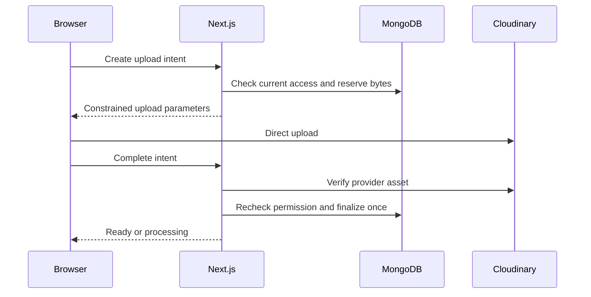
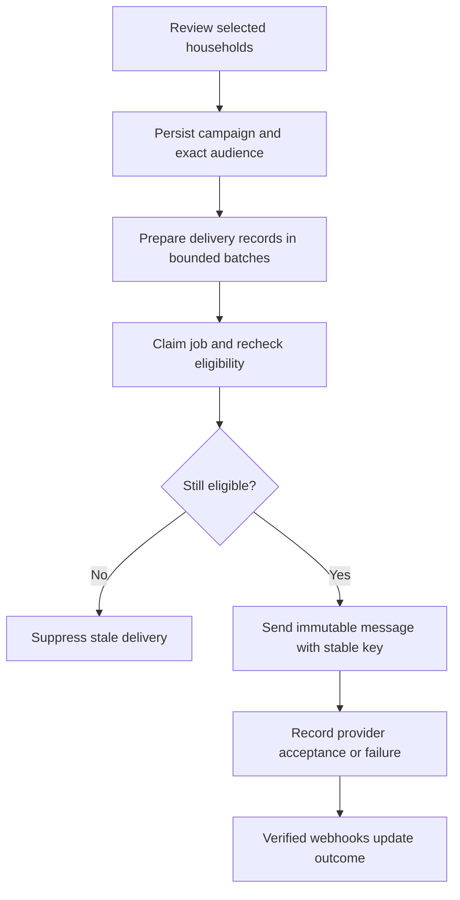

# Wedding Management — Detailed API Design

## October 30 — Implemented family media subset

Six catalog operations are now implemented (49/106 including prior increments): GET /gallery, POST /media/intents, GET /media/intents/{intentId}, POST /media/intents/{intentId}/complete, GET /media/{assetId}/content and POST W/assets/{assetId}/remove. Organizer cookie, verified current family membership and exact same-wedding references are mandatory. Guest access, gallery settings/share/rotate and asset metadata PATCH are not implemented. API prefix is /api/v1.

GET /gallery accepts optional descending ObjectId cursor, returns {data:{photos:[{id,filename,version,bytes,width,height}],nextCursor,count,archived,storage:{usedBytes,reservedBytes,limitBytes}},requestId}, 24 photos/page, ready gallery purpose only. POST intents requires Idempotency-Key and strict {purpose:"gallery",filename,contentType,sizeBytes}; sizeBytes is a positive integer string <=20000000, JPEG/PNG/WebP only. It returns id,state,expiresAt,maxBytes and constrained upload method/url/fields. Existing keys must bind exactly the same parsed input. GET own intent returns id/state/expiry/assetId, never signing secrets. Complete accepts strict {} and independently queries the provider; returns ready:true/assetId with 200 or ready:false with 202 while awaiting the file. Browser providerResult is intentionally not accepted in this subset. Application expiry is 15 minutes; signature timestamp remains fixed on replay. Terminal or expired intents return UPLOAD_EXPIRED, actual oversize/invalid resources PHOTO_REJECTED, over-quota STORAGE_FULL; archive is WEDDING_ARCHIVED, stale removal VERSION_CONFLICT.

MediaQuery permits thumbnail/gallery only, never original; streams authorized JPEG with a 4 MB cap, private/no-store/no-referrer/nosniff, no provider URL redirect. Remove requires expectedVersion and returns 202 state delete_pending; a matching completed retry does not add another audit. Deletion cleanup controls quota release, not the UI response. All browser writes require trusted Origin and X-MMM-CSRF:1, with durable user rate limits. Family media writes are disabled for archived weddings; read access remains. No implicit migrations or fake success.

## Private household invitations — October 26 implementation update

Eight additional catalog operations are implemented: invitation-link POST and rotate POST; access exchange/logout POST; guest site/events/RSVP GET and RSVP PUT (eight operations total: two organizer + two access + four guest). This brings the implemented catalog to 43/106; older counts are historical. Migration 006 is applied; 007 was applied after explicit approval. Family RSVP editing, gallery exchange, imports and sending are still planned.

The implemented sharing URL is /invite#token=<secret>, superseding secret-in-path examples for household links. The fragment is captured in memory and immediately removed, then exchanged via JSON POST {kind:"household",token}. Only household scope is implemented. Exchange sets an opaque seven-day HttpOnly cookie (Secure + __Host- prefix on HTTPS, SameSite=Lax, Path=/) and returns {data:{kind,redirectPath:"/guest"},requestId}. Logout takes {kind:"household"}, revokes/clears only this cookie and returns 204. Organizer cookies remain separate. Link POST returns {data:{url,linkVersion},requestId}; first issuance is user-triggered, with stable encrypted recovery on later authorized requests. Rotation requires Idempotency-Key and {expectedLinkVersion}; changing grant version invalidates old tokens/sessions immediately.

Guest site returns an explicit allowlist: couple names, timezone, household/representative names, assigned scheduled/completed event names/dates/venue/address/safe HTTPS map/description/dress code, own RSVP/limit/version/deadline/late flag/editability and archived state. No notes, contact details, other households, workspace budget or secrets. Guest events returns the complete bounded eligible event array (at most 100 assignments), without cursor pagination in this increment. GET RSVP returns the own RSVP object. Gallery/introduction/livestream fields remain deferred.

PUT RSVP requires Idempotency-Key and strict {status:attending|not_attending|maybe,attendeeCount,expectedVersion,expectedInvitationRevision}. Attending count is an integer 1..maxGuests including the representative; other statuses require zero. expectedInvitationRevision is the opaque 64-hex value returned with the RSVP, binding the household, eligible event versions, wedding state/timezone/deadline. It protects stale forms and a browser switching household cookies. Version/context changes return 409 VERSION_CONFLICT; removed/expired/replaced access returns neutral 404 INVITATION_UNAVAILABLE; no eligible events returns 409 NO_ELIGIBLE_EVENTS; archive returns 409 WEDDING_ARCHIVED. The write returns the safe site DTO so clients can confirm the saved response. An identical authorized retry returns current saved state without another write/audit, including after archive; lost/5xx/429 saves preserve immutable client input/key. Soft deadlines accept and flag late responses. Browser mutations require exact configured Origin and X-MMM-CSRF:1; all guest/secret responses are private/no-store/no-referrer/noindex. Responses refresh on navigation; no live-update claim.

> October 25 Guest Management checkpoint: five household operations (collection GET/POST, detail GET/PATCH, POST remove) are implemented. Together with four task operations, existing event operations and prior accounts/wedding/family operations, this is 35 implemented operations of the 106-operation extended catalog (71 remain planned). This is implementation evidence, not deployment certification; migration 006 activation is pending. Historical counts below retain their original dates.

> October 23, 2026 onboarding checkpoint: POST /weddings, GET /weddings/current and GET /weddings/{id} are implemented under /api/v1. Creation requires verified authentication and Idempotency-Key; settings responses omit secrets. Initial supported currencies: INR/USD/GBP/EUR/AUD/CAD/SGD/AED. Budget is a nonnegative integer string capped at 9223372036854775807 minor units. PATCH/dashboard/archive and membership invitation contracts remain planned. See Wedding-Implementation-Status.md for evidence.

> Account implementation checkpoint — October 21, 2026: All eight /api/v1/auth operations are implemented, plus GET /api/internal/jobs/tick and POST /api/webhooks/resend for account email only (10 routes; 95 remaining). Browser POST requests require exact trusted Origin, application/json and X-MMM-CSRF: 1. Verification/reset tokens come from email-link fragments and are submitted in JSON. Register/resend/forgot acknowledge durable intent with neutral 202 responses; missing provider configuration fails 503. Live provider verification and broader worker contracts remain pending. Earlier scaffold-zero counts below are historical. See Wedding-Implementation-Status.md.

**Version:** 1.1 (aligned design baseline)
**Date:** October 15, 2026
**Related documents:** [Architecture v2.1](Wedding-System-Design-Architecture.md), [Database Design v2.2](Wedding-Database-Design.md)
**Status:** Design only. No endpoints have been implemented or deployed by creating this document.

## 1. Total API count

**105 API operations in total: 102 application operations and 3 internal/provider operations.**

Count each distinct **HTTP method + route** once. GET and POST on the same route are two operations. Website pages, Ably messages, direct Cloudinary upload requests, CORS handling and possible future APIs are not counted.

| Module | Operations |
|---|---:|
| Authentication | 8 |
| Weddings | 6 |
| Memberships | 7 |
| Events | 7 |
| Households | 8 |
| Household imports | 2 |
| Guest access and RSVP | 6 |
| Tasks, comments and announcements | 12 |
| Vendor discovery and management | 7 |
| Expenses | 6 |
| Gallery and media | 11 |
| Invitation designs | 6 |
| Invitation previews and WhatsApp | 2 |
| Email campaigns | 5 |
| Public wedding website | 7 |
| Realtime and activity | 2 |
| Internal jobs and webhooks | 3 |
| **Total** | **105** |

## 2. Product and architecture scope

- Next.js/Node.js modular monolith on Vercel, MongoDB Atlas, Cloudinary, Resend and Ably.
- Email/password organizer authentication; email verification and secure opaque sessions; no Better Auth.
- ADMIN and MANAGER roles. Only ADMIN manages family membership, archives the wedding, or rotates the shared gallery token.
- Event-specific invitation lists with **one household RSVP and count** across all invited events. Organizer-configured maxGuests includes the representative.
- Manual vendors and Google Places discovery; simple actual expenses and receipts.
- Shared gallery link/QR for viewing and enabled uploads; photographers use that same access.
- Manual WhatsApp sharing, durable email campaigns, public information website, read-only archive.

No separate booking API, payment ledger, automatic WhatsApp delivery, per-event RSVP answer, guest account or OTP is introduced.

## 3. Addressing, identity and permission rules

Browser API base: `/api/v1`. In the catalog, **W** means `/api/v1/weddings/{weddingId}`. Routes beginning `/api/internal` or `/api/webhooks` are absolute and do not receive the v1 prefix.

Example host: `https://weddingapp.vercel.app`; replace it with the deployed canonical origin. Page routes `/w/{slug}`, `/invite/{secret}`, and `/gallery/{secret}` render pages and do not increase the API count.

**Family** means a current ADMIN or MANAGER of the requested wedding. **Family active** also requires an active wedding. **Household** means a valid household capability session with current link/version and household eligibility. **Gallery** scope grants no household RSVP, private event, livestream, receipt or planning access.

Use distinct secure HttpOnly organizer, household and gallery cookies. Opening a gallery link must not overwrite a household session. Do not return raw session tokens. Every private operation derives authority from the server-validated session, never from a supplied wedding/household ID. Cross-wedding record access returns an unavailable result. All references must belong to the authorized wedding.

Browser mutations require trusted Origin checks and CSRF protection under the chosen cookie policy. Unknown mutation fields are rejected. Rate-limit sensitive authentication, link exchange, RSVP, uploads, discovery and sending operations. Raw secrets and sensitive provider payloads must not enter logs.

## 4. Common contracts

### Representation and validation

| Value | API format |
|---|---|
| ID | 24-character hexadecimal ObjectId string |
| Timestamp | ISO 8601 with timezone; normalized to UTC |
| Calendar date | YYYY-MM-DD |
| Timezone | Supported IANA timezone, for example Asia/Kolkata |
| Money | Integer minor units as a decimal string; INR 500000 means 5,000 rupees |
| Bytes | Nonnegative integer decimal string |
| Version | Positive integer |
| Boolean | JSON true or false |

Names/titles are bounded to 200 characters and ordinary descriptions/comments to 10,000, consistent with the database defaults. Validate explicit numeric ranges, arrays, URL schemes and allowed enum values. No arbitrary Mongo operators, executable design content, client-controlled provider fields or arbitrary sort expressions.

For PATCH: omitted means unchanged; an allowed optional field set to null means clear it; a supplied array replaces that entire array. Clearing optional database fields unsets them rather than persisting null into optional unique indexes. Required fields cannot be cleared.

### Success, lists and errors

```json
{
  "data": {"id": "507f1f77bcf86cd799439011", "version": 1},
  "requestId": "req_example"
}
```

```json
{
  "data": [],
  "pagination": {"nextCursor": null, "hasMore": false},
  "requestId": "req_example"
}
```

```json
{
  "error": {
    "code": "GUEST_LIMIT_EXCEEDED",
    "message": "Attendance cannot exceed the household limit.",
    "fields": [{"path": "attendeeCount", "message": "Enter a number between 1 and 5."}],
    "details": {"maxGuests": 5}
  },
  "requestId": "req_example"
}
```

`fields` and `details` are optional and must not leak inaccessible data. Media endpoints return bytes or the approved short-lived delivery mechanism instead of JSON. A 204 response has no body. Resource DTOs expose only allowlisted fields; never serialize entire database documents.

| Status | Meaning |
|---|---|
| 200 / 201 | Successful read/update / resource creation |
| 202 | Durable asynchronous work accepted, not completed |
| 204 | Success without body |
| 400 | Malformed request, JSON or cursor |
| 401 | Missing, revoked or expired required session |
| 403 | Authenticated actor lacks permission |
| 404 | Missing/inaccessible record; avoid cross-tenant existence disclosure |
| 409 | Version, uniqueness or lifecycle conflict |
| 413 | Request payload exceeds technical limit |
| 422 | Field or business-rule validation error |
| 429 | Rate limit; provide appropriate Retry-After guidance |
| 503 | Required dependency temporarily unavailable |

### Versions and retries

`Version` in the catalog means `{expectedVersion: positiveInteger}`. Mutations on editable resources require it. Stale saves return 409 VERSION_CONFLICT with safe currentVersion; no silent overwrites. Public drafts use expectedDraftVersion; unpublish uses expectedPublishedRevision; links use expectedLinkVersion.

Require `Idempotency-Key` for wedding creation, expense creation, import commit, email-campaign creation, upload-intent creation, design publication and gallery-token rotation. Scope keys to actor/operation, persist canonical request hashes, replay identical results only after current authorization, and reject different content under the same key with 409. Secret-bearing replay results must remain encrypted or be reconstructed from an authorized encrypted resource. Other version-checked writes are not automatically duplicate-safe creates.

### Pagination, data minimization and caching

Default list limit 25, maximum 50. Validate opaque cursors against sort and filters. Use stable timestamp/ID ordering where appropriate. Static paths such as /current and /summary must resolve before parameterized resource IDs.

Private DTOs, guest routes, secret responses and protected media use private/no-store behavior. Public responses may use controlled caching only with publication/cancellation invalidation. URLs containing invitation/gallery tokens are excluded from analytics and use no-referrer behavior; redirect to a clean URL after exchange.

## 5. Complete endpoint catalog

All success bodies use the common envelope unless marked media, acknowledgement or no body. Request names below are defined in sections 6–22; `None` means no request body. Safe reads are allowed on archived weddings where authorization remains valid. The lifecycle matrix overrides mutation defaults.

### Authentication — 8 operations

| # | Method | Route | Access | Request/query | Success response | Status |
|---:|---|---|---|---|---|---|
| 1 | POST | `/auth/register` | Anonymous | Register | Neutral message | 202 |
| 2 | POST | `/auth/verify-email` | Token | Token | Verification result | 200 |
| 3 | POST | `/auth/resend-verification` | Anonymous | Email | Neutral message | 202 |
| 4 | POST | `/auth/login` | Anonymous | Login | Identity and session cookie | 200 |
| 5 | GET | `/auth/me` | Organizer | None | Identity | 200 |
| 6 | POST | `/auth/logout` | Organizer | None | No body | 204 |
| 7 | POST | `/auth/forgot-password` | Anonymous | Email | Neutral message | 202 |
| 8 | POST | `/auth/reset-password` | Token | ResetPassword | Reset result | 200 |

### Weddings — 6 operations

| # | Method | Route | Access | Request/query | Success response | Status |
|---:|---|---|---|---|---|---|
| 9 | POST | `/weddings` | Verified unassigned user | CreateWedding | Wedding summary | 201 |
| 10 | GET | `/weddings/current` | Organizer | None | Wedding summary or null | 200 |
| 11 | GET | `W` | Family | None | Wedding settings | 200 |
| 12 | PATCH | `W` | ADMIN active | PatchWedding | Updated wedding | 200 |
| 13 | GET | `W/dashboard` | Family | None | Dashboard | 200 |
| 14 | POST | `W/archive` | ADMIN active | Version | Archived wedding | 200 |

### Memberships — 7 operations

| # | Method | Route | Access | Request/query | Success response | Status |
|---:|---|---|---|---|---|---|
| 15 | GET | `W/members` | Family | Member filters | Member list | 200 |
| 16 | POST | `W/member-invitations` | ADMIN active | MemberInvite | Invitation metadata | 201 |
| 17 | GET | `W/member-invitations` | ADMIN | Invitation filters | Invitation list | 200 |
| 18 | POST | `W/member-invitations/{inviteId}/revoke` | ADMIN | Version | Revoked invitation | 200 |
| 19 | POST | `/membership-invitations/accept` | Verified organizer | Token | Membership | 200 |
| 20 | PATCH | `W/members/{membershipId}` | ADMIN active | ChangeRole | Updated membership | 200 |
| 21 | POST | `W/members/{membershipId}/remove` | ADMIN | Version | Removed membership | 200 |

### Events — 7 operations

| # | Method | Route | Access | Request/query | Success response | Status |
|---:|---|---|---|---|---|---|
| 22 | GET | `W/events` | Family | Event filters | Event list | 200 |
| 23 | POST | `W/events` | Family active | CreateEvent | Event | 201 |
| 24 | GET | `W/events/{eventId}` | Family | None | Event | 200 |
| 25 | PATCH | `W/events/{eventId}` | Family active | PatchEvent | Updated event | 200 |
| 26 | POST | `W/events/{eventId}/cancel` | Family active | Version | Cancelled event | 200 |
| 27 | POST | `W/events/{eventId}/remove` | Family active | Version | Removed event | 200 |
| 28 | GET | `W/events/{eventId}/attendance` | Family | None | Event attendance summary | 200 |

### Households — 8 operations

| # | Method | Route | Access | Request/query | Success response | Status |
|---:|---|---|---|---|---|---|
| 29 | GET | `W/households` | Family | Household filters | Household list | 200 |
| 30 | POST | `W/households` | Family active | CreateHousehold | Household | 201 |
| 31 | GET | `W/households/{householdId}` | Family | None | Household | 200 |
| 32 | PATCH | `W/households/{householdId}` | Family active | PatchHousehold | Updated household | 200 |
| 33 | PUT | `W/households/{householdId}/rsvp` | Family active | Rsvp | Updated RSVP | 200 |
| 34 | POST | `W/households/{householdId}/remove` | Family active | Version | Removed household | 200 |
| 35 | POST | `W/households/{householdId}/invitation-link` | Family | None | Secret sharing URL | 200 |
| 36 | POST | `W/households/{householdId}/invitation-link/rotate` | Family active | LinkVersion | New secret sharing URL | 200 |

### Household imports — 2 operations

| # | Method | Route | Access | Request/query | Success response | Status |
|---:|---|---|---|---|---|---|
| 37 | POST | `W/households/import/preview` | Family active | ImportPreview | Per-row validation | 200 |
| 38 | POST | `W/households/import/commit` | Family active | ImportCommit | Per-row outcomes | 200 |

### Guest access and RSVP — 6 operations

| # | Method | Route | Access | Request/query | Success response | Status |
|---:|---|---|---|---|---|---|
| 39 | POST | `/access/exchange` | Token | AccessExchange | Guest cookie and redirect | 200 |
| 40 | POST | `/access/logout` | Guest | AccessLogout | No body | 204 |
| 41 | GET | `/guest/site` | Household | None | Private guest website | 200 |
| 42 | GET | `/guest/events` | Household | Pagination | Eligible event list | 200 |
| 43 | GET | `/guest/rsvp` | Household | None | RSVP and capacity | 200 |
| 44 | PUT | `/guest/rsvp` | Household active | Rsvp | Updated RSVP | 200 |

### Tasks, comments and announcements — 12 operations

| # | Method | Route | Access | Request/query | Success response | Status |
|---:|---|---|---|---|---|---|
| 45 | GET | `W/tasks` | Family | Task filters | Task list | 200 |
| 46 | POST | `W/tasks` | Family active | CreateTask | Task | 201 |
| 47 | GET | `W/tasks/{taskId}` | Family | None | Task | 200 |
| 48 | PATCH | `W/tasks/{taskId}` | Family active | PatchTask | Updated task | 200 |
| 49 | GET | `W/tasks/{taskId}/comments` | Family | Pagination | Comment list | 200 |
| 50 | POST | `W/tasks/{taskId}/comments` | Family active | CreateComment | Comment | 201 |
| 51 | PATCH | `W/tasks/{taskId}/comments/{commentId}` | Family active | PatchComment | Updated comment | 200 |
| 52 | POST | `W/tasks/{taskId}/comments/{commentId}/remove` | Family active | Version | Removed comment | 200 |
| 53 | GET | `W/announcements` | Family | Pagination | Announcement list | 200 |
| 54 | POST | `W/announcements` | Family active | CreateAnnouncement | Announcement | 201 |
| 55 | PATCH | `W/announcements/{announcementId}` | Family active | PatchAnnouncement | Updated announcement | 200 |
| 56 | POST | `W/announcements/{announcementId}/remove` | Family active | Version | Removed announcement | 200 |

### Vendor discovery and management — 7 operations

| # | Method | Route | Access | Request/query | Success response | Status |
|---:|---|---|---|---|---|---|
| 57 | GET | `W/vendor-discovery` | Family | DiscoveryQuery | Attributed search results | 200 |
| 58 | GET | `W/vendor-discovery/details` | Family | PlaceQuery | Attributed place details | 200 |
| 59 | GET | `W/vendors` | Family | Vendor filters | Vendor list | 200 |
| 60 | POST | `W/vendors` | Family active | CreateVendor | Vendor | 201 |
| 61 | GET | `W/vendors/{vendorId}` | Family | None | Vendor | 200 |
| 62 | PATCH | `W/vendors/{vendorId}` | Family active | PatchVendor | Updated vendor | 200 |
| 63 | POST | `W/vendors/{vendorId}/remove` | Family active | Version | Removed vendor | 200 |

### Expenses — 6 operations

| # | Method | Route | Access | Request/query | Success response | Status |
|---:|---|---|---|---|---|---|
| 64 | GET | `W/expenses` | Family | Expense filters | Expense list | 200 |
| 65 | POST | `W/expenses` | Family active | CreateExpense | Expense | 201 |
| 66 | GET | `W/expenses/summary` | Family | Expense summary filters | Expense totals | 200 |
| 67 | GET | `W/expenses/{expenseId}` | Family | None | Expense | 200 |
| 68 | PATCH | `W/expenses/{expenseId}` | Family active | PatchExpense | Updated expense | 200 |
| 69 | POST | `W/expenses/{expenseId}/remove` | Family active | Version | Removed expense | 200 |

### Gallery and media — 11 operations

| # | Method | Route | Access | Request/query | Success response | Status |
|---:|---|---|---|---|---|---|
| 70 | GET | `W/gallery/settings` | Family | None | Gallery settings | 200 |
| 71 | PATCH | `W/gallery/settings` | Family active; ADMIN privacy exception | GallerySettings | Updated settings | 200 |
| 72 | POST | `W/gallery/share-link` | Family | None | Secret gallery URL | 200 |
| 73 | POST | `W/gallery/rotate` | ADMIN | RotateGallery | New secret gallery URL | 200 |
| 74 | GET | `/gallery` | Authorized gallery reader | Pagination | Ready gallery images | 200 |
| 75 | POST | `/media/intents` | Authorized uploader | UploadIntent | Intent and signed upload parameters | 201 |
| 76 | GET | `/media/intents/{intentId}` | Authorized actor | None | Intent status | 200 |
| 77 | POST | `/media/intents/{intentId}/complete` | Authorized actor | CompleteUpload | Ready asset or processing status | 200/202 |
| 78 | GET | `/media/{assetId}/content` | Authorized asset reader | MediaQuery | Media stream | 200 |
| 79 | PATCH | `W/assets/{assetId}` | Family active | PatchAsset | Updated metadata | 200 |
| 80 | POST | `W/assets/{assetId}/remove` | Family active | Version | Cleanup accepted | 202 |

### Invitation designs — 6 operations

| # | Method | Route | Access | Request/query | Success response | Status |
|---:|---|---|---|---|---|---|
| 81 | GET | `W/designs` | Family | Pagination | Design list | 200 |
| 82 | POST | `W/designs` | Family active | CreateDesign | Design | 201 |
| 83 | GET | `W/designs/{designId}` | Family | None | Design | 200 |
| 84 | PATCH | `W/designs/{designId}` | Family active | PatchDesign | Updated draft | 200 |
| 85 | POST | `W/designs/{designId}/publish` | Family active | PublishDesign | Immutable version | 201 |
| 86 | GET | `W/designs/{designId}/versions` | Family | Pagination | Published version list | 200 |

### Invitation previews and WhatsApp — 2 operations

| # | Method | Route | Access | Request/query | Success response | Status |
|---:|---|---|---|---|---|---|
| 87 | POST | `W/invitations/preview` | Family active | InvitationPreview | Eligibility and previews | 200 |
| 88 | POST | `W/invitations/whatsapp-preview` | Family active | WhatsAppPreview | Manual message and secret link | 200 |

### Email campaigns — 5 operations

| # | Method | Route | Access | Request/query | Success response | Status |
|---:|---|---|---|---|---|---|
| 89 | POST | `W/email-campaigns` | Family active | CreateCampaign | Durable campaign | 202 |
| 90 | GET | `W/email-campaigns` | Family | Pagination | Campaign list | 200 |
| 91 | GET | `W/email-campaigns/{campaignId}` | Family | None | Campaign progress | 200 |
| 92 | GET | `W/email-campaigns/{campaignId}/deliveries` | Family | Delivery filters | Delivery results | 200 |
| 93 | POST | `W/email-campaigns/{campaignId}/cancel` | Family active | Version | Cancellation accepted | 202 |

### Public wedding website — 7 operations

| # | Method | Route | Access | Request/query | Success response | Status |
|---:|---|---|---|---|---|---|
| 94 | GET | `W/public-page` | Family | None | Draft and publication metadata | 200 |
| 95 | PATCH | `W/public-page` | Family active | PatchPublicPage | Updated draft | 200 |
| 96 | GET | `W/public-page/preview` | Family | None | Authenticated publication preview | 200 |
| 97 | POST | `W/public-page/publish` | Family active | DraftVersion | Published snapshot metadata | 200 |
| 98 | POST | `W/public-page/unpublish` | Family active; ADMIN after archive | PublishedRevision | Unpublished result | 200 |
| 99 | GET | `/public/weddings/{slug}` | Anonymous | None | Published allowlisted DTO | 200 |
| 100 | GET | `/public/weddings/{slug}/media/{assetId}` | Anonymous published selection | MediaQuery | Selected public media | 200 |

### Realtime and activity — 2 operations

| # | Method | Route | Access | Request/query | Success response | Status |
|---:|---|---|---|---|---|---|
| 101 | POST | `/realtime/token` | Authorized session | RealtimeContext | Scoped temporary credentials | 200 |
| 102 | GET | `W/activity` | Family | Activity filters | Safe audit list | 200 |

### Internal jobs and webhooks — 3 operations

| # | Method | Route | Access | Request/query | Success response | Status |
|---:|---|---|---|---|---|---|
| 103 | GET | `/api/internal/jobs/tick` | Scheduler secret | None | Bounded execution summary | 200 |
| 104 | POST | `/api/webhooks/resend` | Provider signature | Resend raw payload | Acknowledgement | 200 |
| 105 | POST | `/api/webhooks/cloudinary` | Provider signature | Cloudinary raw payload | Acknowledgement | 200 |

## 6. Authentication request and response schemas

| Request | Required fields | Rules |
|---|---|---|
| Register | displayName, email, password | Proposed password policy: 12–128 characters, no truncation; normalize email consistently |
| Login | email, password | Generic invalid-credentials response; rate-limit attempts |
| Email | email | Neutral verification/recovery response prevents account enumeration |
| Token | token | Validate cryptographically random purpose-bound token, expiry and one-use state |
| ResetPassword | token, newPassword | Same password policy; atomically consume token and invalidate older sessions |

Register persists account and verification intent before a neutral 202 result. Existing-address responses must not disclose registration state. Verification returns `{emailVerified:true}` but does not itself create an organizer session. An unverified user may sign in to complete verification but cannot create a wedding or send invitations. Recovery works after wedding archive.

Login and /auth/me return `{user, membership}`. User is `{id,displayName,email,emailVerified}`; membership is null or `{id,weddingId,role,status,version}`. Cookies contain session secrets; JSON never does. Logout revokes and clears the current organizer session; repeated logout is safe. Reset returns `{passwordReset:true,signInRequired:true}`.

```json
{
  "email": "rakesh@example.com",
  "password": "user-entered-password"
}
```

## 7. Wedding contracts

### CreateWedding

| Field | Required | Meaning |
|---|---|---|
| couple.brideName | Yes | Bride display name |
| couple.groomName | Yes | Groom display name |
| title | Yes | Workspace title |
| weddingDate | No | Date only |
| timezone | Yes | Valid IANA timezone |
| currency | Yes | Supported currency code |
| budgetMinor | No | Nonnegative integer minor units |

Create the wedding, creator ADMIN membership, unique unpublished public slug and initial gallery configuration atomically. A partner becomes ADMIN by explicit membership invitation; names never create access. Proposed privacy defaults are gallery disabled and guest uploads disabled until explicitly enabled.

```json
{
  "couple": {"brideName": "Priya", "groomName": "Rakesh"},
  "title": "Rakesh and Priya's Wedding",
  "weddingDate": "2027-02-14",
  "timezone": "Asia/Kolkata",
  "currency": "INR"
}
```

Wedding summary returns id, title, state, public slug/publication state and version. /weddings/current returns null when no active membership exists. Family settings can include ordinary details, storage usage, budget and lifecycle, but never token hashes/encrypted secrets.

### PatchWedding and Dashboard

October 24 user decision: wedding-details PATCH requires active ADMIN membership. MANAGER may read the saved details/settings but valid edit requests return 403 `FORBIDDEN`. This supersedes the earlier Family-active PATCH permission; no role change, publication or future feature is implicitly enabled by this route.

PatchWedding allows create fields plus optional rsvpDeadline, privateWebsite and livestream, with expectedVersion. Private website accepts bounded intro, coverAssetId and guest-facing text; livestream accepts provider, URL and title or null to clear. Validate every referenced asset and permitted URL. No role, archive-state, gallery-secret or publication-state changes through this generic route. Currency changes are blocked after expense creation. Timezone changes never silently shift existing UTC event instants.

Dashboard returns event counts, task counts by status, household counts by RSVP, confirmedPeople, expense totals/currency/optional budget, and storage used/reserved/limit bytes. Confirmed people sums each eligible active household once. Counts are derived from primary records; no new summary collection.

Archive takes Version and returns archived summary after committing state/fence/activity. Cancelling remaining jobs may continue asynchronously. External email already dispatched cannot be recalled.

## 8. Membership contracts

October 23 invitation increment implements POST `W/member-invitations`, POST `W/member-invitations/{inviteId}/revoke` and POST `/membership-invitations/accept`. Adds supporting POST `/membership-invitations/preview` with strict `{token}` (106 total designed operations, including this extension). Preview requires the matching signed-in verified email and returns `{title,role,alreadyJoined}` without granting access. Acceptance returns `{weddingId,role}`. Tokens use the existing common CSRF/trusted-origin checks in JSON bodies; no GET token query. Creation returns metadata plus `emailSubmission:"queued"`, never a token or a delivered claim. Lists add safe emailSubmission display status backed by delivery/receipt state. Initial expiry is seven days. No resend endpoint is added; a new invitation requires settling/revoking the old pending invitation. Role change and member removal remain planned.

October 23 edit-details increment: PATCH `/api/v1/weddings/{id}` implements only the ordinary create-field subset of PatchWedding plus required `expectedVersion`. Omitted fields are unchanged; `weddingDate:null` and `budgetMinor:null` clear those optional values. Empty patches and unknown fields are rejected. Settings GET adds `currencyLocked`; currency change returns 409 `CURRENCY_LOCKED` after any expense is recorded. Stale versions return 409 `VERSION_CONFLICT` with `error.currentVersion`. PrivateWebsite, livestream and rsvpDeadline updates remain planned; no endpoint stubs are provided for them.

Member filters: status=active|removed, role=ADMIN|MANAGER, pagination. Invitation filters: state=pending|accepted|revoked|expired, pagination. Lists return safe user/recipient details, role, state and version; no tokens.

October 23 foundation: both list GET operations are implemented, with default 25/max 50, descending ObjectId pagination and opaque cursors bound to kind/wedding/filters. Members return id, userId, displayName/email when available, role, status, joinedAt and version; invitations return id, email, role, effective state, expiresAt and version. Pending records past expiresAt are read as expired. Active ADMIN/MANAGER members may read members; invitation history is ADMIN-only, including after archive. All invitation/member mutations below remain planned.

| Request | Fields |
|---|---|
| MemberInvite | email and role (ADMIN or MANAGER) |
| ChangeRole | role and expectedVersion |
| Acceptance | token; signed-in verified email must match recipient |
| Revoke/remove | expectedVersion |

October 23 member-management increment implements PATCH `W/members/{membershipId}` and POST `W/members/{membershipId}/remove`. Active same-wedding ADMIN required; role edits are blocked after archive, while removal remains an ADMIN privacy action. Stale versions return 409 VERSION_CONFLICT with error.currentVersion. Removing/demoting the final active ADMIN returns 409 LAST_ADMIN. Removed members return 409 MEMBER_REMOVED for role changes and require a fresh same-wedding invitation for restoration. Responses expose only `{id,userId,role,status,version}`. Member lists additionally expose top-level activeAdminCount across all pages for UI guidance. Self-removal/demotion obeys identical safeguards; no account deletion or wedding transfer is provided. Earlier dated planned statements are historical checkpoints.

Only ADMIN issues, revokes, removes or changes family access. Duplicate pending invitations return INVITATION_ALREADY_PENDING; settle expired pending records before issuing replacements. Acceptance transaction consumes the invitation and writes/reactivates same-wedding membership while preserving the one-wedding rule. Never remove/demote the last active ADMIN. Member removal preserves audit/history and denies wedding access on subsequent requests. Invitation revocation and member removal remain ADMIN privacy actions after archive; new invitations, role promotions and acceptance do not.

## 9. Event contracts

**October 25 first increment:** POST/GET `/api/v1/weddings/{id}/events` and GET `/api/v1/weddings/{id}/events/{eventId}` are implemented for active ADMIN/MANAGER membership; archived members retain reads. Initial creation accepts only `draft` (default), and only name/type/startsAt/endsAt/venue.name/venue.address/venue.mapUrl/description/dressCode. Agenda/contact/coordinates and scheduled creation remain designed, not implemented. Unknown fields are rejected. Require a 16–128 character `Idempotency-Key`; immutable retries within the retained seven-day key window return the same event, mismatched payloads return 409 IDEMPOTENCY_CONFLICT, and access is rechecked before replay. The browser sends optional `X-MMM-Wedding-Timezone`; a changed timezone returns 409 WEDDING_TIMEZONE_CHANGED before a new save. Timestamps require an explicit offset or Z. Map links require HTTPS and no embedded credentials. Create writes event/activity/idempotency records atomically under wedding, user and membership fences; it never queues mail or publishes anything. Lists use ascending startsAt/ID, 25 default/50 maximum, status/type/from/to filters and wedding/filter-bound cursors. Unavailable migration returns 503 EVENTS_UNAVAILABLE, not a fake empty list. Migration 004 was applied with explicit approval October 25; user acceptance is recorded in Project Status.

Event filters: status, type, from, to, pagination. Sort by startsAt and ID. CreateEvent fields:

| Field | Required | Rules |
|---|---|---|
| name, type | Yes | Type: haldi, mehendi, sangeet, wedding, reception, pre_wedding, post_wedding, custom |
| startsAt | Yes | Timestamp with timezone |
| endsAt | No | Must follow startsAt |
| venue.name, venue.address | Yes | Bounded text |
| venue.mapUrl | No | Allowed HTTPS URL |
| venue.latitude, venue.longitude | No | Valid coordinate ranges |
| description, dressCode | No | Bounded text |
| contact | No | Name required if supplied; optional email/phone |
| schedule | No | Defaults empty; bounded items with id, title, startsAt, optional endsAt |
| status | No | draft by default; creation allows draft or scheduled |

**October 25 scheduling increment:** Existing PATCH additionally accepts only {expectedVersion,status:"scheduled"} for Draft → Scheduled. Status cannot be combined with content edits. Required Idempotency-Key and optional timezone guard are unchanged; required saved event fields are revalidated. New non-draft transitions return EVENT_NOT_DRAFT; stale versions return VERSION_CONFLICT/currentVersion. Success changes status/version and event.scheduled activity only, without guest assignment, delivery, public publication or automatic completion. Idempotent authorized replay returns current details without another mutation. Other status values and reverse transitions remain unsupported; POST creation stays draft-only.

**October 25 edit increment:** PATCH implements draft-only name/type/startsAt/endsAt/venue.name/address/mapUrl/description/dressCode plus required positive expectedVersion. Unknown fields/status are rejected; omitted fields remain unchanged. endsAt, description and dressCode accept null to clear. Supplied venue replaces its supported fields; omit mapUrl to clear it. Merged dates are validated. Require Idempotency-Key (16–128 characters) and support the same optional X-MMM-Wedding-Timezone guard as create. Repeated identical keys reconcile before version/archive/timezone checks after access revalidation, returning current authorized event details without another update; changed payload returns IDEMPOTENCY_CONFLICT. New stale edits return 409 VERSION_CONFLICT/currentVersion; non-drafts return EVENT_NOT_DRAFT; archived writes return WEDDING_ARCHIVED. No mail or publication occurs.

PatchEvent accepts editable fields plus expectedVersion; validate state transitions. Cancellation/removal use dedicated Version actions, preserving related records while suppressing active guest/public display. A draft event does not become visible solely because its ID is in a household's list. Guest-visible eligible statuses are scheduled and completed. Attendance returns eventId, invitedHouseholds, counts by RSVP and projectedPeople from each invited household’s one answer; it is not another RSVP table.

## 10. Household and import contracts

### CreateHousehold and PatchHousehold

| Field | Required on create | Meaning |
|---|---|---|
| displayName | Yes | Household label |
| representative.name | Yes | Contact name |
| representative.email, representative.phone | No | Optional, nonunique contacts |
| side | Yes | bride, groom, both, other |
| tags | No | Defaults empty |
| maxGuests | Yes | Positive integer including representative |
| invitedEventIds | Yes | Unique same-wedding event IDs; may be empty during planning |
| notes | No | Family-only text |

The server sets source/normalized contacts and initial RSVP `{status:pending,attendeeCount:0,updatedAfterDeadline:false}`. PatchHousehold accepts editable create fields plus expectedVersion. Do not allow clients to change status, token secrets or RSVP via this generic patch. Household filters: status, side, tag, eventId, rsvpStatus, bounded name/contact search and pagination.

After a response exists, changing invitedEventIds requires `acknowledgeExistingRsvp:true`; otherwise return 409 RSVP_SCOPE_REVIEW_REQUIRED. Retain the single answer after explicit acknowledgement. Lowering maxGuests below saved attendance returns 409 GUEST_LIMIT_BELOW_RSVP. First explicitly correct the answer or increase capacity; never silently truncate attendance.

Removing a household soft-removes it, revokes household-link/session access and suppresses pending eligible messages. It does not revoke a separately known shared-gallery token. Organizer RSVP writes use the same Rsvp schema and capacity rules as guests, recording the organizer actor.

### Invitation sharing

Invitation-link returns an existing active household URL or creates one while active. Secret responses use no-store and redacted logging. An archived wedding permits authorized retrieval of an existing valid link, not unrestricted creation. LinkVersion is `{expectedLinkVersion}`. Rotation replaces the grant, revokes old sessions and returns `{url,linkVersion}`. The active-wedding rotation endpoint is not a general archived edit permission.

### ImportPreview and ImportCommit

Proposed maximum 100 rows per request. Browser parses CSV/contacts to JSON; server independently validates. Preview accepts `{source:csv|contacts,rows:[...]}`. Each row contains clientRowId and CreateHousehold fields. Return `{rows:[{clientRowId,valid,errors,warnings,possibleDuplicateHouseholdIds}]}`. Never auto-merge based on shared contact information.

Commit accepts `{importId,source,rows}` with stable clientRowId values and an Idempotency-Key. Revalidate current permissions, event ownership and values. Use stable per-row identity and request hashes. Return 200 with `{results:[{clientRowId,status,householdId?,error?}],createdCount,failedCount}`; status is created, already_created or failed. Partial failure is explicit; successful rows are not recreated when retrying failures.

## 11. Household guest contracts

**October 25 implemented organizer subset:** Household collection GET/POST, detail GET/PATCH and POST remove are implemented; guest-facing contracts in this section remain planned. Create requires trimmed displayName/representative.name (1–200), maxGuests integer 1–2147483647 and 1–100 unique same-wedding draft/scheduled/completed event IDs. Email (up to 254), phone (5–40, at least five digits, optional leading + and ordinary separators) and notes (10,000) are optional. Side defaults other; tags default empty. These are private assignments, not publication or invitations. The broader empty-event/RSVP-adjustment workflows above are not supported yet. PATCH requires expectedVersion, retains omitted fields and supports null notes; representative replacement clears omitted email/phone. Side/tags remain when omitted. Non-pending RSVP event changes return RSVP_SCOPE_REVIEW_REQUIRED; capacity below saved attendance returns GUEST_LIMIT_BELOW_RSVP. No RSVP-writing/link/import operation is implemented.

Organizer list filters are q (literal case-insensitive name/email/phone, max 100), eventId, rsvpStatus, status active/removed (default active), limit (25 default, 50 max) and cursor. Sort displayName/ID ascending; cursor binds wedding and filters. Return `{data,pagination:{total,nextCursor}}`, where total covers the matching filter before cursor. Detail/write return a safe Household with same-wedding event names/availability; normalized email and secrets are excluded. Removed details remain readable to authorized family. Both roles may write only active weddings. All three mutations require a 16–128 character Idempotency-Key; PATCH/remove require expectedVersion. Identical authorized replay returns current safe details without applying twice, including after archive. Stale version returns VERSION_CONFLICT/currentVersion; changed payload/key returns IDEMPOTENCY_CONFLICT. Soft removal excludes active totals and retains history. There are no capability/message resources to revoke yet. Overview totals and event choices are server reads, not new API operations. Migration 006 must be applied explicitly before writes; absent schema fails GUESTS_UNAVAILABLE rather than creating collections.

AccessExchange is `{kind:household|gallery,token}`. Validate the current token, set the corresponding scoped cookie and return `{kind,redirectPath}` with a server-selected clean same-origin path. No raw session token in JSON. Invalid links show an unavailable result. AccessLogout takes kind and clears/revokes only that session type.

/guest/site returns safe couple/introduction content, eligible invited events, the household’s own RSVP/limit, gallery availability, authorized private livestream and lifecycle/version details. It excludes internal notes, other households, member contact lists, expenses and secrets. /guest/events is filtered by current invitedEventIds, wedding scope and eligible status.

### Rsvp

```json
{
  "status": "attending",
  "attendeeCount": 3,
  "expectedVersion": 2
}
```

Submitted statuses: attending, not_attending, maybe. Pending is the initial state. Attending requires integer 1..maxGuests; other answers require zero. A household needs at least one eligible invitation. Late responses are accepted/flagged until archive, using the optional single wedding deadline. The server derives household identity; guests cannot set weddingId, householdId, maxGuests or invitedEventIds.

Read/write response: `{status,attendeeCount,maxGuests,deadline,updatedAfterDeadline,editable,version}`. Editable is informative and checked again on save. Version is the household version. A household invited to Haldi and Wedding answering 3 contributes 3 to each projected event total, but only 3 to the household-based wedding total. No per-event RSVP endpoint exists.

## 12. Tasks, comments and announcements

**October 25 task foundation:** Four task collection/detail operations are implemented; comments/announcements/templates remain planned. Initial CreateTask supports title (1–200 trimmed characters), description (up to 10,000), status/priority, optional eventId/assigneeUserId/dueAt only. Defaults todo/normal; checklist and attachment arrays initialize empty and are not accepted in this subset. PATCH requires expectedVersion; null clears description/eventId/assigneeUserId/dueAt; empty patches and unknown fields are rejected. Both mutations require a 16–128-character Idempotency-Key; changed payloads return IDEMPOTENCY_CONFLICT, authorized identical replays return current safe details without another version/audit increment. Optional X-MMM-Wedding-Timezone protects deadline edits. Stale version returns VERSION_CONFLICT/currentVersion. Archived writes are denied; removed access is neutral NOT_FOUND. Inactive/foreign references return 422 ASSIGNEE_UNAVAILABLE/EVENT_UNAVAILABLE. List filters include documented fields plus assigneeUserId=me/none and eventId=none; absent means all. dueBefore/dueAfter are inclusive ISO-offset instants. Sort newest createdAt/ID; limit 25 default/50 max; cursors bind wedding/user/filter scope. Safe referenced names/active or available flags are returned without contact details. Dashboard summary and selector choices are server-side service reads, not extra public API endpoints. No provider messages are sent.

Task filters: status, priority, eventId, assigneeUserId, dueBefore, dueAfter and pagination. CreateTask requires title; accepts description, eventId, assigneeUserId, dueAt, priority, status, checklist and attachmentAssetIds. Defaults: priority normal, status todo, arrays empty. Status enum: todo, in_progress, done, cancelled. Priority: low, normal, high. Assignee must be an active same-wedding member; attachments must be authorized same-wedding assets.

Checklist items: `{id,text,done}` with IDs unique inside task. PatchTask takes editable fields and expectedVersion; backend derives completedAt. Use cancelled to retire a task while retaining history; there is no extra delete-task API in this baseline.

CreateComment is `{body}`. PatchComment is `{body,expectedVersion}`. Removal uses Version and soft-removes the comment. Comments are paginated and belong to the task/wedding in the path. All active family roles can edit shared planning content under the agreed model; preserve original author and record editor/remover in activity.

CreateAnnouncement is `{title,body,pinned:false}` with pinned optional. PatchAnnouncement accepts these fields plus expectedVersion. Removal uses Version. Announcements are family-only and never automatically appear on guest/public pages.

Resource responses include id, allowlisted content, safe author/assignee summary where relevant, timestamps and version. They never expose private attachment credentials or other wedding references.

## 13. Vendor contracts

DiscoveryQuery requires category and location, with optional opaque cursor. PlaceQuery requires placeId. The authenticated server selects a bounded provider field set, applies limits and returns live provider display fields plus required attribution. Clients cannot request arbitrary billable field masks. Use restricted credentials and current integration policy from the architecture. Provider display data is separate from organizer-authored fields; selecting a search result does not authorize indefinite copying of restricted provider content.

```json
{
  "source": "GOOGLE_PLACES",
  "googlePlaceId": "provider-place-id",
  "category": "mehendi",
  "eventIds": ["507f1f77bcf86cd799439021"],
  "notes": "Ask about availability."
}
```

CreateVendor requires source, category and eventIds. MANUAL additionally requires name; GOOGLE_PLACES requires googlePlaceId. Optional organizer-owned fields: name/private label, contact.person/phone/email/address, notes. One saved place reference per wedding; duplicate returns 409 VENDOR_ALREADY_SAVED with an authorized existing ID if appropriate. Empty eventIds means wedding-wide.

PatchVendor changes organizer-owned fields and event associations with expectedVersion; it does not silently replace provider identity or turn provider data into permanent manual content. Vendor filters: source, category, eventId, status, bounded search and pagination. Removal preserves expense references. If Google is unavailable, retain saved place ID and organizer notes, show external details unavailable, and allow manual planning.

## 14. Expense contracts

CreateExpense requires title, amountMinor, currency, expenseDate and category; optional eventId, vendorId, notes and receiptAssetIds (default empty). Use Idempotency-Key; persist a stable operationKey. Amount must be a positive supported integer string; currency matches wedding. All references belong to the wedding and receipts are ready family-only assets.

```json
{
  "title": "Mehendi advance",
  "amountMinor": "500000",
  "currency": "INR",
  "expenseDate": "2027-02-10T12:00:00+05:30",
  "category": "mehendi",
  "vendorId": "507f1f77bcf86cd799439041",
  "receiptAssetIds": []
}
```

PatchExpense accepts editable creation fields plus expectedVersion, preserving operationKey. Removal uses Version and excludes the row from totals while retaining activity. Expense filters: category, eventId, vendorId, from, to, pagination. Summary filters: eventId, vendorId, from, to.

Summary response: `{currency,totalSpentMinor,expenseCount,budgetMinor,budgetRemainingMinor}`. Wedding budget comparisons are meaningful only for the unfiltered total; return null budget-comparison values for filtered results. Shared charges are recorded once without eventId. No contract balance, instalment schedule or payment endpoint exists.

## 15. Gallery contracts

Settings read returns `{isEnabled,guestUploadsEnabled,tokenVersion,weddingState,version}`. Version is weddings.version because settings are embedded. GallerySettings takes supplied booleans and expectedVersion. After archive, only ADMIN may make restrictive allowed privacy changes, not enable uploads or edit unrelated content.

Share-link returns `{url,tokenVersion}` without changing the token. Apply no-store and do not log the secret. The QR encodes that same URL; photographers receive identical scope. RotateGallery requires `{expectedVersion,expectedTokenVersion}` and Idempotency-Key. ADMIN rotation atomically replaces token/version, records activity and returns the new URL/version. Old printed QR codes and gallery sessions lose authorization on the next check.

/gallery returns only ready gallery assets as `{id,caption?,width?,height?,contentPath,createdAt}` with cursor pagination. It excludes receipt/task/invitation assets, provider secrets and uploader contact information. The family/household/gallery identity and current settings determine access. Gallery disabling blocks gallery reads/uploads; guest-upload disabling preserves viewing. Tokens never grant event/RSVP/livestream access.

## 16. Media and upload contracts

### UploadIntent

| Field | Required | Meaning |
|---|---|---|
| purpose | Yes | Supported purpose; guests may request gallery only |
| filename | Yes | Display/input metadata only, never trusted storage key |
| contentType | Yes | Claimed type, verified later |
| sizeBytes | Yes | Claimed size for reservation; verified later |
| context | Where relevant | Validated task/design/expense reference and resource-specific scope |

Create one intent per file, reserve quota and store actor/grant/session/version. Return intentId, expiresAt, maxBytes and constrained upload `{method,url,fields}` from the configured Cloudinary adapter. Never include API secret. Client cannot choose trusted provider identity, audience or arbitrary wedding folder. public_copy generation is server-controlled as part of publication, not a client shortcut.

```json
{
  "purpose": "gallery",
  "filename": "celebration.jpg",
  "contentType": "image/jpeg",
  "sizeBytes": "5242880"
}
```

GET intent returns id, state, assetId if known and expiry only to the originating authorized actor/permitted family. CompleteUpload may include `{providerResult:{assetId,publicId,version,signature}}` as verification input. Independently verify authoritative provider metadata and current access. Return 200 with ready asset or 202 with durable processing status; intent identity prevents duplicate accounting. Valid webhooks do not bypass actor/grant rechecks.

MediaQuery uses variant=thumbnail|gallery|original from a server allowlist. /media/{id}/content checks current purpose/audience permissions, then streams bytes or uses the architecture-approved temporary delivery mechanism. Do not expose a reusable upstream signed URL. Original delivery remains subject to deployment validation.

PatchAsset allows caption/capturedAt and expectedVersion only. It cannot change purpose, audience, provider IDs, size or state. Removal takes Version, marks the asset inaccessible and records cleanup before 202. Decrease used storage only after provider deletion is verified, once. Retain tombstones and reconcile abandoned uploads.



## 17. Invitation design contracts

CreateDesign requires name, mode, eventIds and draft. Modes: template, uploaded_image, designer. Draft supports permitted templateKey/textFields/assetIds/layout. Validate bounded component count, field lengths, asset ownership and supported layout schema; no arbitrary HTML/scripts/remote media references.

```json
{
  "name": "Haldi invitation",
  "mode": "template",
  "eventIds": ["507f1f77bcf86cd799439021"],
  "draft": {
    "templateKey": "floral-01",
    "textFields": {"heading": "Join us for Haldi"},
    "assetIds": []
  }
}
```

PatchDesign takes editable name/eventIds/draft and expectedVersion. A scope change revalidates all assets; do not silently broaden their audience. PublishDesign requires expectedVersion, optionally renderAssetId when needed, and Idempotency-Key. Create immutable version and update latest published reference atomically. Response: `{designVersionId,designId,revision,eventIds}`. Version list is read-only/paginated.

A household must be authorized for every event represented in a design/version. Empty eventIds means wedding-wide content without event-specific details and still requires eligible household access. Gallery tokens cannot access invitation assets. Published content does not change when a draft is edited.

## 18. Invitation preview and manual WhatsApp

InvitationPreview requires kind=invitation|reminder|event_update, householdIds, eventIds and optional designVersionId. Return per-household eligibility, address availability, safe message preview and actionable validation errors. Recheck permission again before send; preview is not a capability.

WhatsAppPreview requires householdId and optional designVersionId. Return only this household’s authorized message, sharing URL and optional image reference. Response is secret-bearing and no-store. The organizer sends inside WhatsApp. Opening WhatsApp is not evidence of sending, delivery or reading; no automatic WhatsApp job is created.

## 19. Email campaign contracts

CreateCampaign requires kind, householdIds and eventIds; designVersionId is optional where message type does not require it. Technical proposal: at most 2,000 unique household IDs per campaign. This is a processing limit, not maxGuests. Idempotency-Key is required.

Persist the exact reviewed audience manifest and immutable campaign configuration before returning 202 `{campaignId,state:preparing,requestedHouseholds}`. Background work materializes delivery rows in bounded batches using the manifest/cursor. Do not rerun an unconstrained live search and call it the reviewed audience. This persistence clarification is listed in section 24.

```json
{
  "kind": "invitation",
  "householdIds": ["507f1f77bcf86cd799439051"],
  "eventIds": ["507f1f77bcf86cd799439021"],
  "designVersionId": "507f1f77bcf86cd799439061"
}
```

Campaign GET returns id, kind, state, version and counts requested/prepared/queued/accepted/failed/suppressed/unknown. Delivery outcome timestamps distinguish provider acceptance from actual delivery. Delivery filters: submissionState, householdId, pagination. Return safe recipient/status/error data only to authorized family, never encrypted payloads or raw provider bodies.

Cancel takes Version and returns 202 after durable cancellation; stop further eligible dispatch while preserving already accepted outcomes. Archive also stops dispatch independently of batch cancellation.

Before every send check wedding, household, address, represented events/design access, suppression state and timing. Reminders require the one household RSVP to remain pending; dedupe per household/campaign, not event. If an immutable payload becomes obsolete/unauthorized, suppress it; a changed message uses a new reviewed delivery/key. Provider acceptance uncertainty requires reconciliation rather than blind resend outside provider idempotency coverage.



## 20. Public website contracts

GET public-page returns editable draft, draftVersion, publication state, publishedRevision and safe metadata. PatchPublicPage is `{draft:{...},expectedDraftVersion}`. Allowed draft fields: coupleNames, intro, coverAssetId, date, selectedEventIds and approved contact fields. Draft edits never mutate an already published snapshot. The slug is stable; slug rename is not an endpoint in this baseline.

Preview is authenticated and returns the proposed anonymous DTO; it must not create a publicly accessible secret preview link. DraftVersion is `{expectedDraftVersion}`. Publish checks selected assets are ready and every public field is explicitly approved, then commits the snapshot/revision. If media is not ready, return a clear conflict rather than claiming publication.

PublishedRevision is `{expectedPublishedRevision}`. Unpublish blocks new anonymous page/media access. While active both family roles may unpublish; after archive only ADMIN may do so. Copies previously downloaded cannot be recalled.

Anonymous /public/weddings/{slug} returns selected names, intro, date, event summaries, venues, dress guidance and explicitly public contact. Unpublished/missing returns unavailable. Media endpoint checks the exact selected asset in the currently published snapshot. Neither public endpoint grants private session, RSVP, gallery, livestream or planning access. Cancelled/removed public events are suppressed immediately, including cache invalidation.

## 21. Realtime, activity and internal endpoints

RealtimeContext is `{context:{type:wedding|task|household|gallery,id?:ObjectId}}`. Server derives required context identity, permitted channel names, client identity and subscribe/presence capabilities. Reject arbitrary raw channel expressions or publish grants. Return short-lived provider-compatible credentials and expiry, not the Ably API key. Authoritative saves remain API/database operations. Presence contains no unsaved text; archive denies editing/typing presence.

Activity filters: entityType, entityId, action and pagination. Return safe actor display, summary, action, timestamp and relevant versions; no secret/full sensitive snapshots.

Internal tick authenticates scheduler secret, claims bounded jobs with leases, performs external work outside transactions, verifies current lease ownership before completion, retries safely and exits before runtime limit. No reliance on browser session or a persistent worker.

Provider webhooks verify signatures against the required raw payload before trusting it. Persist receipt identity, deduplicate and correlate against known provider IDs. Acknowledge only after durable handling or durable recording for recovery. Preserve independent email event timestamps to handle out-of-order notifications. Cloudinary callback verification never replaces current upload permission checks.

## 22. Error catalog

| Code | Typical status | Meaning |
|---|---:|---|
| INVALID_CREDENTIALS | 401 | Generic login failure |
| EMAIL_NOT_VERIFIED | 403 | Verification required for this operation |
| TOKEN_INVALID_OR_EXPIRED | 404 | Private/reset/verification link unavailable; return no private details |
| WEDDING_MEMBERSHIP_EXISTS | 409 | Single-wedding membership rule |
| INVITATION_ALREADY_PENDING | 409 | Pending member invite exists |
| LAST_ADMIN_REQUIRED | 409 | Last active ADMIN cannot be removed/demoted |
| WEDDING_ARCHIVED | 409 | Ordinary mutation blocked |
| VERSION_CONFLICT | 409 | Stale expected version |
| IDEMPOTENCY_CONFLICT | 409 | Retry key reused with different request |
| GUEST_LIMIT_EXCEEDED | 422 | RSVP count exceeds current maxGuests |
| GUEST_LIMIT_BELOW_RSVP | 409 | Proposed cap below saved count |
| RSVP_SCOPE_REVIEW_REQUIRED | 409 | Event-list change needs acknowledgement |
| EVENT_ACCESS_DENIED | 404 | Event inaccessible to this actor |
| INVITATION_CONTENT_NOT_AUTHORIZED | 422 | Card/message represents uninvited events |
| VENDOR_ALREADY_SAVED | 409 | Place already saved in this wedding |
| GALLERY_DISABLED | 403 | Valid grant but gallery disabled |
| UPLOADS_DISABLED | 403 | Guest contribution disabled |
| STORAGE_LIMIT_EXCEEDED | 422 | Insufficient quota |
| UPLOAD_NOT_AUTHORIZED | 403 | Current actor/grant cannot finalize |
| ASSET_NOT_READY | 409 | Publication/delivery requires completed verification |
| PROVIDER_UNAVAILABLE | 503 | Required external service unavailable |

Use generic inaccessible errors instead of specific codes where the code itself would leak another wedding’s existence. Field validation produces 422 with safe field paths; malformed JSON/IDs/cursors produce 400.

## 23. Archive and lifecycle matrix

| Operation | Active wedding | Archived wedding |
|---|---|---|
| Read planning | Family | Family |
| Edit events/tasks/vendors/expenses | Family | Denied |
| RSVP | Authorized household/family | Denied |
| New upload/finalization | Authorized uploader | Denied |
| View enabled gallery | Authorized reader | Authorized reader |
| Send wedding messages | Eligible job | Denied |
| Password recovery | Account flow | Account flow |
| Unpublish public page | Family | ADMIN |
| Remove member/revoke access | Authorized role | ADMIN privacy action |
| Rotate gallery token | ADMIN | ADMIN privacy action |
| Disable gallery | Family | ADMIN |
| Republish page or enable uploads | Authorized active flow | Denied |
| Reconcile orphan/rejected assets | Internal service | Internal service |

Archived privacy actions use narrow handlers, not an arbitrary bypass of active-wedding checks. Return clear errors even if an old browser still displays enabled controls. In-flight external sends/downloads cannot be retroactively cancelled.

## 24. Persistence clarifications before implementation

The API maps to the existing 26-collection design. The following contract clarifications were approved and incorporated into Database Design v2.2 on October 15, 2026. This is document alignment only: no database migration or API implementation has run.

| Area | Required clarification |
|---|---|
| Campaign recovery | Bounded immutable audienceHouseholdIds (proposed maximum 2,000), manifest hash and preparation cursor on emailCampaigns; persist before acknowledging creation |
| Import retries | Stable importId/clientRowId operation identity with request hashes and resource references, using the existing idempotency infrastructure; reject mismatched replay |
| Upload context | Persist validated task/design/expense context where needed for finalization/attachment; not arbitrary client ownership |
| Public-page edits | Explicit expectedDraftVersion versus expectedPublishedRevision rules, using the existing fields |
| Gallery defaults | Initial disabled gallery/uploads as proposed privacy defaults, deliberately enabled by organizers |

These are not new product modules or collections. Match future validators/migrations to these approved contracts. Earlier architecture patterns are illustrative; this document defines normalized /api/v1 browser routes. PRD v3.0, UI Guidelines and Development Plan now reflect the approved product rules.

## 25. Acceptance checks and implementation status

| Scenario | Required result |
|---|---|
| Supplied other-wedding ID | No private information or mutation |
| MANAGER changes membership | Denied |
| Last ADMIN removed | Conflict |
| RSVP over maxGuests | Validation error |
| Concurrent cap and RSVP edits | Version conflict; no silent truncation |
| Household answers once | Same answer applies to all its invited events |
| Card contains an uninvited event | Preview/send/read denied |
| Gallery token requests RSVP or receipt | Denied |
| Same expense key repeats | One expense and replayed authorized result |
| Repeated upload completion | One finalization and quota transition |
| Token rotated during upload | Obsolete grant rejected at finalization |
| Household answered before reminder dispatch | Reminder suppressed |
| Campaign preparation crashes | Recover from exact persisted reviewed audience |
| Public event cancelled | Suppressed from anonymous output/cache |
| Archive races write | Guarded transaction enforces lifecycle |
| TTL cleanup delayed | Expired grants still rejected |
| Duplicate/out-of-order webhook | No duplicate effect; facts preserved |

The endpoint inventory and counts were checked for unique HTTP method/path pairs. This is a design document, not a generated OpenAPI specification or a report of running API tests. Request validators, repositories, service implementations, provider configuration and integration/security tests remain to be built. Provider SDK wire payloads and exact operating limits must be validated during implementation.

## 26. Scaffold status and remaining contract gates — October 15, 2026

Zero of the 105 operations is implemented by Phase 0A. Only page routing/configuration/build infrastructure exists. Do not create dummy successful API responses or auth bypasses. Add Route Handlers incrementally with their services, scoped repositories, DTO validation and meaningful tests.

Approved interpretation: event drafts require the core CreateEvent fields; contact is optional. Private website settings save directly; no separate private-site publication endpoint/state is introduced. Public publication remains explicit. Cancelled/removed events are omitted from active guest/public displays. Before event-cancellation messaging is implemented, define message-type-specific eligibility so a safe cancellation notice is not blocked by ordinary upcoming-event eligibility rules. Provider wire payloads, configured limits and protected original delivery remain validation gates.
