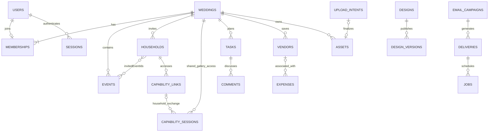
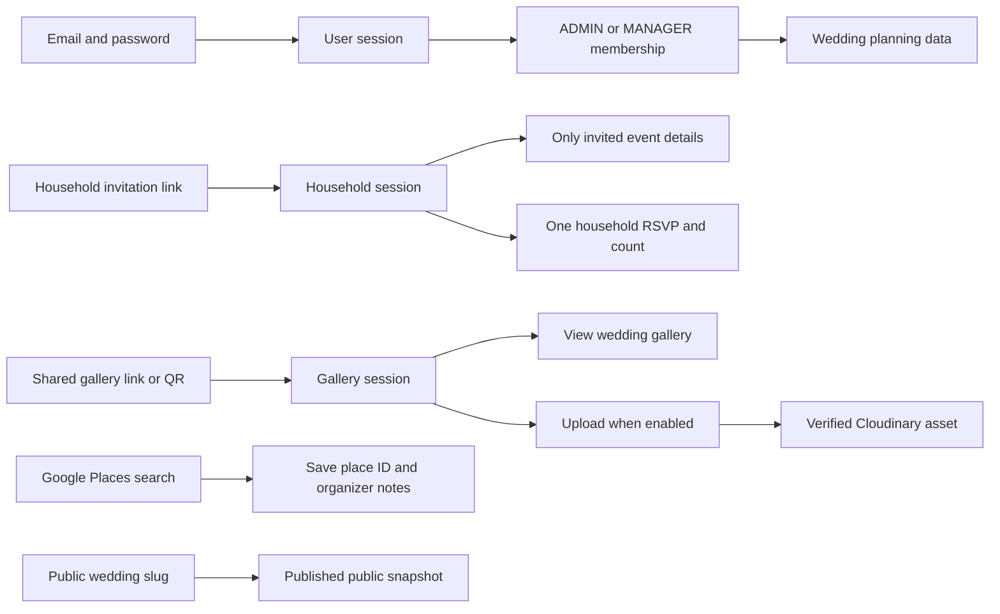
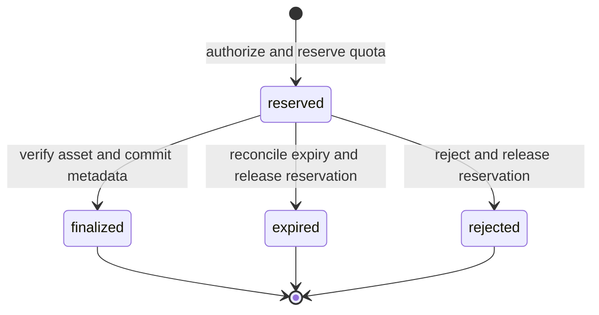
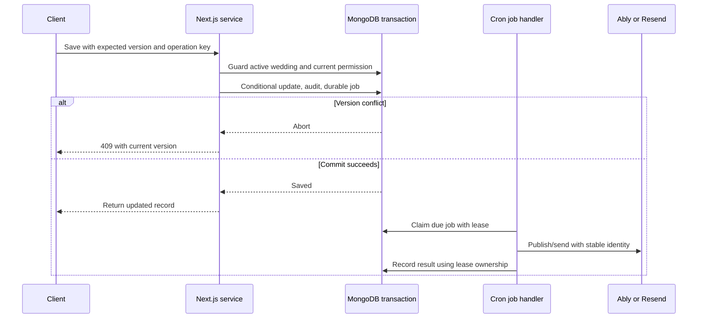

# Wedding Management — MongoDB Database Design

> October 23, 2026 onboarding checkpoint: explicit migration 002 adds weddings, memberships, activity and idempotencyKeys (11 implemented collections total). Creation transaction and unique indexes enforce the retained single-wedding membership; gallery/uploads and public publication start disabled. Gallery secrets use the independent CAPABILITY_ENCRYPTION_KEY. Initial storage allowance is zero until media is configured; this is not a promised storage entitlement. Remaining collection specifications are plans. See Wedding-Implementation-Status.md for evidence.

**Account callback correction, October 22, 2026:** Unmatched Resend receipts retain `state: received` with `nextAttemptAt` delayed one minute. After 48 hours unmatched, they become `failed` with `lastErrorCode: UNMATCHED_DELIVERY`; encrypted payload is removed and `purgeAt` schedules removal after 90 days. The explicit repeatable account migration adds the provider/state/nextAttemptAt/receivedAt index. No collection or API is added.

> Account implementation checkpoint — October 21, 2026: Explicit migration 001-accounts installs users, sessions, authTokens, rateLimits, deliveries, jobs and webhookReceipts with validators and indexes. Validation currently permits implemented account mail kinds only; future features must expand it through migrations. Token/session hashes, credentialVersion revocation, transactional token consumption and durable email intent are implemented. Encrypted recipient/payload fields exist while pending and are unset on terminal/expired deliveries; minimal delivery facts remain for suppression. Membership and remaining collections are not migrated. The 26-collection design remains the target. See Wedding-Implementation-Status.md for measured evidence; earlier scaffold-only statements are historical.

**Version:** 2.2
**Date:** October 15, 2026
**Status:** Implementation specification; no live database has been created or changed.
**Baseline:** [System Design Architecture v2.1](Wedding-System-Design-Architecture.md) and [PRD](Wedding-Management-PRD.md).
**Stack:** Next.js / Node.js modular monolith on Vercel, MongoDB Atlas, Cloudinary, Resend, Ably. Application-owned email/password authentication; no Better Auth.


**Decision update:** This version incorporates the six latest user decisions and supersedes conflicting parts of the earlier PRD and architecture. System Design Architecture v2.1, API Design v1.1 and PRD v3.0 reflect these decisions. API section 24 persistence clarifications are incorporated below as design only; no validators, indexes or database migrations have run.

| Decision | Current behavior |
|---|---|
| RSVP | One response and total attendance count per household, shared across all its invited events. |
| Guest limit | Organizers set a maximum party size for each household. |
| Family access | Only `ADMIN` and `MANAGER` roles. Bride and groom start as admins. |
| Vendors | Manual entry and Google Places discovery. |
| Expenses | Simple expense records, without separate bookings or payment ledgers. |
| Gallery | One shared wedding gallery token; its QR/link permits gallery viewing and enabled uploads. |

Cloudinary remains the media provider. Email verification, manual WhatsApp sharing, Resend email, public-page publication, task comments, announcements, invitation designs, and read-only archives remain in scope.

## 1. Recommended database structure

Use one production database, `wedding_management`, containing shared collections. Every wedding-owned document carries `weddingId`. Use a separate database and credentials for development/staging, never production guest data.

MongoDB holds accounts, planning records, permissions, metadata, and durable work. Cloudinary holds media bytes. Resend sends email. Ably carries temporary typing/presence and saved-change signals. Do not persist keystrokes or create a chat-message collection.

Separate collections are necessary where records grow independently, need their own indexes, or have a different retention/security policy. Embed small bounded values that are normally read and changed together: a household's current RSVP, a venue address, task checklist, and the public-page snapshot. Do not embed every guest, photo, task, or expense in a wedding document.

No database per wedding, sharding, Redis, separate backend service, or always-running worker is required for the initial five weddings and approximately 500 people per wedding. People, households, invitation rows, email recipients, and concurrent users are different measurements.

### Collection inventory

| Module | Collections | Purpose |
|---|---|---|
| Accounts | `users`, `sessions`, `authTokens` | Organizer login and recovery |
| Workspace | `weddings`, `memberships`, `membershipInvites` | Wedding, family access and public page |
| Guests | `households`, `events` | Household contacts, embedded invited event IDs and one RSVP |
| Private links | `capabilityLinks`, `capabilitySessions` | Household invitation links and guest sessions; gallery token embedded in wedding |
| Planning | `tasks`, `comments`, `announcements` | Work allocation and communication |
| Providers and costs | `vendors`, `expenses` | Manual/discovered vendors and simple expenses |
| Invitations | `designs`, `designVersions` | Editable designs and immutable send versions |
| Media | `assets`, `uploadIntents` | Private media metadata and upload lifecycle |
| Email and background work | `emailCampaigns`, `deliveries`, `jobs`, `webhookReceipts` | Durable sends, reminders and recovery |
| Integrity | `activity`, `idempotencyKeys`, `rateLimits` | Audit, replay prevention and abuse controls |

These are 26 collections in one shared database within the monolith. `emailCampaigns` and `capabilitySessions` make previously described architecture flows explicit. Collection names otherwise follow the architecture inventory.

## 2. Common field and type conventions

| Convention | Specification |
|---|---|
| Identifiers | BSON `ObjectId`; transmit as hex strings in API JSON. IDs are not authorization tokens. |
| Dates | BSON `Date` in UTC; wedding stores an IANA timezone such as `Asia/Kolkata`. |
| Common metadata | Every collection has `_id`, `schemaVersion: 1`, `createdAt`. Mutable documents also have `updatedAt`. |
| Editable records | `version`, integer starting at 1, incremented on each accepted user edit. Save requires expected version. |
| Audit actor | `{kind: user\|capability\|system, id?: ObjectId}`; never a guest name supplied as proof of identity. |
| Wedding scope | `weddingId: ObjectId` required on wedding-owned records. Global authentication documents do not have it. |
| Optional values | Omit absent fields. Do not use `null` for optional unique fields; validators enforce types when present. |
| Money | BSON `long` in minor units; Node `Long`/`bigint`, serialize amounts as decimal strings. No floating-point arithmetic. |
| Other counts | Validated nonnegative safe integers; BSON `int` for counts/version where range fits. Byte totals use BSON `long`. |
| Contacts | Keep original email plus normalized email; trim/lowercase consistently. Do not merge Gmail dots/aliases. Phone in E.164 when country is known. |
| User text | Length bounds and output escaping; no arbitrary HTML/scripts. Never accept Mongo operators from request bodies. |
| Secrets | Cryptographically random 32-byte tokens; only hashes for lookups. Encryption keys are outside MongoDB. |

Each collection below has a field-by-field table. **Required** means the field must be stored. **Optional** means it may be omitted. **If parent is present** means a field is required only when its containing object exists. The business rules below each table still apply, including requirements that depend on the record type.

A dot shows a field inside another object: `representative.name` is the name inside `representative`. Brackets show a list: `schedule[].title` is the title of each schedule item. ObjectId means a MongoDB record identifier. A Boolean is true or false.

Every record also has these common fields:

| Field | Type | When stored | Meaning |
|---|---|---|---|
| `_id` | ObjectId | Always | Unique identifier for this record. |
| `schemaVersion` | Integer | Always | Schema format version; initially 1. |
| `createdAt` | Date and time | Always | Time the record was created. |
| `updatedAt` | Date and time | Mutable records | Time the record last changed. |

These common fields are not repeated in every collection table. Collection validators enforce types and permitted values. Application services enforce relationships and business rules.

Proposed configurable technical bounds: 200 characters for names/titles, 10,000 for descriptions/comments, 50 tags, 100 checklist items per task, and 100 events per wedding. These prevent unbounded documents and are implementation defaults, not purchased product limits. Set numeric maxima for byte totals and money before arithmetic; reject overflow. RSVP attendance must be a whole number within the household’s configured maximum. Reject fractions, negatives, and unsupported integer values.

## 3. Relationship diagrams



The household stores its invited event IDs and one current RSVP. There is no event-invitation join collection, booking collection, or payment collection. MongoDB references are validated by application services.



## 4. Accounts and membership

### `users`

| Field | Type | Required? | Meaning |
|---|---|---|---|
| `email` | Text | Required | Original email address. |
| `emailNormalized` | Text | Required | Normalized email; globally unique for login. |
| `displayName` | Text | Required | Name shown to family members. |
| `passwordHash` | Text | Required | Argon2id encoded password hash, including salt and parameters. |
| `emailVerifiedAt` | Date and time | Optional | Time the email address was verified. |
| `credentialVersion` | Integer | Required | Increment to invalidate old sessions after a security change. |
| `status` | Text (choice) | Required | Allowed: `active`, `disabled`. |

Require verified email before wedding creation or invitation sending, matching architecture section 6.1. No guest user accounts. Bride and groom are normal users with `ADMIN` memberships. Do not store password plaintext or recoverable passwords. Email changes require verification and uniqueness checks.

### `sessions`

| Field | Type | Required? | Meaning |
|---|---|---|---|
| `userId` | ObjectId | Required | Registered user connected to this record. |
| `tokenHash` | Text | Required | Hash used to verify the secret token; never the original secret. |
| `credentialVersion` | Integer | Required | Security version checked to invalidate older sessions. |
| `expiresAt` | Date and time | Required | Time after which this record no longer grants access or remains valid. |
| `lastSeenAt` | Date and time | Required | Most recent time this session was used. |
| `revokedAt` | Date and time | Optional | Time access was withdrawn. |

Store only opaque session hashes; secure HttpOnly cookies hold the token. Each request verifies expiry, revocation, active user, and matching credential version. TTL is cleanup only.

### `authTokens`

| Field | Type | Required? | Meaning |
|---|---|---|---|
| `userId` | ObjectId | Required | Registered user connected to this record. |
| `purpose` | Text (choice) | Required | Reason this record exists; permitted values depend on the collection. Allowed: `verify_email`, `reset_password`. |
| `tokenHash` | Text | Required | Hash used to verify the secret token; never the original secret. |
| `expiresAt` | Date and time | Required | Time after which this record no longer grants access or remains valid. |
| `consumedAt` | Date and time | Optional | Time this one-use token was used. |
| `targetEmailNormalized` | Text | Optional | Email address this verification applies to. |

Atomic consume requires unconsumed and unexpired. Reset consumes the token, changes the password hash, and increments credential version in one transaction. Verification binds to the intended email. Suggested lifetimes: verification 24 hours, reset 30 minutes; sessions 7 days. Account recovery continues after a wedding is archived.

### `memberships`

| Field | Type | Required? | Meaning |
|---|---|---|---|
| `userId` | ObjectId | Required | Registered user connected to this record. |
| `weddingId` | ObjectId | Required | Wedding that owns this record. |
| `role` | Text (choice) | Required | Access role: `ADMIN` or `MANAGER`. Allowed: `ADMIN`, `MANAGER`. |
| `status` | Text (choice) | Required | Current processing state. Allowed: `active`, `removed`. |
| `joinedAt` | Date and time | Required | Time the user joined the wedding. |
| `removedAt` | Date and time | Optional | Time membership was removed. |
| `version` | Integer | Required | Edit number used to detect simultaneous changes. |

Unique `userId` implements the agreed single-wedding model. Keep the removed row for audit and permit reactivation only for the same wedding. Moving a user to a different wedding is outside v1; do not silently change their wedding. Both roles can edit planning records. Only ADMIN can manage membership, archive the wedding, or rotate the shared gallery token. Never remove or demote the last active ADMIN. MANAGER cannot appoint an ADMIN.

### `membershipInvites`

| Field | Type | Required? | Meaning |
|---|---|---|---|
| `weddingId` | ObjectId | Required | Wedding that owns this record. |
| `emailNormalized` | Text | Required | Trimmed, consistently lowercased email used for matching. |
| `role` | Text (choice) | Required | Only `ADMIN` or `MANAGER`; enforce the same enum as memberships. |
| `tokenHash` | Text | Required | Hash used to verify the secret token; never the original secret. |
| `expiresAt` | Date and time | Required | Time after which this record no longer grants access or remains valid. |
| `state` | Text (choice) | Required | Current processing state. Allowed: `pending`, `accepted`, `revoked`, `expired`. |
| `invitedBy` | ObjectId | Required | User who issued the invitation. |
| `acceptedBy` | ObjectId | Optional | User who accepted the invitation. |
| `acceptedAt` | Date and time | Optional | Time acceptance was recorded. |
| `version` | Integer | Required | Edit number used to detect simultaneous changes. |

Acceptance requires a signed-in verified account matching the invited email. A transaction consumes the invitation, checks the one-wedding rule, writes/reactivates membership, and records activity. Issuing, changing or revoking any membership invitation requires ADMIN authorization, including invitations for MANAGER. Expire old pending records before issuing a new pending invitation for the same email; do not depend on TTL to clear a uniqueness conflict.

## 5. Wedding and website

### `weddings`

| Field | Type | Required? | Meaning |
|---|---|---|---|
| `couple.brideName` | Text | Required | Bride’s display name. |
| `couple.groomName` | Text | Required | Groom’s display name. |
| `title` | Text | Required | Wedding workspace title. |
| `timezone` | Text | Required | IANA timezone, such as Asia/Kolkata. |
| `currency` | Text | Required | Currency code, such as INR; one currency per wedding. |
| `weddingDate` | Date text | Optional | Local calendar date in YYYY-MM-DD format. |
| `rsvpDeadline` | Date and time | Optional | Shared household RSVP deadline; late responses are flagged. |
| `state` | Text (choice) | Required | Allowed: `active`, `archived`. |
| `archivedAt` | Date and time | Optional | Time the wedding was archived. |
| `budgetMinor` | 64-bit integer | Optional | Overall budget in the smallest currency unit. |
| `writeFence` | 64-bit integer | Required | Counter used to coordinate protected writes and archival. |
| `storage.usedBytes` | 64-bit integer | Required | Storage already used by verified files. |
| `storage.reservedBytes` | 64-bit integer | Required | Storage reserved for unfinished uploads. |
| `storage.limitBytes` | 64-bit integer | Required | Configured wedding storage allowance. |
| `privateWebsite` | Object | Required | Bounded introduction, cover reference and guest-facing text. |
| `publicPage` | Object | Required | Public-page fields described in the following table. |
| `gallery.tokenHash` | Text | Required | Unique hash of the shared gallery secret. |
| `gallery.encryptedSecret` | Object | Required | Encrypted copy for authorized admins/managers to copy or print the link again. |
| `gallery.tokenVersion` | Integer | Required | Increment on rotation to invalidate old sessions. |
| `gallery.isEnabled` | Boolean | Required | Enables or disables shared gallery access; initially false. |
| `gallery.guestUploadsEnabled` | Boolean | Required | Allows guest uploads while gallery enabled and wedding active; initially false. |
| `livestream` | Object | Optional | Private guest-facing livestream details. |
| `livestream.provider` | Text | If parent is present | Name of the streaming provider. |
| `livestream.url` | Text | If parent is present | Link to the private livestream. |
| `livestream.title` | Text | If parent is present | Title shown to invited guests. |
| `version` | Integer | Required | Edit number for concurrent changes. |
| `createdBy` | ObjectId | Required | User who created the wedding. |

**Public website fields**

| Field | Type | Required? | Meaning |
|---|---|---|---|
| `publicPage.slug` | Text | Required | Unique URL part, such as rakesh-and-priya. |
| `publicPage.state` | Text (choice) | Required | Allowed: `draft`, `published`, `unpublished`. |
| `publicPage.draft` | Object | Required | Editable public-page content before publication. |
| `publicPage.draft.coupleNames` | Text | Required | Couple names selected for public display. |
| `publicPage.draft.intro` | Text | Required | Public introduction. |
| `publicPage.draft.coverAssetId` | ObjectId | Optional | Selected cover image. |
| `publicPage.draft.date` | Date text | Optional | Wedding date for public display. |
| `publicPage.draft.selectedEventIds` | List of ObjectIds | Required | Events explicitly selected for public display. |
| `publicPage.draft.contact` | Object | Optional | Contact approved for publication; same fields as snapshot contact below. |
| `publicPage.draftVersion` | Integer | Required | Version of the editable draft. |
| `publicPage.publishedRevision` | Integer | Required | Number of the published revision. |
| `publicPage.publishedAt` | Date and time | Optional | Most recent publication time. |
| `publicPage.sourceChanged` | Boolean | Required | Whether source details have changed since publication. |
| `publicPage.snapshot` | Object | Optional | Approved public content copied at publication. |
| `publicPage.snapshot.coupleNames` | Text | If parent is present | Published couple names. |
| `publicPage.snapshot.intro` | Text | If parent is present | Published introduction. |
| `publicPage.snapshot.publicCoverAssetId` | ObjectId | Optional | Sanitized public copy of the cover. |
| `publicPage.snapshot.date` | Date text | Optional | Published wedding date. |
| `publicPage.snapshot.events` | List of objects | If parent is present | Approved event summaries. |
| `publicPage.snapshot.events[].eventId` | ObjectId | For each event | Source event reference. |
| `publicPage.snapshot.events[].title` | Text | For each event | Published event title. |
| `publicPage.snapshot.events[].startsAt` | Date and time | For each event | Published start time. |
| `publicPage.snapshot.events[].endsAt` | Date and time | Optional | Published end time. |
| `publicPage.snapshot.events[].venue` | Object | For each event | Approved venue fields using the event venue structure. |
| `publicPage.snapshot.events[].dressCode` | Text | Optional | Published clothing guidance. |
| `publicPage.snapshot.contact` | Object | Optional | Contact explicitly approved for public display. |
| `publicPage.snapshot.contact.displayName` | Text | If parent is present | Published contact name. |
| `publicPage.snapshot.contact.explicitlyPublicPhone` | Text | Optional | Phone explicitly approved for public display. |

Public URL example: `https://weddingapp.vercel.app/w/rakesh-and-priya`. The actual hostname is the deployed Vercel project hostname. Claim slug using the unique index; on collision try a random suffix and retry. Keep the slug stable after publication; slug renaming/redirect management is deferred.

Publication explicitly copies approved fields to the snapshot. It must never copy household contacts, RSVP, tasks, expenses, private livestream, gallery, or upload links. Mark source changes stale for republishing. On every public read also suppress snapshots of events that have been cancelled/removed; invalidation must prevent stale cached cancellation details. Public assets are explicitly sanitized copies, separate from private originals. Unpublish revokes their application delivery and schedules provider cleanup, but cannot retract already downloaded copies.

Wedding creation and its first ADMIN membership are transactional. The second ADMIN is invited; no email guessing or automatic admin access. Changing currency after expense records exist is blocked in v1.

## 6. Events, households and one shared RSVP

### `events`

| Field | Type | Required? | Meaning |
|---|---|---|---|
| `weddingId` | ObjectId | Required | Wedding containing this event. |
| `name` | Text | Required | Event name, such as Haldi or Family Dinner. |
| `type` | Text | Required | Preset category or `custom`. |
| `description` | Text | Optional | Event description. |
| `startsAt` | Date and time | Required | Start instant in UTC. |
| `endsAt` | Date and time | Optional | End instant in UTC. |
| `venue.name` | Text | Required | Venue name. |
| `venue.address` | Text | Required | Venue address. |
| `venue.mapUrl` | Text | Optional | Map link. |
| `venue.latitude` | Number | Optional | Location latitude. |
| `venue.longitude` | Number | Optional | Location longitude. |
| `dressCode` | Text | Optional | Clothing guidance. |
| `contact.name` | Text | If contact is present | Contact person’s name. |
| `contact.phone` | Text | Optional | Contact number. |
| `contact.email` | Text | Optional | Contact email. |
| `schedule` | List of objects | Required | Bounded agenda list, which may be empty. |
| `schedule[].id` | Text | Per item | Stable agenda item ID. |
| `schedule[].title` | Text | Per item | Agenda item name. |
| `schedule[].startsAt` | Date and time | Per item | Agenda item start time. |
| `schedule[].endsAt` | Date and time | Optional | Agenda item end time. |
| `status` | Text (choice) | Required | `draft`, `scheduled`, `completed`, `cancelled`, `removed`. |
| `version` | Integer | Required | Edit version. |

Tasks remain in `tasks`. End times must follow start times. Guests can see only their household’s invited events with eligible status. No event implies access to another event.

### `households`

One record represents one representative and their family/group. Its RSVP applies to every currently invited event; the application does not collect separate event answers.

| Field | Type | Required? | Meaning |
|---|---|---|---|
| `weddingId` | ObjectId | Required | Wedding owning the household. |
| `displayName` | Text | Required | Household name, such as Sharma family. |
| `representative.name` | Text | Required | Main contact’s name. |
| `representative.email` | Text | Optional | Original email address. |
| `representative.emailNormalized` | Text | Optional | Normalized email for matching. |
| `representative.phone` | Text | Optional | Phone number including country code when known. |
| `side` | Text (choice) | Required | `bride`, `groom`, `both`, `other`. |
| `tags` | List of text values | Required | Organizer labels; may be empty. |
| `invitedEventIds` | List of ObjectIds | Required | Unique event IDs this household is invited to. |
| `maxGuests` | Integer | Required | Positive whole-number maximum, including the representative. |
| `notes` | Text | Optional | Internal notes hidden from guests. |
| `source` | Text (choice) | Required | `manual`, `csv`, `contacts`. |
| `status` | Text (choice) | Required | `active`, `removed`. |
| `rsvp.status` | Text (choice) | Required | `pending`, `attending`, `not_attending`, `maybe`. |
| `rsvp.attendeeCount` | Integer | Required | One total for the household; attending: 1 through maxGuests; otherwise 0. |
| `rsvp.respondedAt` | Date and time | Optional | Most recent answer time. |
| `rsvp.respondedBy` | Actor object | Optional | Household visitor or family user submitting the answer. |
| `rsvp.updatedAfterDeadline` | Boolean | Required | Whether the answer arrived after the shared deadline. |
| `version` | Integer | Required | Used when RSVP, capacity or invitations change. |

Store a single optional `weddings.rsvpDeadline` for the shared RSVP. Deadline is soft: accept and flag late responses until archival. A household must have at least one eligible invitation to submit an RSVP.

Organizers set `maxGuests` during creation/import; a creation form may suggest 1, but must display the chosen limit before saving. Only organizers change it. Guests cannot exceed it. Lowering it below an existing attending count returns a conflict and requires an explicit corrected response; never silently reduce a saved attendance promise.

All event IDs must belong to the same wedding and be unique in the array. Email and phone are not unique because families can share contact details. The invitation list is bounded by the wedding’s event limit.

**Example:** Sharma family is invited to Haldi and the Wedding, with maxGuests = 5. They submit Attending, count = 3 once. Both event dashboards show this household as attending with 3 people. Reception remains hidden if it is absent from invitedEventIds. Different attendance counts per event are intentionally unsupported.

If organizers change invited events after a response, keep the one response and show a confirmation that it will apply to the revised event list. An event update can request the household to review its RSVP. Do not silently create per-event answers.

Wedding confirmed people = sum attending counts once per active household with at least one eligible invitation. An event’s projected count uses that same count for households invited to it. Summing event counts measures event attendances, not distinct individuals. Household totals cannot deduplicate a person listed in multiple households.

## 7. Private invitations and shared gallery access

### `capabilityLinks`

This collection now holds household invitation links only. Shared gallery access is stored once under `weddings.gallery`.

| Field | Type | Required? | Meaning |
|---|---|---|---|
| `weddingId` | ObjectId | Required | Wedding owning the link. |
| `kind` | Text | Required | Fixed value `household`. |
| `subjectId` | ObjectId | Required | Household whose events and RSVP are accessible. |
| `tokenHash` | Text | Required | Unique hash of the random invitation secret. |
| `encryptedSecret` | Object | Required | Encrypted secret for authorized re-sharing. |
| `active` | Boolean | Required | Whether this invitation link works. |
| `version` | Integer | Required | Incremented for access changes. |
| `expiresAt` | Date and time | Optional | Explicit expiry. |
| `revokedAt` | Date and time | Optional | Time the link was revoked. |
| `createdBy` | ObjectId | Required | Organizer who created the link. |

One active invitation link per household. Encryption uses ciphertext, IV, authentication tag and key version; keys remain outside MongoDB. Household removal revokes its invitation access.

### `capabilitySessions`

| Field | Type | Required? | Meaning |
|---|---|---|---|
| `weddingId` | ObjectId | Required | Wedding being accessed. |
| `kind` | Text (choice) | Required | `household` or `gallery`. |
| `capabilityLinkId` | ObjectId | Household sessions | Source household link. |
| `capabilityVersion` | Integer | Household sessions | Source link version when exchanged. |
| `galleryTokenVersion` | Integer | Gallery sessions | Wedding gallery token version when exchanged. |
| `tokenHash` | Text | Required | Unique opaque session-token hash. |
| `expiresAt` | Date and time | Required | Session expiry. |
| `lastSeenAt` | Date and time | Required | Last access time. |
| `revokedAt` | Date and time | Optional | Session revocation time. |

Exchange either link type for a scoped HttpOnly cookie and redirect to a clean URL. Recheck current grant, expiry and version on every request. Use no-referrer policy and avoid third-party resources on exchange pages. No guest account or OTP is required.

| Access route | Can view | Can change |
|---|---|---|
| Household invitation | Its invited events and RSVP, enabled shared gallery, and private livestream | Its single RSVP; gallery uploads when enabled |
| Shared gallery link or QR | Wedding gallery | Upload photos when enabled and wedding active |
| Photographer | Uses the same shared gallery link | Same upload permission as any gallery-link holder |

The shared gallery token is stable until an ADMIN explicitly rotates it. Print its URL as a QR code. Possession grants gallery access, including forwarded links; it does not identify a household or grant RSVP/event/planning access. Removing a household cannot revoke a shared token it already knows. Rotate to revoke all old shared links and gallery sessions; printed old QR codes stop working.

Disabling the gallery blocks gallery reads and uploads. Disabling guest uploads preserves viewing. Archive preserves gallery viewing but blocks new uploads. ADMIN may still disable or rotate gallery access after archive as a privacy action; ordinary content edits remain blocked. Private financial/task attachments remain family-only even when the gallery token is valid. Shared gallery access does not grant livestream access; livestream stays on the household invitation page.

## 8. Planning collections

### `tasks`

| Field | Type | Required? | Meaning |
|---|---|---|---|
| `weddingId` | ObjectId | Required | Wedding that owns this record. |
| `eventId` | ObjectId | Optional | Event connected to this record; omitted for wedding-wide tasks. |
| `title` | Text | Required | Short title shown in the application. |
| `description` | Text | Optional | Longer explanation or instructions. |
| `status` | Text (choice) | Required | Current processing state. Allowed: `todo`, `in_progress`, `done`, `cancelled`. |
| `priority` | Text (choice) | Required | Urgency of the task. Allowed: `low`, `normal`, `high`. |
| `assigneeUserId` | ObjectId | Optional | Family member responsible for the task. |
| `dueAt` | Date and time | Optional | Task deadline. |
| `checklist` | List of objects | Required | Small list of steps inside this task. |
| `checklist[].id` | Text | Required | Stable identifier for this embedded item. |
| `checklist[].text` | Text | Required | Text shown for this item. |
| `checklist[].done` | Boolean | Required | Whether this checklist step is complete. |
| `attachmentAssetIds` | List of ObjectIds | Required | References to uploaded task attachments. |
| `templateKey` | Text | Optional | Identifier of the template used. |
| `completedAt` | Date and time | Optional | Time the work completed. |
| `createdBy` | ObjectId | Required | User who created the record. |
| `version` | Integer | Required | Edit number used to detect simultaneous changes. |

An omitted event means wedding-wide. Haldi is an event containing many tasks, not a single mandatory task. An assignee must be an active member of the same wedding; removal leaves historical assignment visible but marks it inactive in the UI. Reassignment remains possible. Enforce bounded attachment lists and reference permissions.

### `comments`

| Field | Type | Required? | Meaning |
|---|---|---|---|
| `weddingId` | ObjectId | Required | Wedding that owns this record. |
| `taskId` | ObjectId | Required | Task this comment belongs to. |
| `authorUserId` | ObjectId | Required | User who wrote the comment. |
| `body` | Text | Required | Text of the comment or announcement. |
| `editedAt` | Date and time | Optional | Time the text was last edited. |
| `deletedAt` | Date and time | Optional | Time the record was marked deleted. |
| `version` | Integer | Required | Edit number used to detect simultaneous changes. |

Comments are separate for pagination. Activity records who edited/deleted a comment; do not put growing comments in a task array. Typing indicators exist only in Ably with short expiry and never contain draft text.

### `announcements`

| Field | Type | Required? | Meaning |
|---|---|---|---|
| `weddingId` | ObjectId | Required | Wedding that owns this record. |
| `title` | Text | Required | Short title shown in the application. |
| `body` | Text | Required | Text of the comment or announcement. |
| `pinned` | Boolean | Required | Whether this announcement stays at the top. |
| `createdBy` | ObjectId | Required | User who created the record. |
| `deletedAt` | Date and time | Optional | Time the record was marked deleted. |
| `version` | Integer | Required | Edit number used to detect simultaneous changes. |

Internal family announcements only; guest/public content must be explicitly edited through the corresponding website fields. No group chat collection.

## 9. Vendor discovery and simple expenses

### `vendors`

Save known contacts manually or select a Google Places result. There are no separate bookings or vendor accounts in this version.

| Field | Type | Required? | Meaning |
|---|---|---|---|
| `weddingId` | ObjectId | Required | Wedding owning the saved vendor. |
| `name` | Text | Manual vendors | Organizer-entered vendor name or private label. |
| `category` | Text | Required | For example mehendi, haldi, priest, catering, photography or other. |
| `contact.person` | Text | Optional | Independently entered contact person. |
| `contact.phone` | Text | Optional | Independently entered phone. |
| `contact.email` | Text | Optional | Independently entered email. |
| `contact.address` | Text | Optional | Independently entered address. |
| `eventIds` | List of ObjectIds | Required | Events covered by the vendor; empty means wedding-wide. |
| `source` | Text (choice) | Required | `MANUAL` or `GOOGLE_PLACES`. |
| `googlePlaceId` | Text | Google Places vendors | Stable external reference for live detail retrieval. |
| `notes` | Text | Optional | Organizer notes and coordination details. |
| `status` | Text (choice) | Required | `active`, `removed`. |
| `version` | Integer | Required | Edit version. |

Discovery flow: organizer searches a category and location; server calls Places with restricted credentials and bounded requests; user selects a result; save its place ID and organizer-authored data. Fetch provider details for display with required attribution. No internal Google directory copy or automatic booking is created.

Place IDs can be stored, but other Google Places content has storage and attribution restrictions. Do not permanently copy API names, addresses, photos, ratings or reviews into manual fields merely because a user selected the result. Keep manual data distinct from provider display data and implement only caching expressly allowed by current terms. If Google is unavailable, retain the saved reference and organizer notes and show details as temporarily unavailable. [Google Places policies](https://developers.google.com/maps/documentation/places/web-service/policies)

### `expenses`

One row records one actual expense amount. Multiple rows may reference the same vendor, but there is no separate contract, instalment schedule, payment ledger or outstanding-balance calculation.

| Field | Type | Required? | Meaning |
|---|---|---|---|
| `weddingId` | ObjectId | Required | Wedding owning the expense. |
| `title` | Text | Required | Short description of the expense. |
| `amountMinor` | 64-bit integer | Required | Positive amount in the smallest currency unit; INR uses paise. |
| `currency` | Text | Required | Same currency as the wedding. |
| `expenseDate` | Date and time | Required | When the expense occurred. |
| `category` | Text | Required | Category such as venue, food, decoration, clothing or other. |
| `eventId` | ObjectId | Optional | One related event; omit for wedding-wide/shared expenses. |
| `vendorId` | ObjectId | Optional | Associated saved vendor. |
| `notes` | Text | Optional | Extra explanation. |
| `receiptAssetIds` | List of ObjectIds | Required | Family-only receipts; may be empty. |
| `operationKey` | Text | Required | Stable creation key preventing duplicate expense rows on retries. |
| `createdBy` | ObjectId | Required | User recording the expense. |
| `deletedAt` | Date and time | Optional | Removes the expense from totals while retaining activity history. |
| `version` | Integer | Required | Edit version. |

Total spent = sum amountMinor for non-deleted wedding expenses. Optional budget remaining = wedding budget minus total spent. A shared charge is recorded once without eventId, not duplicated for every event. Recording a later actual expenditure adds another simple expense row; it does not create a payment schedule. Existing activity and receipts remain supported.

Vendor removal preserves expense references. All referenced events, vendors and receipt assets must belong to the same wedding.

## 10. Invitation designs

### `designs`

| Field | Type | Required? | Meaning |
|---|---|---|---|
| `weddingId` | ObjectId | Required | Wedding that owns this record. |
| `eventIds` | List of ObjectIds | Required | All events represented in this design; empty only for wedding-wide content without event-specific details. |
| `name` | Text | Required | Display name. |
| `mode` | Text (choice) | Required | How the invitation design was created. Allowed: `template`, `uploaded_image`, `designer`. |
| `draft` | Object | Required | Editable design content. |
| `draft.templateKey` | Text | Optional | Identifier of the template used. |
| `draft.textFields` | Object | Optional | Editable text values used by the template. |
| `draft.assetIds` | List of ObjectIds | Required | Media references used by the design. |
| `draft.layout` | Object | Optional | Validated arrangement of designer components. |
| `latestPublishedVersionId` | ObjectId | Optional | Most recent published design version. |
| `version` | Integer | Required | Edit number used to detect simultaneous changes. |
| `createdBy` | ObjectId | Required | User who created the record. |

Keep layout JSON bounded, validated against supported component types, and free of executable code/remote URLs. An uploaded image references a verified invitation asset.

### `designVersions`

| Field | Type | Required? | Meaning |
|---|---|---|---|
| `weddingId` | ObjectId | Required | Wedding that owns this record. |
| `eventIds` | List of ObjectIds | Required | All events represented in this design; empty only for wedding-wide content without event-specific details. |
| `designId` | ObjectId | Required | Design this published version belongs to. |
| `revision` | Integer | Required | Sequential published version number. |
| `content` | Object | Required | Immutable, validated snapshot of the published design. |
| `renderAssetId` | ObjectId | Optional | Rendered invitation image reference. |
| `publishedBy` | ObjectId | Required | User who published this design version. |

Unique `(weddingId,designId,revision)`. Emails reference a specific version so editing a draft does not alter a queued invitation. Guest access still follows current event assignments, not an old design or message.

Design publication copies eventIds into the immutable design version. A household may receive/read a version only when every represented event is currently eligible and included in its invitedEventIds. An empty eventIds list permits wedding-wide content only and still requires an active household with an eligible invitation. A mixed-event card must not leak an uninvited event. Reusable drafts can remain family-only until a valid version is published.

Invitation assets carry the same `audienceEventIds` as the design version using them. Reject reuse where the stored asset scope would be broader than the version’s scope; create a separately scoped asset/version instead. Family access does not require a household invitation. No shared-gallery token can read invitation assets. Current event cancellation/removal and household revocation are checked on every guest fetch.

## 11. Media and quota safety

### `assets`

| Field | Type | Required? | Meaning |
|---|---|---|---|
| `weddingId` | ObjectId | Required | Wedding that owns this record. |
| `uploadIntentId` | ObjectId | Optional | Upload request that produced this asset. |
| `purpose` | Text | Required | Allowed: `gallery`, `receipt`, `task_attachment`, `invitation`, `private_cover`, `public_copy`. |
| `audienceEventIds` | List of ObjectIds | Invitation assets | Immutable event-access scope copied from the associated design version; same wedding and unique IDs. |
| `provider` | Text | Required | Always `cloudinary`. |
| `providerAssetId` | Text | After provider verification | Provider identifier; required for ready assets. |
| `publicId` | Text | After provider verification | Cloudinary identifier; required for ready assets and never evidence of public access. |
| `providerVersion` | Integer | Optional | Provider-assigned version after verification. |
| `resourceType` | Text | After provider verification | Verified provider media type; do not invent it on an unverified pending row. |
| `format` | Text | After provider verification | Verified file format. |
| `bytes` | 64-bit integer | After provider verification | Verified file size; pending reservations use uploadIntents.reservedBytes. |
| `width` | Integer | Optional | Verified width in pixels. |
| `height` | Integer | Optional | Verified height in pixels. |
| `deliveryType` | Text | Required | Provider delivery setting; private content must remain private. |
| `state` | Text | Required | Allowed: `pending`, `ready`, `rejected`, `delete_pending`, `deleted`. |
| `visibility` | Text | Required | Allowed: `family`, `household`, `gallery`, `public_page`; these are application audiences, not Cloudinary delivery types. |
| `uploadedBy` | Actor object | Required | User ID, capability-session ID, or system actor that initiated the upload; not a verified guest identity. |
| `caption` | Text | Optional | Optional caption shown with the image. |
| `capturedAt` | Date and time | Optional | Time the photo was taken, if known. |
| `sourceAssetId` | ObjectId | Optional | Original asset from which a public copy was made. |
| `deletedAt` | Date and time | Optional | Time the record was marked deleted. |
| `version` | Integer | Required | Edit number used to detect simultaneous changes. |

The audience rules are explicit:

| Asset purpose | Application visibility | Read authorization |
|---|---|---|
| receipt, task_attachment | family | Current ADMIN/MANAGER in this wedding. |
| invitation | household | Family users or an eligible household allowed to see every event represented in the published design. |
| private_cover | household | Family users or an active household with at least one eligible invited event. |
| gallery | gallery | Family users or authorized household/shared-gallery visitors, with gallery settings applied. |
| public_copy | public_page | Asset selected in the current published public snapshot; no access merely from knowing its ID. |

All originals and derivatives remain Cloudinary-authenticated. Application audience labels never convert the provider asset to public delivery. Public copies use the architecture’s allowlisted public-media endpoint. `ready` requires providerAssetId, publicId, verified resourceType/format/bytes and successful automatic validation. Pending rows omit unknown provider facts; they cannot be delivered.

Clients never provide trusted byte size, provider identity, or visibility. Receipt/task assets are family-only; gallery assets are available to authorized household visitors and shared-gallery-token holders; public copies require explicit publication. Signed delivery URLs are generated at read time and are not persisted as durable URLs. Remove location metadata from public copies. Do not expose originals publicly to make delivery easier.

### `uploadIntents`

| Field | Type | Required? | Meaning |
|---|---|---|---|
| `weddingId` | ObjectId | Required | Wedding that owns this record. |
| `actor` | Object | Required | User, private-link visitor, or system responsible for the action. |
| `capabilityLinkId` | ObjectId | Household uploads | Household link granting upload access. |
| `capabilityVersion` | Integer | Household uploads | Captured household-link version; must still match at finalization. |
| `capabilitySessionId` | ObjectId | Guest uploads | Session authorizing household or shared-gallery upload; never a registered guest account. |
| `galleryTokenVersion` | Integer | Shared-token uploads | Shared gallery version used to authorize the upload; omit for member/household authorization. |
| `purpose` | Text | Required | Reason this record exists; permitted values depend on the collection. |
| `context` | Object | Where relevant | Validated attachment context; type task/design/expense and same-wedding resourceId. Persist only authorized scope, and recheck at finalization/attachment. |
| `expectedPublicId` | Text | Required | Exact Cloudinary public ID reserved for this file. |
| `reservedBytes` | 64-bit integer | Required | Storage reserved before the upload finishes. |
| `maxBytes` | 64-bit integer | Required | Maximum permitted upload size in bytes. |
| `state` | Text (choice) | Required | Current processing state. Allowed: `reserved`, `finalized`, `expired`, `rejected`. |
| `expiresAt` | Date and time | Required | Time after which this record no longer grants access or remains valid. |
| `assetId` | ObjectId | Optional | Asset created after upload verification. |
| `finalizedAt` | Date and time | Optional | Time upload verification completed. |
| `reservationReleasedAt` | Date and time | Optional | Time the reserved storage was released. |
| `version` | Integer | Required | Edit number used to detect simultaneous changes. |
| `purgeAt` | Date and time | Optional | Time cleanup may delete settled operational metadata. |

For member uploads, actor references the user and finalization rechecks active account/membership. For guest uploads, actor references capabilitySessionId; finalization rechecks the session’s expiry/revocation plus current household link/version or gallery token version and upload settings. A verified provider callback does not replace these permission checks. Guest sessions may expire under TTL, so keep the actor ID and captured grant/version in the intent for audit and fail authorization if the session no longer exists. Removing all eligible household invitations removes upload access through that household session; possession of the separate shared gallery link remains independent.

One intent represents one file, not an unlimited upload folder. The signature fixes allowed folder/public ID, formats, limits, and expiry. Finalization verifies Cloudinary metadata and current permission. A transaction performs exactly one reserved-to-used accounting transition and marks the asset ready. Larger-than-reserved uploads must reserve the difference atomically or be rejected and cleaned up; never allow negative counters.



Client completion and provider callback may race: both use the same intent and conditional transition. Only the winner updates counters. Expiry reconciliation checks provider state and releases once; a late upload after expiry is deleted, never finalized. Do not TTL-delete a reserved intent. Set `purgeAt` only after reservation settlement and any orphan cleanup are complete. Keep enough reference metadata to reconcile late callbacks.

Deletion first blocks application access with `delete_pending`, then a job deletes the provider asset. Only verified provider deletion decreases `usedBytes`, once. Keep a tombstone. Periodically reconcile provider inventory with metadata and counters. Archive preserves ready media and runs cleanup for unfinished uploads; gallery upload moderation is not added.

## 12. Email, reminders and durable jobs

### `emailCampaigns`

| Field | Type | Required? | Meaning |
|---|---|---|---|
| `weddingId` | ObjectId | Required | Wedding that owns this record. |
| `kind` | Text (choice) | Required | Type of operation or record. Allowed: `invitation`, `reminder`, `event_update`. |
| `eventIds` | List of ObjectIds | Required | Events covered by this record; see the scope rules below. |
| `designVersionId` | ObjectId | Optional | Fixed published invitation version used for this send. |
| `createdBy` | ObjectId | Required | User who created the record. |
| `state` | Text (choice) | Required | Current processing state. Allowed: `preparing`, `queued`, `running`, `completed`, `cancelled`. |
| `audienceCutoffAt` | Date and time | Required | Review cutoff; not a substitute for the persisted exact audience. |
| `audienceHouseholdIds` | List of ObjectIds | Required | Immutable unique reviewed audience, at most 2,000 IDs per current API processing limit; all same wedding. |
| `manifestHash` | Text | Required | Hash of the canonical immutable reviewed audience/configuration. |
| `cursor` | Text | Optional | Durable preparation cursor into the persisted audience; advance atomically with delivery materialization. |
| `version` | Integer | Required | Edit number used to detect simultaneous changes. |

The campaign materializes a reviewed audience into delivery rows in bounded pages. `cursor` permits restart; unique delivery dedupe prevents duplicate materialization. Before acknowledging campaign creation, persist the exact audienceHouseholdIds and manifestHash with the immutable campaign configuration. Materialize delivery rows in bounded restartable pages from that manifest, atomically advancing cursor with the rows. Dispatch only durably prepared eligible rows; retries use the same reviewed selection. Do not rerun an unconstrained live audience query and label it a frozen snapshot. Validate the bounded selected household IDs on creation and recover preparation from the persisted manifest after crashes. The audience cannot be replaced by a live search. Counts are derived from deliveries. At dispatch, recheck eligibility: removed households or households without eligible invited events must not receive a stale reminder. Reminders additionally require the one shared household RSVP to remain pending and current wedding-wide reminder timing to be eligible. Deduplicate by wedding, campaign and household, not by each invited event. Event-specific messages must contain only still-authorized events and a design version whose complete event scope the household can access. If an immutable queued payload becomes unauthorized or obsolete, suppress it; create a new reviewed delivery/key rather than editing the old provider-idempotent payload. Large campaigns are not one request or one giant transaction.

### `deliveries`

| Field | Type | Required? | Meaning |
|---|---|---|---|
| `weddingId` | ObjectId | Optional | Wedding that owns this record. |
| `campaignId` | ObjectId | Optional | Email campaign this delivery belongs to. |
| `kind` | Text (choice) | Required | Type of operation or record. Allowed: `verify_email`, `reset_password`, `family_invite`, `invitation`, `reminder`, `event_update`. |
| `recipientKey` | Text | Required | Stable recipient hash used for matching and suppression. |
| `recipientEmailEncrypted` | Object | Required | Encrypted destination email address. |
| `householdId` | ObjectId | Optional | Household this record belongs to. |
| `userId` | ObjectId | Optional | Registered user connected to this record. |
| `authTokenId` | ObjectId | Optional | Verification or password-reset token reference. |
| `membershipInviteId` | ObjectId | Optional | Family invitation reference. |
| `eventIds` | List of ObjectIds | Optional | Invited event IDs captured for this message; recheck current household access before sending. |
| `designVersionId` | ObjectId | Optional | Fixed published invitation version used for this send. |
| `dedupeKey` | Text | Required | Unique key preventing duplicate creation or processing. |
| `payloadHash` | Text | Required | Hash of the immutable payload. |
| `payloadEncrypted` | Object | Optional | Encrypted payload retained only while needed. |
| `payloadExpiresAt` | Date and time | Optional | Time sensitive stored payload should expire. |
| `providerMessageId` | Text | Optional | Email identifier returned by Resend. |
| `submissionState` | Text (choice) | Required | Current processing state. Allowed: `queued`, `submitting`, `accepted`, `failed`, `suppressed`, `unknown`. |
| `acceptedAt` | Date and time | Optional | Time acceptance was recorded. |
| `deliveredAt` | Date and time | Optional | Time delivery was confirmed by the provider. |
| `bouncedAt` | Date and time | Optional | Time the provider reported a bounce. |
| `complainedAt` | Date and time | Optional | Time the recipient complaint was reported. |
| `lastErrorCode` | Text | Optional | Last recorded error code, without sensitive payloads. |
| `version` | Integer | Required | Edit number used to detect simultaneous changes. |

`recipientKey` is a stable hash for dedupe/reporting; email is encrypted at rest at the application layer where practical. Required references depend on kind: account emails require a user/token reference and no wedding; family invites require a valid membership invite; event mail requires an eligible household and eligible invited event IDs. Do not put raw reset/private tokens in activity or plaintext queued payloads. Encrypt any recoverable mail payload and purge after its retry window.

Delivery accepted by Resend is not evidence of delivery to an inbox. Webhook facts have independent timestamps so out-of-order events do not revert status. Complaints and hard bounces suppress further relevant email to that address through an indexed suppression check; retain the required minimum suppression data even after message content is purged. Manual WhatsApp sharing may produce an activity entry `whatsapp_share_opened`; it never marks a message sent or delivered.

### `jobs`

| Field | Type | Required? | Meaning |
|---|---|---|---|
| `weddingId` | ObjectId | Optional | Wedding that owns this record. |
| `kind` | Text (choice) | Required | Type of operation or record. Allowed: `email_send`, `campaign_expand`, `realtime_publish`, `cache_invalidate`, `media_cleanup`, `upload_reconcile`, `archive_reconcile`. |
| `dedupeKey` | Text | Required | Unique key preventing duplicate creation or processing. |
| `payloadRef` | Object | Required | Reference identifying the durable data this job processes. |
| `state` | Text (choice) | Required | Current processing state. Allowed: `queued`, `running`, `retry`, `done`, `dead`, `cancelled`. |
| `runAt` | Date and time | Required | Earliest scheduled execution time. |
| `attempts` | Integer | Required | Number of attempts made. |
| `maxAttempts` | Integer | Required | Maximum allowed retry attempts. |
| `leaseOwner` | Text | Optional | Worker identifier currently claiming this job. |
| `leaseUntil` | Date and time | Optional | Time the worker claim expires. |
| `lastErrorCode` | Text | Optional | Last recorded error code, without sensitive payloads. |
| `completedAt` | Date and time | Optional | Time the work completed. |
| `purgeAt` | Date and time | Optional | Time cleanup may delete settled operational metadata. |

Insert jobs in the same transaction as the business record that requires them. A bounded Vercel cron invocation atomically claims due jobs with a lease, performs external work outside transactions, and conditionally completes using its lease owner. Reclaim expired leases. Retry temporary errors with exponential backoff/jitter; use provider retry guidance for rate limits. Permanent failures go dead for organizer/support inspection. New job kinds require explicit schema/handler support.

Each email retry uses the same immutable payload and provider idempotency key. Provider idempotency has a finite window: if acceptance is uncertain beyond that window, mark `unknown` for reconciliation instead of blindly resending. The application does not promise exactly-once external delivery. If using provider batch sending later, persist immutable batch membership and response mapping; never rebuild a different batch under the old key.

### `webhookReceipts`

| Field | Type | Required? | Meaning |
|---|---|---|---|
| `provider` | Text (choice) | Required | Type of operation or record. Allowed: `resend`, `cloudinary`. |
| `providerEventId` | Text | Required | Stable provider event identity used to deduplicate callbacks. |
| `eventType` | Text | Required | Type of provider notification. |
| `payloadHash` | Text | Required | Hash of the immutable payload. |
| `receivedAt` | Date and time | Required | Time the callback reached the application. |
| `processedAt` | Date and time | Optional | Time callback processing completed. |
| `state` | Text (choice) | Required | Current processing state. Allowed: `received`, `processed`, `failed`. |
| `payloadEncrypted` | Object | Optional | Encrypted payload retained only while needed. |
| `purgeAt` | Date and time | Optional | Time cleanup may delete settled operational metadata. |

Verify provider signatures before accepting. Unique `(provider,providerEventId)` deduplicates retries. If a provider lacks a stable event ID, define and test a deterministic digest from authenticated event identity fields. Updating the receipt and corresponding metadata is transactional. Never assign TTL before processing is complete. Redact sensitive payloads; retain event identity beyond expected replay/retry windows.

For 500 or 2,000 recipients, create durable delivery records and send incrementally under the purchased provider limits. No 2,000-call loop inside an interactive request. A verified sending domain is required for production Resend delivery even when the website uses only a Vercel hostname. Cron cadence and media delivery limits still need deployment validation.

## 13. Integrity and security collections

### `activity`

| Field | Type | Required? | Meaning |
|---|---|---|---|
| `weddingId` | ObjectId | Optional | Wedding that owns this record. |
| `actor` | Object | Required | User, private-link visitor, or system responsible for the action. |
| `action` | Text | Required | Operation being recorded or rate-limited. |
| `entityType` | Text | Required | Kind of record changed. |
| `entityId` | ObjectId | Required | ID of the record changed. |
| `operationKey` | Text | Optional | Stable request identifier that prevents duplicate records on retry. |
| `summary` | Text | Required | Short, safe description of the change. |
| `changedFields` | List of text values | Optional | Names of changed fields; do not copy secrets here. |
| `beforeVersion` | Integer | Optional | Record version before the change. |
| `afterVersion` | Integer | Optional | Record version after the change. |
| `occurredAt` | Date and time | Required | Time the action happened. |

Append-only through application permissions. Record changes to access, invitations, RSVP, costs, archive, and publication. Keep summaries bounded; never copy password/token hashes, secrets, full emails, or arbitrary documents. This is an operational history, not a tamper-proof external audit system. Wedding activity is retained with its archive.

### `idempotencyKeys`

| Field | Type | Required? | Meaning |
|---|---|---|---|
| `scopeKey` | Text | Required | Actor and operation scope for a retry-prevention key. |
| `keyHash` | Text | Required | Hash of the key used for matching. |
| `requestHash` | Text | Required | Hash used to detect a different request reusing the same key. |
| `state` | Text (choice) | Required | Current processing state. Allowed: `processing`, `completed`. |
| `resourceType` | Text | Optional | Kind of resource created or processed. |
| `resourceId` | ObjectId | Optional | ID of the resulting resource. |
| `responseCode` | Integer | Optional | HTTP result code recorded for a repeated request. |
| `leaseUntil` | Date and time | Optional | Time the worker claim expires. |
| `expiresAt` | Date and time | Required | Time after which this record no longer grants access or remains valid. |

Scope includes actor, wedding when relevant, and operation. Import commit additionally uses stable importId/clientRowId in each row operation scope, storing canonical requestHash and household resource references through these existing fields. Retry a row only under current authorization; mismatched content conflicts, successful rows are not recreated, and partial outcomes remain explicit. Unique `(scopeKey,keyHash)`. Same key with different request hash returns conflict. Commit completed state with the created resource transactionally; stale processing requires recovery. Do not store raw response bodies containing secrets. Suggested retention 7 days; permanent business uniqueness remains after expiry (e.g. expense `operationKey`).

### `rateLimits`

| Field | Type | Required? | Meaning |
|---|---|---|---|
| `keyHash` | Text | Required | Hash of the key used for matching. |
| `action` | Text | Required | Operation being recorded or rate-limited. |
| `windowStart` | Date and time | Required | Beginning of the rate-limit time window. |
| `count` | Integer | Required | Number of requests within this window. |
| `expiresAt` | Date and time | Required | Time after which this record no longer grants access or remains valid. |

Atomic increment keyed by HMAC of appropriate IP/account/capability signals; no raw IP necessary. Unique `(keyHash,action,windowStart)`. Application evaluates the time window itself; TTL merely removes old counters. Protect login, reset, capability exchange, uploads, and RSVP from abuse. Bound counter creation to resist attacker-driven database growth.

## 14. Index specification

MongoDB automatically provides unique `_id` indexes. Below, `U` means unique, `P` means partial, and `TTL` means single-field `expireAfterSeconds: 0`. Field order is intentional. Use stable descriptive names in migrations.

| Collection | Index keys in order | Options / query |
|---|---|---|
| users | `{emailNormalized:1}` | U; login |
| sessions | `{tokenHash:1}`; `{userId:1}`; `{expiresAt:1}` | U on token; user revocation; TTL |
| authTokens | `{tokenHash:1}`; `{userId:1,purpose:1}`; `{expiresAt:1}` | U on token; recovery; TTL |
| memberships | `{userId:1}`; `{weddingId:1,status:1,role:1}` | U on user; family list |
| membershipInvites | `{tokenHash:1}`; `{weddingId:1,emailNormalized:1}` | U token; U P `{state:'pending'}` for second |
| weddings | `{'publicPage.slug':1}` | U P `{'publicPage.slug':{$type:'string'}}` |
| weddings | `{'gallery.tokenHash':1}` | U; shared gallery token resolution |
| events | `{weddingId:1,status:1,startsAt:1,_id:1}` | Event calendar |
| households | `{weddingId:1,status:1,displayName:1,_id:1}`; `{weddingId:1,status:1,'rsvp.status':1}`; `{weddingId:1,invitedEventIds:1,status:1}` | Household listing, RSVP totals, event invitation filtering |
| households | `{weddingId:1,'representative.emailNormalized':1}`; `{weddingId:1,'representative.phone':1}` | Non-unique contact matching |
| capabilityLinks | `{tokenHash:1}`; `{weddingId:1,subjectId:1}` | U token; U P `{kind:'household',active:true}` for second |
| capabilityLinks | `{weddingId:1,kind:1,active:1}` | List active/revoked household invitation links; shared gallery token is on weddings |
| capabilitySessions | `{tokenHash:1}`; `{capabilityLinkId:1}`; `{expiresAt:1}` | U token; household-link session lookup; TTL |
| capabilitySessions | `{weddingId:1,kind:1,galleryTokenVersion:1}` | Find shared-gallery sessions for operational revocation; authorization always checks current wedding token version |
| tasks | `{weddingId:1,status:1,dueAt:1,_id:1}`; `{weddingId:1,eventId:1,status:1}`; `{weddingId:1,assigneeUserId:1,status:1}` | Planner, event, assignee views |
| comments | `{weddingId:1,taskId:1,createdAt:1,_id:1}` | Cursor pagination |
| announcements | `{weddingId:1,pinned:-1,createdAt:-1,_id:-1}` | Family feed |
| vendors | `{weddingId:1,status:1,name:1,_id:1}` | Vendor list |
| vendors | `{weddingId:1,googlePlaceId:1}` | U P `{googlePlaceId:{$type:'string'}}`; one saved Google place per wedding |
| vendors | `{weddingId:1,eventIds:1}` | Vendor event filter |
| expenses | `{weddingId:1,operationKey:1}` | U; retry-safe expense creation |
| expenses | `{weddingId:1,deletedAt:1,expenseDate:-1,_id:-1}`; `{weddingId:1,vendorId:1}`; `{weddingId:1,eventId:1}` | Totals, chronological ledger and filters |
| designs | `{weddingId:1,updatedAt:-1,_id:-1}` | Design list |
| designVersions | `{weddingId:1,designId:1,revision:1}` | U revision |
| assets | `{provider:1,providerAssetId:1}`; `{weddingId:1,uploadIntentId:1}` | U P on existing string provider ID / ObjectId intent |
| assets | `{weddingId:1,purpose:1,state:1,createdAt:-1,_id:-1}` | Gallery and attachments |
| uploadIntents | `{expectedPublicId:1}`; `{state:1,expiresAt:1}`; `{purgeAt:1}` | U target; expiry recovery; TTL after cleanup |
| emailCampaigns | `{weddingId:1,createdAt:-1,_id:-1}` | Campaign history |
| deliveries | `{dedupeKey:1}`; `{providerMessageId:1}` | U dedupe; U P provider ID is string |
| deliveries | `{weddingId:1,campaignId:1,submissionState:1}`; `{recipientKey:1,bouncedAt:1,complainedAt:1}` | Campaign status; suppression lookup |
| jobs | `{dedupeKey:1}`; `{state:1,runAt:1,_id:1}`; `{state:1,leaseUntil:1}`; `{purgeAt:1}` | U dedupe; due claim; expired leases; TTL |
| webhookReceipts | `{provider:1,providerEventId:1}`; `{state:1,receivedAt:1}`; `{purgeAt:1}` | U event; failed processing; TTL |
| activity | `{weddingId:1,occurredAt:-1,_id:-1}`; `{weddingId:1,entityType:1,entityId:1,occurredAt:-1}` | Audit feeds |
| idempotencyKeys | `{scopeKey:1,keyHash:1}`; `{expiresAt:1}` | U key; TTL |
| rateLimits | `{keyHash:1,action:1,windowStart:1}`; `{expiresAt:1}` | U counter; TTL |

Include tenant and semantic revision in global dedupe strings, e.g. `email:W1:campaign:C1:household:H1:revision:1`. A purposeful resend creates a new campaign/revision; retries reuse the same key. Partial filters must also have matching type/conditional validation so malformed rows cannot evade uniqueness. MongoDB unique indexes enforce combinations across documents; optional unique fields need partial indexes to avoid missing-value collisions. [MongoDB unique index documentation](https://www.mongodb.com/docs/manual/core/index-unique/)

These are initial candidates, not permission to add every imaginable index. Inspect `explain('executionStats')` for actual query shapes and remove demonstrably unused indexes after measurement. Queries sorting across all statuses may need an additional wedding/date index if the status-leading index cannot support their sort. No Atlas Search deployment is necessary for initial name/contact lookup.

TTL removal is asynchronous. Authorization and token consumption must explicitly test expiration; never assume expired documents have disappeared. No TTL on weddings, assets, expense records, or archived planning content. [MongoDB TTL documentation](https://www.mongodb.com/docs/manual/core/index-ttl/)

## 15. Validation and reference integrity

Apply MongoDB collection validators using `$jsonSchema`, with required fields, BSON types, enums, length limits and numeric bounds. Add conditional validators where supported; repeat business validation in the service for useful error messages. Validate unknown keys at the API boundary. Validators do not create foreign keys. [MongoDB schema validation](https://www.mongodb.com/docs/manual/core/schema-validation/specify-json-schema/)

| Rule | Enforcement |
|---|---|
| Referenced event, household, expense, asset belongs to wedding | Service query including `weddingId`, inside transaction for mutations |
| Single wedding membership | Unique user ID plus acceptance transaction |
| Last ADMIN cannot be removed | Count/check under wedding write fence and transaction |
| RSVP count corresponds to status | Service plus collection validation; attending 1 through maxGuests, others 0 |
| No duplicate invited event | Service validates household invitedEventIds as a unique set |
| No duplicate expense on request retry | Durable expense operation key + transaction |
| Shared expense counted once | Record one wedding-wide expense instead of copying it to events |
| Household capability requires subject | Conditional validator; same-wedding household check |
| Array IDs contain no duplicates | Service set validation; not assumed from multikey indexes |
| Gallery access cannot read receipt | Asset purpose/visibility and actor authorization on every read |
| Published content is safe | Explicit DTO/snapshot allowlist, not raw document serialization |
| Archived wedding is read-only | Guarded write transaction; narrow ADMIN privacy actions (unpublish, revoke access, disable/rotate gallery) and system cleanup exceptions |

## 16. Transactions and concurrent saves

Use the MongoDB driver transaction API with primary reads and majority write concern for invariant-changing operations. Keep transactions short and perform their operations sequentially. Retry only with replay-safe logic; drivers may rerun transaction callbacks. No Cloudinary, Resend, or Ably calls inside transactions. [MongoDB Node.js transaction documentation](https://www.mongodb.com/docs/drivers/node/current/crud/transactions/)

For ordinary active-wedding mutations, the transaction first conditionally updates `weddings` where `{_id:weddingId,state:'active'}`, incrementing `writeFence`. It then rechecks actor membership/capability and updates the target by `{_id,weddingId,version:expectedVersion}`. No match means conflict or permission failure, not an unconditional overwrite. Write activity and needed outbox job before committing.

Archived privacy actions and system cleanup have separate allowlisted handlers. ADMIN privacy handlers may unpublish, revoke access, disable the gallery or rotate its token while state is archived; they still update the fence and audit atomically. They must not accept arbitrary content updates or enable uploads. Cleanup may settle reservations/delete rejected provider assets without reopening planning edits.

Archival and permission revocation touch the same wedding fence. Concurrent writes conflict and retry against the current state; a request that read old permissions cannot commit unchecked afterward. This serializes wedding writes and is deliberately simple at the expected scale. Load-test contention and retry latency before increasing concurrency.

| Operation | Atomic records |
|---|---|
| Create wedding | Wedding + first ADMIN membership + activity |
| Accept family invitation | Wedding fence + invite consumption + membership + activity |
| Change access / revoke link | Wedding fence + membership/link/gallery-token version + activity |
| RSVP | Wedding fence + versioned household + activity + realtime job |
| Expense create/edit | Wedding fence + expense + idempotency result + activity |
| Publish website | Wedding fence + validated public snapshot + activity + invalidation job |
| Start/finalize upload | Wedding fence + quota counters + intent + asset when applicable |
| Archive | Wedding state/fence + activity + cancellation/reconciliation jobs |
| Password reset | Token consume + user hash and credential version; no wedding needed |

Workers recheck current eligibility just before external submission. Archive prevents new authorizations and queues cancellation, but cannot retract email already accepted by a provider or a download already started. Describe this boundary honestly in the UI.



For saved-change responsiveness, attempt Ably publication immediately **after commit**, using the durable outbox event ID; cron retries on failure. Clients dedupe that ID and refetch authorized data. Cron alone cannot guarantee a 1–2 second notification target. Presence is separate and ephemeral.

## 17. Important query examples

The server derives weddingId and householdId from current authenticated access. Never trust a client-selected tenant. These examples omit endpoint error handling for readability.

```javascript
const household = await db.collection('households').findOne({
  _id: householdId,
  weddingId,
  status: 'active'
});
if (!household) throw new Error('Access denied');

const events = await db.collection('events').find({
  weddingId,
  _id: { $in: household.invitedEventIds },
  status: { $in: ['scheduled', 'completed'] }
}, { projection: {
  name: 1, startsAt: 1, endsAt: 1, venue: 1,
  dressCode: 1, schedule: 1, contact: 1
}}).toArray();

// The event must first be checked as eligible and in this wedding.
const eventTotals = await db.collection('households').aggregate([
  { $match: {
    weddingId, status: 'active', invitedEventIds: eventId,
    'rsvp.status': 'attending'
  }},
  { $group: {
    _id: null, households: { $sum: 1 },
    people: { $sum: '$rsvp.attendeeCount' }
  }}
]).toArray();
```

RSVP updates condition on household ID, wedding ID, expected version, active status and current maxGuests. Update response fields and increment version together under the active-wedding transaction guard. Changes to the event list and maxGuests use the same version, so concurrent edits return conflict instead of silently overwriting each other.

Gallery pages use `(createdAt,_id)` cursors plus wedding, gallery purpose and ready-state filters. Shared-token access never returns receipts or other family-only assets. Cap pages at a configured size, such as 50. Calculate dashboard totals from primary records before adding derived counters.

## 18. Lifecycle, retention and recovery

| Data | Policy |
|---|---|
| Wedding, planning, financial and ready media metadata | Retain with read-only archive; no automatic TTL |
| Original media | Cloudinary retention while supported and within configured storage agreement; not a backup by itself |
| Sessions, auth tokens, rate-limit windows | Expiry checked by application; TTL cleanup |
| Upload intents | Reconcile first; proposed purge 30 days after settled cleanup |
| Jobs | Never purge unfinished/dead work automatically; proposed completed metadata retention 30 days |
| Webhook identities | Proposed 90 days after successful processing, subject to provider retry/reconciliation needs |
| Email content and encrypted secrets | Purge as soon as retry/audit needs allow; retain minimal delivery/suppression metadata |
| Activity | Retain with wedding; redact sensitive content at creation |

Deletion semantics are deliberate. Removing a household disables its invitation and household-session access, but does not revoke a separately known shared gallery token; deleting an event soft-removes it and suppresses public/private display. Removing a vendor does not erase recorded expenses. Removing assets preserves tombstones until external cleanup succeeds. Do not implement implicit cascading hard deletes.

Use Atlas backups appropriate to the selected plan and perform a restore drill into an isolated database. Keep Cloudinary recovery/export policy separately: a MongoDB restore cannot restore image bytes. Proposed launch recovery objectives are RPO <=24 hours and RTO <=8 hours, subject to selected plans and a measured restore drill. After restoration, pause dispatch, reconcile external delivery/asset state, then resume to avoid replaying old sends or resurrecting revoked access.

## 19. Deployment and migration sequence

1. Create a nonproduction database with restricted application credentials; production and staging secrets differ.
2. Add versioned migration scripts for collections, validators and indexes. Do not run migrations on every Vercel request or startup.
3. Seed two synthetic weddings, users, households, and overlapping emails to test tenant boundaries.
4. Implement account and membership services, then events/invitations/RSVP.
5. Implement planning, manual/Google Places vendors and simple expenses.
6. Implement private household links, shared gallery token, media intents and quota reconciliation.
7. Implement durable campaigns/deliveries/jobs, Resend callbacks and manual WhatsApp activity.
8. Implement public snapshots, archive, and recovery tooling.
9. Validate query plans, concurrency, provider limits, backup recovery, and operational alerts before production.

For evolving schemas, deploy readers compatible with old/new fields, backfill in bounded restartable batches, inspect invalid/duplicate records, build constraints, then tighten validators. Keep `schemaVersion` explicit. Before adding a unique index to existing data, inspect and resolve duplicates rather than dropping records. Reuse a bounded MongoClient pool per warm Vercel instance; total connections across instances must fit the Atlas plan.

## 20. Acceptance tests for implementation

| Scenario | Required outcome |
|---|---|
| Member from wedding A requests wedding B ID | Denied without data leakage. |
| Household invited only to reception | Cannot see other events or RSVP on behalf of another household. |
| Household answers attending with count 3 | One answer applies to all its invited events. |
| Household maxGuests is 4 and submits 5 | Validation rejects the response. |
| Organizer lowers maxGuests below saved attendance | Conflict; explicit attendance correction required. |
| Two clients update RSVP at the same version | One succeeds; one receives conflict. |
| Event list changes after RSVP | Organizer sees effect on shared response; no hidden per-event RSVP is created. |
| MANAGER changes roles or archives wedding | Denied; only ADMIN may perform these actions. |
| Last ADMIN is removed/demoted | Denied. |
| Shared gallery QR is opened | Gallery visible; uploads follow current settings and archive state. |
| Shared gallery token requests RSVP or receipts | Denied. |
| Gallery token rotates | Old QR/link and gallery sessions lose access on the next authorization. |
| Household removed but retains shared gallery token | Its invitation is revoked; shared gallery access persists until rotation/disable. |
| Same expense operation retried | One expense record. |
| Expense references another wedding’s vendor | Denied. |
| One charge covers several events | Stored and counted once as a wedding-wide expense. |
| Google Places vendor saved twice | Unique place reference prevents duplicates in the wedding. |
| Google API is unavailable | Saved place ID and organizer notes remain; provider details show unavailable. |
| Upload callback and client finalize together | One asset and one quota transition. |
| Gallery disabled/rotated or wedding archived during upload | Finalization rechecks permission; disallowed asset is cleaned up. |
| Worker crashes after provider accepts email | Stable-key retry/reconciliation; no blind duplicate send. |
| Public event cancelled after publication | Removed from public output and relevant caches. |
| Archive races RSVP or expense save | Guarded transaction serializes the outcome. |
| Password reset after wedding archive | Works and invalidates old organizer sessions. |
| Expired token still exists due to delayed TTL cleanup | Access denied. |
| Backup restored | Reconcile provider state before dispatch/cleanup resumes. |
| Household sees a design containing an uninvited event | Denied even if another event on the card is invited. |
| Shared gallery token fetches invitation assets | Denied; gallery scope does not grant household scope. |
| Pending asset lacks verified metadata | Cannot become ready or be delivered. |
| Household already answered RSVP | Reminder suppressed for all its invited events. |
| ADMIN rotates gallery token after archive | Allowed as a privacy action; ordinary edits remain denied. |

This document specifies the revised model; no live database migration has run. Existing rows, if any, require an explicit migration: map owner to ADMIN and manager/member to MANAGER; consolidate event answers only after organizer review when they disagree; set maxGuests visibly; convert only actual recorded payments into simple expenses without counting estimates as spent; issue the shared gallery token and retire old upload-only grants. Do not silently merge contradictory responses or expense records.

Implementation, validators, provider configuration, concurrency tests, query-plan checks and recovery drills are still required before production. Architecture v2.0 is aligned to these six decisions. PRD v3.0 is aligned; implementation of the affected flows remains pending.

## 21. Architecture alignment review

Reviewed against System Design Architecture v2.0 on October 12, 2026. This is a document consistency review, not runtime or security certification.

| Architecture behavior | Database representation | Review result |
|---|---|---|
| One household response with guest limit | households.rsvp, maxGuests, invitedEventIds, version | Aligned; no event-response collection. |
| ADMIN and MANAGER | memberships.role and membershipInvites.role | Aligned; invitation management is ADMIN-only. |
| Google Places discovery | vendors.source, googlePlaceId and manual fields | Aligned; provider details are not permanently copied by default. |
| Simple actual expenses | expenses.amountMinor, operationKey, optional vendor/event | Aligned; no booking/payment ledger. |
| Shared gallery and QR | weddings.gallery plus gallery capability sessions | Aligned; gallery audience explicitly distinguished from household/private assets. |
| Private event designs | designs.eventIds, designVersions.eventIds, assets.audienceEventIds | Added explicit access fields to implement architecture sections 11 and 17. |
| Authorized uploads and revocation | uploadIntents session/grant/version references and verified assets | Clarified actor identity, session checks and pending-to-ready requirements. |
| Household reminder suppression | deliveries, campaign dedupe and current household RSVP | Clarified one reminder per household and payload eligibility checks. |
| Archive with privacy exceptions | state, fence, token versions and activity | Clarified separate restricted handlers for archived privacy actions. |

The collection count, schemas, index references and Markdown diagram blocks were checked. Schema migrations, database validators, query performance and provider integrations were not executed. PRD v3.0 now records the latest product decisions.

## 22. Contract alignment and implementation boundary — October 15, 2026

API Design section 24 is resolved in this specification: immutable campaign audience/hash/cursor, stable import row identity using existing idempotency records, persisted authorized upload context, disabled initial gallery/uploads, and existing public draft/published revision checks. No new collections; the inventory remains 26.

Public draft edits/publication use expectedDraftVersion; unpublish uses expectedPublishedRevision. Both update the proper nested counters plus wedding fence/audit in the owning transaction; do not substitute the generic wedding version for these contracts. No separate privateWebsite publication flag is introduced. Event drafts retain required core fields; incomplete drafts need a future explicit schema/API amendment.

Scaffold code has no database driver, repositories, collections, validators or migrations. Add explicit versioned migrations with each feature rather than creating all collections at startup. MongoDB transactions need a transaction-capable environment, not an unconfigured standalone local server. See Implementation Status for actual verification.
