# Wedding Management Platform — System Design Architecture

> October 23, 2026 onboarding checkpoint: protected creation/overview pages, three thin Node wedding Route Handlers, server-only wedding business services and explicit MongoDB migration now exist within this deployment. No separate server/provider/background process was added. Invitations, events/dashboard, publication and media remain planned; see Wedding-Implementation-Status.md.

> Account implementation checkpoint — October 21, 2026: Node Route Handlers, application-owned identity services, MongoDB persistence and bounded Resend account jobs are implemented in this single Next.js deployment. Eight auth routes, the account-scoped job tick and signed Resend webhook exist. No permanent worker or Express service was added. Live provider delivery, production scheduling and Vercel runtime validation remain gates. Earlier Phase 0A statements below are historical; see Wedding-Implementation-Status.md.

**Version:** 2.1
**Date:** October 15, 2026
**Status:** Architecture baseline for implementation; provider plans and numeric operating limits require deployment validation.
**Related documents:** [Database Design v2](Wedding-Database-Design.md), [PRD](Wedding-Management-PRD.md), [UI Guidelines](Wedding-UI-Guidelines.md), [Development Plan](Wedding-Development-Plan.md)

## Diagram and flow index

Each flow includes a diagram plus a plain-English explanation. Mermaid-capable Markdown viewers render the diagrams; the text explains the flow even without rendering support.

| Diagram or journey | Location |
|---|---|
| System context and external services | [Section 3](#3-system-context) |
| Deployment and trust boundaries | [Section 23](#23-deployment-diagram-and-trust-boundaries) |
| Complete application navigation | [Section 24](#24-complete-application-flow) |
| Database relationships | [Section 25](#25-data-relationship-diagram) |
| Registration and email/password login | [Section 26](#26-emailpassword-registration-and-login) |
| Public-page URL generation and publication | [Section 27](#27-public-website-generation-and-publication) |
| WhatsApp and email invitation delivery | [Section 28](#28-private-invitations-and-email-delivery) |
| Household access and RSVP | [Section 29](#29-household-invitation-and-rsvp-sequence) |
| Task saves, typing and editing indicators | [Section 30](#30-tasks-typing-and-editing-flow) |
| Saved-change sequence | [Section 9](#9-saved-updates-typing-and-edit-conflicts) |
| Vendor discovery and simple expenses | [Section 31](#31-vendor-discovery-and-simple-expenses) |
| Phone uploads, venue QR and recovery | [Section 32](#32-photo-upload-routes-and-recovery) |
| Cloudinary upload sequence | [Section 10](#10-cloudinary-media-architecture) |
| Archive lifecycle | [Section 33](#33-archive-lifecycle) |
| Implementation checklist | [Section 34](#34-flow-to-implementation-checklist) |

## 1. Purpose and decision precedence

Design the approved wedding platform as a modular monolith with one source repository and one Vercel application deployment. Couples and families share planning tools; households access only their invited events through private links. Initial planning scale is approximately five weddings with 500 people per wedding, not 500 simultaneous users or necessarily 500 household records.

This version incorporates the six latest user decisions and aligns with Database Design v2. PRD v3.0 now records the approved resolutions. See [Decision Record](Wedding-Decision-Record.md) and [Implementation Status](Wedding-Implementation-Status.md); design specification is not implementation evidence. The following decisions take precedence:

| Area | Agreed decision |
|---|---|
| Application | Next.js and TypeScript; backend executes on Node.js. |
| Deployment | One application deployment on Vercel; platform-managed function instances are accepted. |
| Database | One shared MongoDB Atlas application database with separate collections. |
| Organizer login | Email/password, email verification, password reset, server-managed sessions. |
| Guest access | Revocable private links; no accounts or OTP. |
| Media | Cloudinary, replacing the earlier S3 preference. Keep originals and optimized gallery derivatives. |
| Retention | Indefinite archive retention while the service remains supported; configurable wedding storage allowances. |
| Realtime | Ably for saved-change notifications, task-comment typing, and shared-form editing presence. |
| Email | Resend for account emails, membership invitations, event invitations, and reminders. |
| WhatsApp | Manual sharing only. No WhatsApp API or automated delivery. |
| Collaboration | Forms remain unlocked; conflicting saves require review. |
| RSVP | One response and total count per household across its invited events; invitation selection remains event-specific. |
| Party size | Organizer-configured maxGuests per household; count includes the representative. |
| Family roles | ADMIN and MANAGER only; bride and groom are ADMINs. |
| Vendors | Manual entry and Google Places discovery; no vendor accounts or automated booking. |
| Expenses | Simple actual expense entries and receipts; no separate bookings, payment ledger or outstanding balance. |
| Gallery | One shared token/QR for viewing and enabled uploads; photographers use the same access. |
| Jobs | Durable MongoDB jobs processed by bounded scheduled invocations in the same codebase. |

One deployment does not mean one persistent operating-system process. Vercel Functions run request-driven invocations and may reuse or scale instances; application correctness must not depend on local memory surviving a request. [Vercel Functions](https://vercel.com/docs/functions)

## 2. Goals and constraints

- Keep feature logic together and deploy it as one application.
- Enforce wedding isolation and household-specific event access on every server operation.
- Make saved changes visible promptly without broadcasting private records.
- Accept phone photo uploads without routing large uploads through Next.js.
- Preserve jobs, expenses, and responses across crashes, retries, and deployments.
- Keep indefinite storage bounded by an explicit allowance rather than promise unlimited free storage.
- Avoid a separate Express service, always-running worker, Redis, or search cluster initially.

Out of scope: group chat, live text co-editing, hotel allocation, guest check-in, vendor marketplace/accounts, payment processing, SMS, and native livestream broadcasting. Typing and editing presence do not introduce chat or collaborative document editing.

## 3. System context

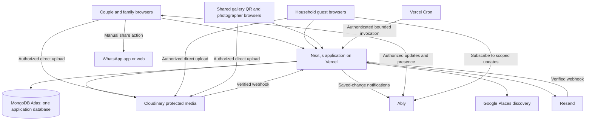

MongoDB owns business state. Ably transports notifications and temporary presence. Cloudinary owns file bytes and transformations. Resend transports email. None of these providers decides who belongs to a wedding; the application does.

## 4. Application structure

```text
src/
  app/
    (marketing)/               product homepage
    (auth)/                    login, registration, verification, recovery
    (onboarding)/              wedding creation and family invitation acceptance
    (public-wedding)/          /w/:slug selected public information
    (family)/                  dashboard and planning screens
    (guest)/                   private household website
    (gallery)/                 shared-token gallery and photo uploads
    api/
      v1/                      API Design browser contracts; add routes per feature
        auth/ weddings/ membership-invitations/ access/
        guest/ gallery/ media/ public/ realtime/
      webhooks/                Cloudinary and Resend callbacks
      internal/jobs/           protected scheduled job execution
  modules/
    identity/ weddings/ events/ guests/ invitations/
    tasks/ vendors/ finance/ media/ realtime/ notifications/
  infrastructure/
    config/ mongodb/ security/ cloudinary/ ably/ resend/ google-places/ jobs/ observability/
  components/                  shared UI, layout and feedback
  shared/                      common API errors, response envelopes and formatting
tests/
  integration/ e2e/             unit tests colocated with services
scripts/
  migrations/ seed/ reconciliation/
```

This tree is a growth plan, not a set of empty folders to create during scaffolding. Feature schemas/types/UI/services/repositories live together under modules; server modules import server-only. See [Project Structure](Wedding-Project-Structure.md) for actual versus planned paths.

Route Handlers authenticate, validate input, and call module services. Services enforce permissions and invariants; repositories require explicit wedding scope. Server-rendered pages may call services directly without HTTP calls back into the same deployment. Interactive editors and uploads use client components.

Use the Node.js runtime for authentication, database access, cryptography, and provider SDK calls. Pin supported package versions and a compatible Node.js runtime during implementation. Do not rely on a specific latest version mentioned in a design document.

Recommend the official MongoDB Node driver plus application input validation. An ODM is optional, not required. Reuse a MongoClient connection pool per warm instance, cap pool sizes, and budget total connections across web and cron invocations. [MongoDB connection pools](https://www.mongodb.com/docs/drivers/node/current/connect/connection-options/connection-pools/)

## 5. Domain boundaries

| Module | Responsibilities |
|---|---|
| Identity | Organizer accounts, sessions, verification, reset, membership invitations. |
| Wedding | Couple details, lifecycle, membership, settings, website publication. |
| Events | Templates, event details, publication, cancellation, event access. |
| Guests | Households, contact import, tags, invited event IDs, guest limits, one RSVP. |
| Invitations | Design documents, published versions, manual WhatsApp preparation. |
| Tasks | Wedding/event tasks, checklists, assignment, comments, announcements. |
| Vendors | Manual contacts, Google Places discovery, saved place references and event associations. |
| Finance | Simple actual expense records, receipts and spending totals. |
| Media | Upload grants, verification, storage accounting, gallery, protected delivery. |
| Realtime | Scoped token issuance, saved-change publishing, presence conventions. |
| Notifications | Email templates, due jobs, delivery records, callbacks, reminders. |

Modules share a database, but updates go through the owning service. Provider SDKs are behind adapters so domain code does not depend on provider response formats.

## 6. Identity and authorization

### 6.1 Organizer authentication

Use application-owned email/password authentication in Next.js Route Handlers. Better Auth is explicitly excluded. Implement register, verify email, login, logout, forgot password, reset password, and current-session endpoints. Use a maintained password-hashing implementation; do not implement cryptographic algorithms yourself. Verification and reset emails are delivered through Resend.

- Hash passwords with Argon2id using unique salts and a vetted implementation; benchmark a suitable work factor on the selected Node.js/Vercel runtime. Store the encoded hash, never plaintext or reversible passwords. [OWASP password storage](https://cheatsheetseries.owasp.org/cheatsheets/Password_Storage_Cheat_Sheet.html)
- Use secure HttpOnly cookies, same-site protection, trusted origins, and CSRF defenses for mutations.
- Require email verification before creating a wedding or sending invitations.
- Bind membership acceptance to the intended verified email, not merely possession of an invitation URL.
- Rate-limit login, reset, verification resend, and registration with shared persistent counters; process-local limits alone are insufficient on Vercel.
- Return neutral account-recovery responses. Revoke relevant sessions after password reset.
- Keep guest capability sessions distinct from organizer sessions.

### 6.1.1 Session and account recovery implementation

- Registration validates and consistently normalizes email, enforces a documented password-length policy without silently truncating passwords, and relies on a unique email index to handle races.
- Successful login creates a cryptographically random opaque session secret (at least 32 random bytes); persist its hash in MongoDB and send the raw value only in a Secure, HttpOnly, SameSite cookie. Do not store sessions or passwords in browser localStorage.
- Validate session expiry, revocation, user state, and credentialVersion on every protected request. TTL deletion is cleanup, not the authorization check. Use host-only cookies for the canonical application domain.
- Logout revokes the server session and clears the cookie. Rotate sessions after sensitive identity changes. Password reset atomically increments credentialVersion so older sessions immediately fail validation.
- Verification/reset tokens are random, short-lived, purpose-bound, and single-use. Consume a reset token and update the password/credentialVersion in one transaction; concurrent attempts cannot reuse it.
- Apply shared rate limits and generic login/recovery responses. Check Origin and CSRF protection for browser mutations. Validate any return URL against approved same-origin destinations.
- Initial configurable session policy: seven-day absolute lifetime, with shorter sensitive-action reauthentication as required; verification tokens expire after 24 hours and reset tokens after 30 minutes. Validate these defaults during implementation.
- Test session fixation, reset replay, concurrent reset, account enumeration, invalid origin, expired sessions, and revoked-session access before release.

The browser experience stays simple: email + password. These server-side controls protect that flow. [OWASP session management](https://cheatsheetseries.owasp.org/cheatsheets/Session_Management_Cheat_Sheet.html)

### 6.2 Permissions

| Actor | Allowed scope |
|---|---|
| ADMIN | All planning operations, member invitations/role changes/removal, archive, gallery-token rotation and privacy controls. |
| MANAGER | View wedding details; cannot edit them (user decision, October 24, 2026). Edit events, households and guest limits, tasks, vendors, expenses, designs, media and website content; cannot manage memberships or archive. |
| Household guest | Only its invited event details, one household RSVP, enabled gallery/private livestream, and enabled photo uploads. |
| Shared gallery visitor | View wedding gallery and upload when enabled; no event details, RSVP, livestream, receipts or family planning access. |
| Cron/webhook | Narrow authenticated service operation; no general user privileges. |

Bride and groom hold ADMIN memberships. Other family users receive ADMIN or MANAGER through an ADMIN-issued invitation. Never remove/demote the last active ADMIN. All authenticated family users can see shared planning information. Every private query uses server-derived wedding scope. Guest event access reads the household's current invitedEventIds and eligible event status; cancelled/removed events are excluded from active guest views.

### 6.3 Private invitations and shared gallery links

Household invitation capabilities remain individually revocable. A second, wedding-wide gallery secret is embedded in weddings.gallery. Store token hashes for verification and encrypted copies for authorized re-sharing; encryption keys remain server-only. Do not store raw reusable secrets in logs, analytics or ordinary database projections.

Exchange either link for a kind-specific HttpOnly capability session and redirect to a clean URL. Household sessions reference the link and version; gallery sessions reference weddingId and galleryTokenVersion. Recheck current state, expiry and version on every request. Use no-referrer behavior on exchange pages. No guest OTP is required.

Example gallery URL: `/gallery/random-secret`. The QR encodes this same URL. Photographers use the same link as other gallery visitors. There is no separate upload-only venue/photographer permission in this version. A forwarded link grants gallery viewing and enabled uploads, but never household RSVP access.

ADMIN rotation creates a new shared token/version and invalidates old gallery sessions; old printed QR codes stop working. Removing a household revokes its invitation, but cannot revoke its knowledge of the shared gallery secret. Rotation or disabling gallery access is necessary to revoke that shared access. Guest-upload disable preserves gallery viewing. Archived galleries remain readable when enabled, but uploads are denied.

## 7. MongoDB data model and indexes

Use one Atlas application database per environment. Production weddings share collections scoped by weddingId. Files remain in Cloudinary. The detailed source for field tables, exact indexes and invariants is [Database Design v2](Wedding-Database-Design.md).

| Collections | Responsibility | Important constraints |
|---|---|---|
| users, sessions, authTokens | Email/password and verification/reset | Unique normalized email/token hashes; checked expiry and credential version. |
| weddings | Settings, public snapshot, gallery secret, storage, archive state | Unique public slug and gallery.tokenHash; write fence. |
| memberships, membershipInvites | ADMIN/MANAGER access | Unique userId; one wedding per user; preserve last ADMIN. |
| events | Event details and state | Wedding-scoped calendar indexes. |
| households | Contacts, invitedEventIds, maxGuests, embedded single RSVP | Unique event IDs inside bounded array; positive guest limit; version check. |
| capabilityLinks, capabilitySessions | Household links and scoped household/gallery sessions | Unique token hashes; one active household link; session kind and version checks. |
| tasks, comments, announcements | Planning and family communication | Wedding/event/assignee indexes; paginated comments. |
| vendors | Manual contacts and saved Google place references | Optional unique weddingId + googlePlaceId; event IDs in bounded array. |
| expenses | Simple actual expense records and receipts | Unique weddingId + operationKey; event/vendor ownership validation. |
| designs, designVersions | Editable and published invitation designs | Unique design revision; immutable published content. |
| assets, uploadIntents | Cloudinary metadata, quota reservations and verification | Provider/intent uniqueness; one accounting transition per upload. |
| emailCampaigns, deliveries, jobs, webhookReceipts | Durable email and background operations | Unique dedupe/provider event identities; leases and bounded retries. |
| activity, idempotencyKeys, rateLimits | Audit, retry protection, abuse controls | Scoped keys, checked expiry, carefully applied TTL. |

There are 26 collections. eventInvitations, bookings and payments are removed from the revised model. A household stores its invitedEventIds and one current RSVP, with history in activity. Removing one invited event leaves its shared answer unchanged; changing the list shows the organizer that the existing answer applies to the revised list.

Use ObjectId references, UTC dates plus IANA wedding timezone, explicit versions, and integer minor currency units. Money uses BSON long and safe BigInt/Long arithmetic, serialized as decimal strings. One currency per wedding. TTL is cleanup, not an access check; never automatically expire archived planning, expenses or ready media.

### Consistency strategy

- Check same-wedding ownership of every referenced record.
- Save forms and RSVP using expected version; stale writes return 409.
- RSVP attendingCount must be 1 through current maxGuests; other statuses count as zero. A capacity reduction below saved attendance requires explicit correction.
- Commit business mutation, activity and durable outbox together where required; no provider calls inside transactions.
- Guard active-wedding mutations using the shared wedding writeFence. Archive, membership/link revocation and gallery rotation touch the same fence. Retry conflicts against current state; measure contention.
- Expense totals sum non-deleted actual expense entries. Shared charges are recorded once without an eventId. There is no contractual outstanding-balance calculation.
- Privacy operations after archive use a narrowly authorized ADMIN path: unpublish, revoke access, or disable/rotate the gallery; ordinary edits remain blocked.

[MongoDB transactions](https://www.mongodb.com/docs/manual/core/transactions/)

## 8. API and request contracts

October 25 task increment: protected task pages and four Node task Route Handlers call a server-only task service in this existing deployment. Dashboard summaries and safe selector choices use direct scoped service reads. A contained task-data failure preserves the rest of the dashboard. No permanent worker, provider integration or realtime behavior was added; Ably remains deferred for task collaboration. See Implementation Status for evidence.

Routes below are historical illustrative patterns, not implementation paths or a mandatory route count. API Design v1.1 is authoritative: browser operations use /api/v1; internal/webhook paths remain absolute. No route in this table is implemented by the scaffold. Every mutation validates its body, authorization, lifecycle state, and relevant record version.

| Route pattern | Purpose |
|---|---|
| /api/auth/* | Application-owned registration, login, verification, reset, logout, and session lookup; no Better Auth. |
| POST /api/weddings | Create wedding and ADMIN membership atomically. |
| /api/weddings/:id/events | Event CRUD/publication/cancellation. |
| /api/weddings/:id/households | Household entry/import, invitedEventIds, maxGuests and shared RSVP. |
| /api/weddings/:id/tasks, vendors, expenses | Module operations. |
| POST /api/weddings/:id/expenses | Create a simple expense using a stable operation key. |
| GET /api/weddings/:id/vendor-discovery | Authorized, rate-limited Google Places category/location search. |
| POST /api/weddings/:id/vendors | Save manual contact or selected Google place reference. |
| PATCH /api/weddings/:id/gallery | Change gallery/view/upload settings. |
| POST /api/weddings/:id/gallery/rotate | ADMIN rotates the shared gallery secret/version. |
| GET /api/gallery | Gallery-only DTO using authorized household/family/gallery identity. |
| POST /api/access/exchange | Exchange household or shared-gallery secret for a kind-specific session. |
| GET /api/guest/site | Authorized guest DTO only. |
| GET /api/public/weddings/:slug | Anonymous allowlisted public-page DTO; requires explicit public publication. |
| GET /api/public/weddings/:slug/media/:assetId | Only an explicitly public-page-selected image of the published page. |
| PUT /api/guest/rsvp | Update the current household's single RSVP; enforce maxGuests. |
| POST /api/media/intents | Authorize upload and reserve storage. |
| POST /api/media/intents/:id/complete | Verify provider result and finalize. |
| GET /api/media/:id/content | Protected media delivery or short-lived authorized redirect. |
| POST /api/realtime/token | Issue narrowly scoped Ably credentials. |
| POST /api/weddings/:id/invitations/send | Create email campaign/delivery jobs. |
| POST /api/weddings/:id/archive | Apply ADMIN-only archive transition. |
| /api/webhooks/resend, /api/webhooks/cloudinary | Verified provider callbacks. |
| GET /api/internal/jobs/tick | Secret-protected Vercel cron handler; not a user endpoint. |

Use 401 for absent identity, 404 for inaccessible resources where disclosure is undesirable, 409 for version/state conflict, 422 for invalid values, and 429 for limits. Return requestId and a stable error code. Cursor-paginate lists; cap page sizes. Never send whole internal documents to guest clients.

Private pages, APIs, and media authorization responses use private/no-store behavior and must not enter shared Next.js/CDN caches. Public product pages and versioned nonprivate static assets can be cached. Next.js authorization belongs in server-side services, not solely navigation guards. [Next.js authentication](https://nextjs.org/docs/app/guides/authentication)

## 9. Saved updates, typing, and edit conflicts

### Channel boundaries

| Channel class | Subscribers | Publishers | Payload |
|---|---|---|---|
| Wedding family changes | Current family members | Server only | Change type, opaque target ID, version; no full records. |
| Household changes | Current household capability | Server only | Refresh hint without names/details of uninvited events. |
| Wedding gallery changes | Authorized household/family/shared-gallery visitors | Server only | Gallery refresh hint without private planning data. |
| Task presence | Family members authorized for task | Identified members via restricted presence capability | Typing state and timestamp. |
| Form presence | Family members authorized for record | Identified members via restricted presence capability | Editing/viewing state; no unsaved field values. |

Next.js checks current identity and grants only explicitly named channels/capabilities. Browsers never receive an Ably API key or publish permission on authoritative change channels. Server-bound client identity prevents impersonating another family member. [Ably capabilities](https://ably.com/docs/auth/capabilities)

### Save flow

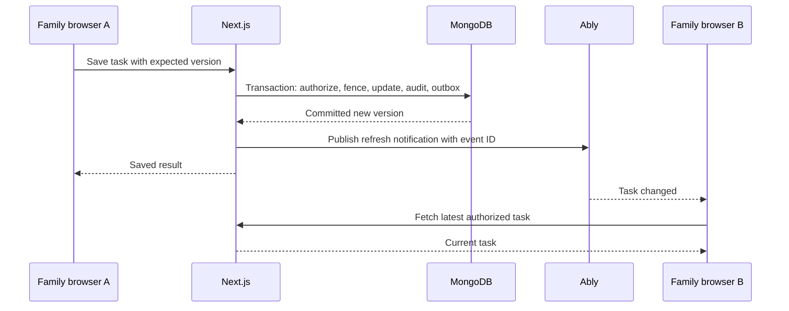

Attempt publication within a bounded request budget after commit. If it fails, the committed outbox remains for cron retry. Duplicate notices are harmless: clients deduplicate event IDs and ignore old versions. On reconnect or tab focus, fetch authoritative state. Live-update latency is a target, not a promise during provider failure.

Typing sends throttled activity, not every keystroke. Suggested defaults: heartbeat at most every two seconds while active, visual expiry after five seconds without renewal, immediate clear on submit/blur where practical. Editing presence similarly expires after missed heartbeats. Neither locks records nor saves text.

Do not overwrite a user's dirty form when a refresh arrives. Show a newer-version banner. A stale save receives 409; allow review and resubmission against the latest version. Presence is advisory and must not bypass version checks.

Ably tokens should be short-lived (initial target five minutes) and renewed through authorization. Revoke/disconnect where provider support is validated; otherwise expired/revoked membership may retain temporary channel access until token expiry. Keep notification payloads minimal and deny all subsequent data fetches immediately. [Ably token authentication](https://ably.com/docs/auth/token)

## 10. Cloudinary media architecture

### Upload lifecycle

```mermaid
sequenceDiagram
    participant B as Phone browser
    participant N as Next.js
    participant M as MongoDB
    participant C as Cloudinary
    B->>N: Request upload intent with size and purpose
    N->>M: Check scope/state; reserve quota; store intent
    N-->>B: Constrained signed upload parameters
    B->>C: Direct file upload
    C-->>B: Provider result
    B->>N: Complete intent
    N->>C: Verify authoritative asset metadata
    N->>M: Recheck permission/state; finalize actual bytes
    N-->>B: Accepted or processing
    C->>N: Signed processing notification
    N->>M: Mark ready after verification
```

Signed uploads are generated only after application authorization; the API secret stays server-side. Cloudinary supports direct signed uploads and transformations. [Cloudinary uploads](https://cloudinary.com/documentation/upload_images)

- Use random application-assigned public IDs, a restricted preset, authenticated delivery type, disabled overwrite, allowed formats, and provider-enforced file limits where supported.
- Treat all browser metadata as untrusted. Verify provider signatures plus authoritative asset ID, type, byte count, dimensions, and intended public ID before publishing.
- Suggested starting limit: 20 MB per image and batches of up to 20 files, configurable after phone-format testing. JPEG/PNG/WebP are the initial baseline; validate HEIC conversion in a deployment spike before promising support. Reject arbitrary SVG/HTML as gallery images.
- Reserve declared bytes atomically; finalize actual usage or reject over-quota assets. Count originals and derivatives according to a documented quota rule; reconcile with provider usage.
- Asset states: pending, ready, rejected, delete_pending, deleted, matching Database Design v2. Provider processing details remain metadata while pending. Ready follows automatic validation, not human approval.
- Generate limited named thumbnail/gallery transformations. Strip location metadata from displayed derivatives. Preserve private originals as agreed; originals may retain metadata, so downloading them is an explicit authorized action.
- Separate gallery images, invitation images, receipts, and task attachments. A wedding guest cannot fetch a receipt merely because it is in the same Cloudinary account.
- Shared gallery sessions may view ready gallery assets and upload when enabled. Recheck gallery.isEnabled, tokenVersion and guestUploadsEnabled during intent creation and finalization. Receipts remain family-only.

A previously issued upload signature may remain usable briefly after link revocation/archive. Recheck at finalization, reject publication, and clean up orphaned assets. Do not claim application revocation instantly cancels an already issued provider upload authorization.

### Protected delivery

Use Cloudinary authenticated assets for originals AND transformed versions. Private-type assets alone may leave derivatives accessible. Ordinary signed delivery URLs are bearer access and should not be described as automatically expiring. Cloudinary's token/cookie-based expiring delivery is a premium feature. [Cloudinary access controls](https://cloudinary.com/documentation/control_access_to_media)

**Baseline without premium delivery:** An authenticated Next.js media endpoint checks current access and streams a size-bounded Cloudinary derivative using a server-side signed URL. Do not expose the upstream reusable URL, and disable shared caching. This adds Vercel bandwidth/runtime cost; load-test it. Original downloads must be streamed, not buffered, and kept within validated platform limits.

**Preferred production upgrade when funded:** Short-lived Cloudinary delivery tokens scoped to the exact asset/approved path, issued only after application authorization. This removes image bytes from Vercel. Validate plan availability and token expiry in a spike before selecting the paid plan. Previously fetched/downloaded bytes cannot be recalled in either model.

No automatic retention expiry for archived originals. Explicit deletion, rejected/orphan uploads, and account/service termination are separate lifecycle cases. Indefinite retention requires ongoing paid capacity and a recovery/export policy; it is not a guarantee of free permanent hosting.

## 11. Invitation editor and WhatsApp

Store designs as versioned JSON scene documents with allowed text/image elements and owned asset references. Keep published versions immutable; edits create drafts. Use a client-side canvas editor for move/resize controls and image export, then validate exported uploads like other assets. Validate maximum element counts and URLs; never execute stored HTML/scripts.

Guest event details remain authoritative in MongoDB even if a downloaded invitation image contains older text. Show current details in the website. Keep private event designs behind the relevant household authorization.

WhatsApp action prepares one household's text/link and opens WhatsApp. No job sends WhatsApp messages. Log only share-opened or organizer-marked-shared, never inferred delivery/read status. Allow downloading an invitation image for manual attachment and copying text/link as fallback.

## 12. Resend and durable background jobs

### Job execution

Vercel Cron invokes a protected route in the same deployment; no setInterval, persistent worker, or fire-and-forget timer is relied upon. The job route validates CRON_SECRET, claims small batches atomically, and exits before its configured function deadline.

Job states: queued → running → done; retryable failures enter retry with a later runAt; permanent/exhausted failures become dead; ineligible work becomes cancelled. Each claim includes a unique lease owner, lease expiry, and attempt count. Completion updates require the current lease owner. Expired leases are recoverable, and provider timeouts must be shorter than lease/runtime budgets.

Jobs include email delivery, campaign expansion, realtime outbox retry, cache invalidation, archive reconciliation, and media cleanup/reconciliation. Contact imports run in bounded requests with retry protection. Separate priorities prevent media maintenance from starving emails. Suggested retries are exponential backoff with jitter and a configurable maximum; expose exhausted failures to operators.

Vercel does not automatically retry failed cron invocations. Its documented Hobby schedule is daily, while Pro supports minute-level schedules. Timely reminders and retry recovery therefore require a suitable production plan; do not represent Hobby as meeting this design. [Cron management](https://vercel.com/docs/cron-jobs/manage-cron-jobs), [cron plan limits](https://vercel.com/docs/cron-jobs/usage-and-pricing)

Use a one-minute tick as the production design target, subject to plan validation. Process due work in bounded chunks and alert on oldest queued age. Store due time in UTC calculated from wedding timezone. Missed ticks are recovered from durable runAt values. Expired event reminders are suppressed rather than sent after the event.

### Email consistency

Business mutation and email intent commit together in MongoDB. Small immediate sends may be attempted during a bounded request; large campaigns fan out into per-household jobs. Account verification/reset emails are issued by the identity module with durable retry handling, without logging the secret URL. Any retry payload containing a secret link must be encrypted at rest and discarded after expiry/delivery; token validation stores hashes only.

Before each attempt, apply message-type-specific eligibility (section 28). Event messages check wedding/event/household state and current invitedEventIds; RSVP reminders check the single household response. One answered household is not reminded separately for every event. Account verification and recovery check account/token state and must not require a wedding. Never expose recipient lists to other households.

Use a stable Resend idempotency key per immutable message payload. Resend currently keeps keys for 24 hours, so retain application delivery history longer. If acceptance is uncertain beyond that window, reconcile or require operator review rather than blindly resend. A deliberate resend creates a new delivery intent. [Resend idempotency](https://resend.com/docs/dashboard/emails/idempotency-keys)

Verify webhook signatures against the raw body, reject replay outside the allowed verification window, deduplicate provider event IDs, and correlate provider message ID to the stored delivery. Preserve timestamps and handle out-of-order delivered/bounced events explicitly. Provider acceptance is not delivery. Disable click tracking on secret-bearing links where possible. [Resend webhook verification](https://resend.com/docs/webhooks/verify-webhooks-requests)

Verify the sending domain, configure required DNS records, and monitor bounces/complaints. Resend failure should not prevent manual WhatsApp sharing or guest RSVP.

## 13. Archive and revocation semantics

Archive transaction changes wedding state under the write fence and records the action. New edits, comments, RSVP writes, upload finalization, and scheduled guest messages are denied. Existing jobs are cancelled in bounded batches, but execution also checks current state so cancellation does not depend on a complete batch sweep.

Keep authorized read access to website, enabled gallery, and family records. ADMIN may still unpublish, revoke access, or disable/rotate gallery credentials through a narrow privacy path; these operations do not permit ordinary archived edits. Disable presence publishing after archive; read-only refresh notifications may still occur for administrative revocations. Revoke or stop renewing realtime grants when members/links are removed.

External sends are not transactional with MongoDB. An email whose dispatch began before archive may still be accepted afterward; it cannot reliably be recalled. Similarly, already signed uploads may create rejected/orphan provider assets. Document these bounded in-flight exceptions instead of claiming atomic cancellation across providers.

## 14. Deployment and configuration

Use one Vercel project for the application. Preview and production deployments have isolated credentials and data. Keep Vercel execution close to the selected Atlas region where supported; choose the actual region at setup, not by assumption.

| Configuration | Treatment |
|---|---|
| MONGODB_URI / database name | Server only; restricted database user and reviewed Atlas network access. |
| Authentication secret/base URL | Environment-specific; trusted callback origins. |
| Capability encryption key | Separate server-only key; rotate with versioned decryption support. |
| Cloudinary API key/secret | Secret server-side; constrain signed client parameters. |
| ABLY_API_KEY | Server only; browsers receive scoped short-lived credentials. |
| RESEND_API_KEY / webhook secret | Separate environments; least required access. |
| GOOGLE_PLACES_API_KEY | Server-only API-restricted key; request budgets, billing alerts and current attribution rules. |
| CRON_SECRET | Verify every scheduler request. |
| Quotas and job batch limits | Explicit configuration, observable and changeable. |

Plan Atlas connectivity for Vercel's egress model. Do not silently open unrestricted network access as a permanent default; evaluate supported restricted egress/private connectivity versus cost and document the chosen boundary. TLS and strong database credentials remain required.

Build in CI, type-check, validate indexes/migrations, run critical tests, deploy a preview, smoke-test, then promote. Schema changes follow expand/migrate/contract so older and newer functions can overlap safely. Create indexes deliberately; do not build them on every request. Rollbacks must remain compatible with committed records and outstanding jobs.

No secrets in NEXT_PUBLIC variables, invitation designs, source control, client bundles, or ordinary logs. Preview jobs must never send production invitations.

## 15. Capacity, cost, and performance

Initial load assumptions are estimates to test:

- Five weddings, approximately 500 expected people each; household record count is independently measured.
- Begin load tests with 50 concurrent browsers across weddings, then increase until measured limits are understood. This is a test starting point, not an approved production ceiling.
- Saved-update target: about 1–2 seconds under healthy provider/network conditions; reconnect triggers resynchronization.
- Proposed RSVP p95 target: under two seconds on the agreed test setup, excluding outages; cold starts included in measurement.
- Photo counts vary. Example only: 5,000 originals at 5 MB each are approximately 25 GB per wedding before derivatives and download traffic.

Main costs: Google Places searches/details, Vercel functions/cron and media-proxy transfer, Atlas cluster/connections/backups, Cloudinary originals/derivatives/transformations/delivery, Ably connections/presence traffic, and Resend emails. Free product access is not free infrastructure.

Avoid realtime subscriptions to every screen simultaneously. Subscribe only to current wedding and active detail contexts; throttle presence. Use paginated galleries and pre-generated size variants. Set user-visible quota warnings, upload rate limits, provider spending alerts, and job backlog alerts.

No fixed price estimate is asserted here. Choose plans after validating protected-media delivery and reminder cadence, then estimate actual usage against current provider pricing.

## 16. Failure recovery and observability

| Failure | Required behavior |
|---|---|
| Atlas unavailable | Fail writes clearly; preserve browser draft; do not claim success or use stale data for authorization. |
| Ably unavailable | Saves still work; show live-update interruption, refetch on focus/manual action, retry outbox later. |
| Resend unavailable | Preserve queued intent, back off; show pending/failure rather than delivered. |
| Google Places unavailable | Keep organizer notes and saved place IDs; show discovery/details unavailable, allow manual vendor entry. |
| Cloudinary unavailable | Planning stays usable; uploads fail/retry individually; retain completed uploads. |
| Function timeout during job | Lease expires, next invocation recovers; idempotency protects provider actions. |
| Duplicate webhook | Unique event ID makes replay a no-op. |
| Revoked grant during upload | Reject finalization and schedule cleanup. |
| Two simultaneous edits | One version-checked save wins; other returns conflict for review. |
| Quota race | Atomic reservation prevents concurrent uploads exceeding allowance unnoticed. |
| Cron missed | Alert on tick/backlog age; next tick processes still-eligible due work. |

Structured logs contain requestId, weddingId, action, latency, provider correlation ID, and safe error category; redact passwords, guest link secrets, tokens, and sensitive content. Track API errors, pool usage, oldest job age, retry/dead-letter counts, upload failure/quota usage, email outcomes, and realtime latency.

Use a suitable Atlas backup/restore capability for the selected tier and test restoration. Cloudinary availability alone is not a backup policy: validate original export/recovery, accidental deletion handling, and any provider backup feature before launch. Proposed recovery targets are RPO up to 24 hours and RTO up to 8 hours, pending budget and a successful recovery exercise; do not advertise them as achieved.

## 17. Validation and acceptance gates

1. Cross-wedding queries and direct object IDs cannot bypass authorization.
2. Wedding/reception invitees cannot retrieve haldi records, designs, or realtime details.
3. One household RSVP applies to all its invited events, enforces maxGuests, and updates projected event counts without treating their sum as unique people.
4. One user cannot gain two active wedding memberships through concurrent acceptance.
5. Stale task/expense saves return conflicts, and dirty forms are not replaced by realtime refreshes.
6. Typing/editing indicators identify the authenticated member, expire, and never include unfinished text.
7. Client Ably tokens cannot publish authoritative saved-change messages or join another wedding.
8. Shared gallery QR permits gallery viewing and enabled uploads, but cannot access receipts, RSVP, private events, livestream or planning records. Rotation invalidates old links/sessions.
9. Both Cloudinary originals and derivatives reject unauthenticated access through the chosen delivery path.
10. Upload retries, forged completion requests, quota races, unsupported files, and revoked grants are handled safely.
11. Simple expense entries total correctly; repeated operation keys do not duplicate rows; shared charges count once. Google Places references remain distinct from organizer-authored data.
12. Duplicate cron invocations and expired leases do not cause uncontrolled duplicate email sends.
13. Resend acceptance uncertainty beyond its idempotency window is surfaced for reconciliation.
14. Archive races reject new database mutations and publication; in-flight external exceptions are visible and bounded.
15. Preview deployments cannot use production data or send real guest messages.
16. Restore drill recovers linked wedding records and resolves missing media references.
17. MANAGER cannot manage membership/archive/rotate gallery; the last ADMIN cannot be removed.
18. Lowering maxGuests below saved attendance requires review; concurrent RSVP/capacity changes return conflict.

Use unit tests for domain calculations and permission rules; integration tests against a transaction-capable MongoDB environment; browser tests for family/guest/QR journeys; and provider sandbox/spike tests for Cloudinary delivery, Ably token scope, and Resend callbacks. Do not rely on mocks alone for these integration boundaries.

## 18. Implementation sequence

| Phase | Architecture deliverables |
|---|---|
| 0 — Technical validation | Verify application-owned login/reset/session flows, Cloudinary protected delivery/phone formats, Ably scopes, Vercel cron plan, Atlas connectivity, and environment isolation. |
| 1 — Foundation | Next.js skeleton, authentication, repository scoping, memberships, wedding/events, indexes, audit/version/fence pattern. |
| 2 — Guest journeys | Households, CSV validation, private links/sessions, guest DTOs, one capped household RSVP and event-filtered website. |
| 3 — Planning | Tasks/comments, manual/Google Places vendors, simple expenses, presence and saved-change outbox. |
| 4 — Invitations | Designer versions, manual WhatsApp, Resend templates, durable jobs, verified callbacks, reminders. |
| 5 — Celebration | Cloudinary intent/finalization, protected gallery, shared gallery token/QR and settings, livestream links, archive. |
| 6 — Launch validation | Access/load/failure tests, backup restore, operating dashboards, quotas, plan selection, real-family pilot. |

## 19. Decisions and launch prerequisites

**Settled:** One capped household RSVP, ADMIN/MANAGER roles, manual/Google Places vendors, simple expenses, shared gallery token, Vercel modular monolith, Next.js/Node.js, shared Atlas database, email/password, Cloudinary, Ably, Resend, manual WhatsApp, no guest OTP, indefinite media retention with quotas, unlocked forms with typing/editing presence.

**Recommended implementation defaults:** Official MongoDB driver, application-owned email/password authentication with secure opaque sessions, optimistic concurrency, transactional outbox, bounded MongoDB-backed jobs, minimal realtime messages, authenticated media, and no separate always-running worker.

**Must validate before launch:** Paid cron cadence, protected-media path and its cost, exact storage/file limits, region and network access, domain/DNS, password hashing, session revocation, and single-use reset behavior, backup/export policy, throughput targets, session/link/token lifetimes, expense correction rules, Google Places billing/restrictions/attribution, and provider secret rotation. These are implementation gates, not reasons to reopen agreed product scope.

## 20. References and document maintenance

Original provider references were consulted October 11, 2026; Google Places integration policy was reviewed October 12, 2026. Existing provider references remain subject to deployment-time validation. Links are placed beside the claims they support. Provider plans, limits, SDK behavior, and pricing can change; verify them when provisioning. Diagrams use Mermaid and have accompanying prose for viewers without rendering support.

Update this document when a deployment boundary, permission model, provider, consistency rule, or retention policy changes. Use section 1 and Database Design v2 for the six latest product decisions. PRD v3.0, UI Guidelines and Development Plan were aligned on October 15, 2026; none overrides the deployment, data or API boundaries here.

## 21. Public information website — approved extension

This extension implements PRD v2.2 section 9.1. There are two independent website surfaces:

| Surface | Route example | Access and purpose |
|---|---|---|
| Public information | /w/rakesh-and-priya | Anonymous, view-only selected couple/event/contact information. |
| Private invitation | /invite/random-secret, exchanged for a scoped session | Household-specific invited events, RSVP, shared gallery/livestream, and uploads. |

A public slug is not a credential. Requests to it never create a household session or return invitation/contribution secrets. Visitors cannot acquire private access merely because an event is publicly described.

### Data and publication

Store publicPage separately from the private website settings: slug, state (draft/published), revision, explicit public field values, selected public event summaries, and selected image asset IDs. Start unpublished. Use a unique partial index for assigned slugs; normalize and validate slugs, and reject reserved names/collisions. Keep slugs stable initially.

Use a public snapshot populated from explicit organizer selections and reviewed on publication. Editing source event details marks the relevant public snapshot stale in the editor; organizers review and republish the public information. This prevents newly added private fields from leaking through automatic document serialization. Suppress cancelled or removed public event summaries immediately on public reads and flag them for review, as specified in section 27. Display the public revision and last publication time internally.

The public service returns only the allowlisted snapshot after checking publication state. Never serialize entire wedding/event documents or reuse household DTOs. Include only approved contact fields; omit guest lists, IDs that are not needed for rendering, expenses, tasks, vendor details, gallery/livestream, and private links from HTML, JSON, metadata, and social previews.

### Public photos and caching

Only selected couple/introduction photos are anonymous-access eligible. Keep underlying Cloudinary assets authenticated and use a public-page media endpoint that checks the published snapshot's exact asset selection. This endpoint grants public access to those selected images only; it must not become a generic asset proxy. Reuse bounded streaming until the documented short-lived delivery alternative is validated. Do not change the shared gallery or receipt assets to public delivery.

Use no-store for public wedding page data and media authorization initially, even though the content is intentionally public, so unpublishing or removing an image is checked on subsequent requests. If public-page caching is added later, define purge and maximum staleness explicitly. Public product marketing/static assets keep their separate caching policy. Default noindex is a discoverability setting, not a security boundary.

### Lifecycle and access controls

Family members may edit and publish public content while the wedding is active, using existing version/fence/audit rules. Archive preserves the last published public snapshot read-only. ADMINs may unpublish an archived page as a narrow privacy-control exception; this does not permit general archived content editing or republication.

Public page viewers get no Ably family/household token and no typing/editing presence. RSVP and uploads remain behind the existing private capabilities. Unpublishing denies future anonymous page/API/media authorization requests; it cannot recall already downloaded content or third-party copies.

### Additional acceptance tests

- Anonymous visitors can read a published page without a guest session, but see only selected fields/events/photos.
- A private-only event cannot be fetched from the public endpoint, including by changing identifiers.
- Public image endpoints reject unrelated gallery images, receipts, and private invitation assets.
- Neither public HTML nor social previews contain household invitation tokens or internal records.
- Public slug collisions are rejected atomically.
- Unpublish removes public page/data/media access without breaking valid household invitation links.
- Archived public content is read-only, with ADMIN unpublish as the only specified publication exception.

Implement this surface during Phase 2 alongside the private website. It does not introduce a separate deployment, database, or service.
## 22. Approved public URL strategy

Use one canonical Vercel application address and a separate path for each wedding:

`https://weddingapp.vercel.app/w/rakesh-and-priya`

`weddingapp.vercel.app` is an illustrative project address, not a reserved or deployed domain. Use the actual configured Vercel production origin from server configuration. No per-wedding domain registration, hostname mapping, separate Vercel project, or separate deployment is required. Custom domains and per-couple vercel.app hostnames are outside the initial scope.

Generation flow: create wedding → normalize couple names into a lowercase hyphenated slug → reserve it using the unique slug index → if it conflicts, retry with a short random suffix such as `rakesh-and-priya-k7m4` → save as an unpublished public-page draft → organizer selects public fields and previews → Publish activates the page → Copy public link.

Normalize and validate slugs, reject reserved names, and use a generic wedding prefix plus random suffix when names do not yield a valid slug. The database unique index, not a pre-check alone, resolves simultaneous collisions. Keep assigned slugs stable even if names are edited. Private household invitation tokens are generated separately and must never appear in the public URL.

An automatically generated URL does not automatically publish content. Draft/unpublished pages remain unavailable to anonymous visitors. The public route serves only the approved snapshot; publishing it does not enable RSVP, uploads, gallery access, or internal planning access.

Use the configured canonical origin for invitation, verification, and password-reset links; never trust arbitrary request Host values. Test concurrent slug collisions, reserved names, unpublished access, and separation from private invitation URLs.

## 23. Deployment diagram and trust boundaries

The Vercel boxes below are logical parts of one application, not separate microservices. One deployment may execute across multiple function instances. Browsers never receive database credentials or provider secrets.

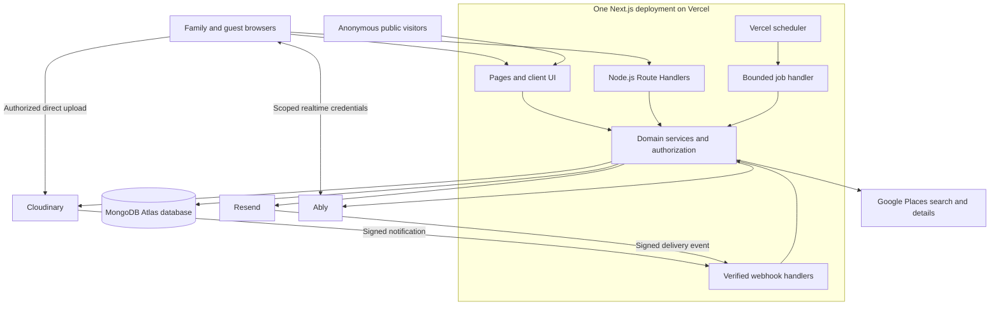

**Boundaries:** Next.js authorizes every database action, upload grant, and realtime token. Cloudinary stores files, MongoDB owns business records, Ably distributes temporary signals, Resend delivers email, and Google Places supplies attributed discovery results. Public visitors receive only the public snapshot. Webhooks require signature verification, not a browser session.

## 24. Complete application flow

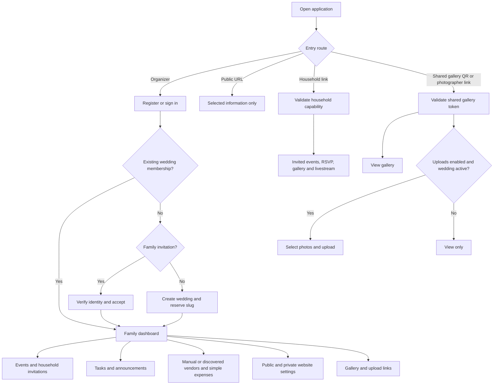

**Steps:** The couple creates a wedding, invites family, creates events, assigns households, and plans tasks/vendors/expenses. Public visitors can view selected information. Household invitees submit one response/count for all invited events, within maxGuests. Shared gallery links open viewing and enabled uploads. Vendors can be entered manually or discovered through Google Places.

## 25. Data relationship diagram

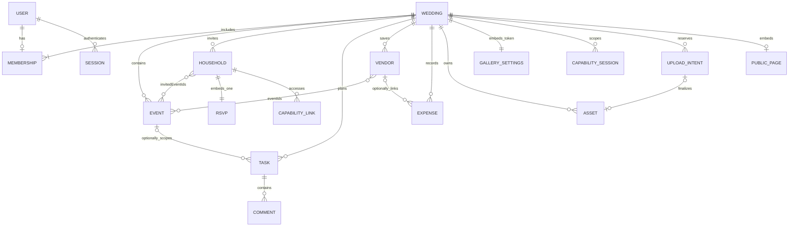

RSVP, gallery settings/token and public-page settings are embedded, not separate collections. Event relationships are bounded arrays. No eventInvitations, bookings or payments collection remains. Gallery sessions identify the shared grant/version rather than a particular household. Each simple expense is counted once. The complete 26-collection inventory and indexes are in Database Design v2.

## 26. Email/password registration and login

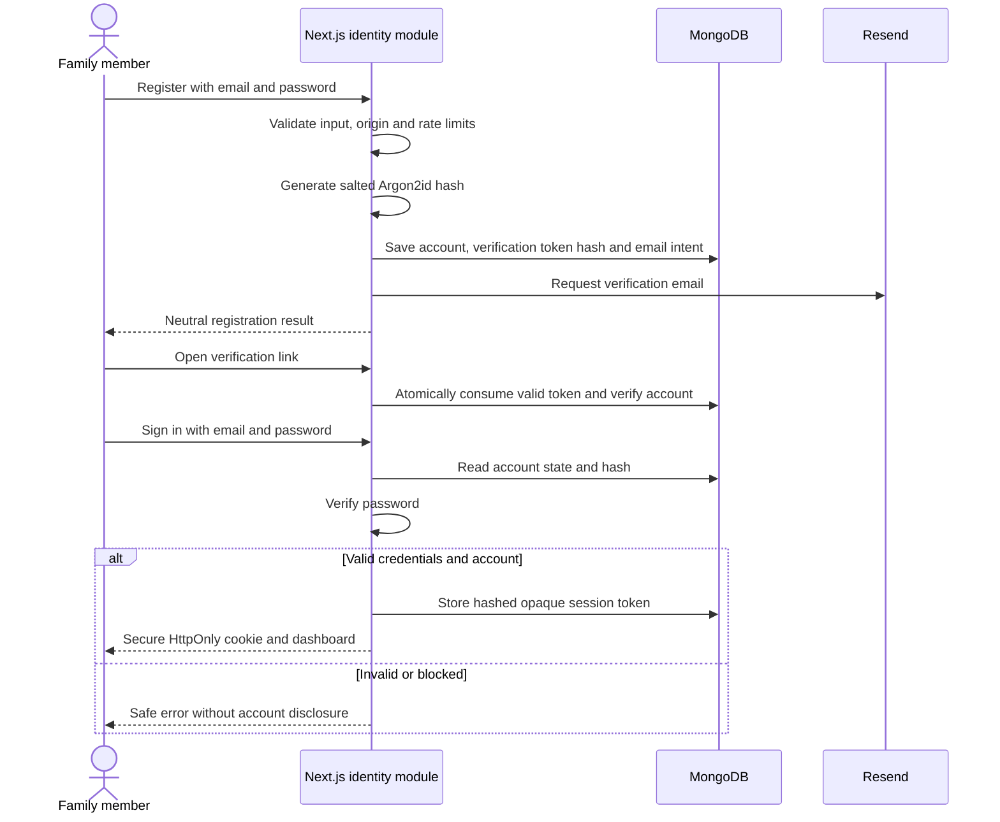

**Password reset:** Request reset → neutral response → eligible account receives a Resend link → validate token purpose/expiry → atomically consume token, update password hash and increment credentialVersion → invalidate previous sessions → sign in again. No Better Auth is used.

**Failure path:** Unsent emails retain durable delivery intents. Expired verification/reset links must not be sent through delayed retries. Account emails check account/token state; they do not require an existing wedding or event.

## 27. Public website generation and publication

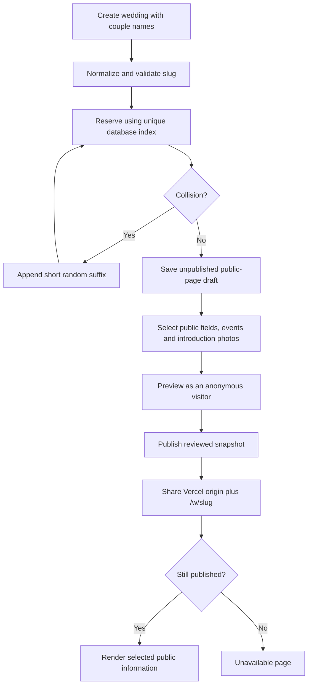

Example: `https://weddingapp.vercel.app/w/rakesh-and-priya`. If needed, use `rakesh-and-priya-k7m4`. The origin is illustrative until deployed. Creating a URL does not publish a page. Public access grants no RSVP, upload, guest gallery, or family-workspace permissions.

Ordinary source edits require review and republishing of the allowlisted snapshot. For cancellation or removal of a publicly displayed event, suppress that event summary immediately on public reads and flag the snapshot for review. Never leave a cancelled event displayed as active while waiting for republishing. This safety rule overrides the generic stale-snapshot behavior in section 21.

## 28. Private invitations and email delivery

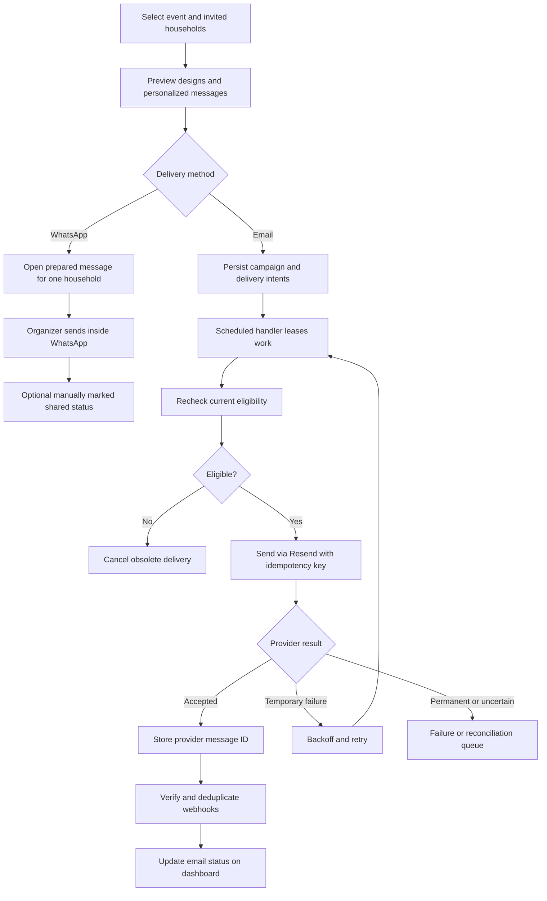

For 500 or 2,000 recipients, persist one logical delivery per household/message and process bounded batches across invocations. Do not keep the browser waiting for the entire campaign. If using the provider batch API, freeze each batch's payload, membership, and idempotency key; never regroup accepted messages during a retry. Keep individual provider IDs. Each household receives its own email, not a shared To/CC list.

| Message type | Eligibility checked before sending |
|---|---|
| Verification/reset | Account and purpose-bound token remain valid; no wedding required. |
| Family membership invite | Invitation, intended recipient and wedding state remain eligible. |
| Event invitation/update | Wedding, event, household invitedEventIds and recipient remain eligible. |
| RSVP reminder | Active household with eligible invited events, single RSVP still pending, and valid shared-deadline reminder timing; dedupe per household/campaign. |

This table refines section 12's general eligibility rule. Password recovery still works for a member of an archived wedding. WhatsApp has no automated job or verified delivery receipt. Resend production email requires a verified sender domain controlled by the platform, even if the website uses a free Vercel address.

## 29. Household invitation and RSVP sequence

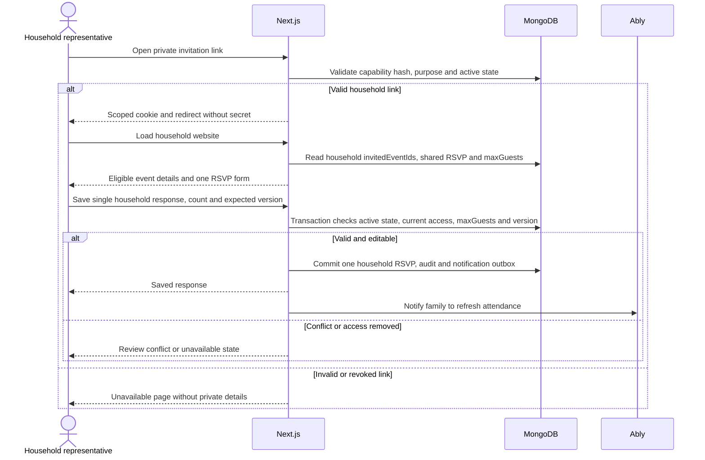

Attending requires a whole-number count from 1 through maxGuests. Other statuses have count zero. A family invited to Haldi and Wedding that answers 3 is projected as 3 at both events; it cannot submit different counts per event. The wedding total counts this household once, while summing event totals counts attendances. Organizers cannot lower maxGuests below a saved count without explicitly correcting it. A changed event list retains the shared answer after organizer review. Use one optional wedding rsvpDeadline; late answers are flagged until archive. Public slugs and gallery tokens never authorize RSVP writes.

## 30. Tasks, typing and editing flow

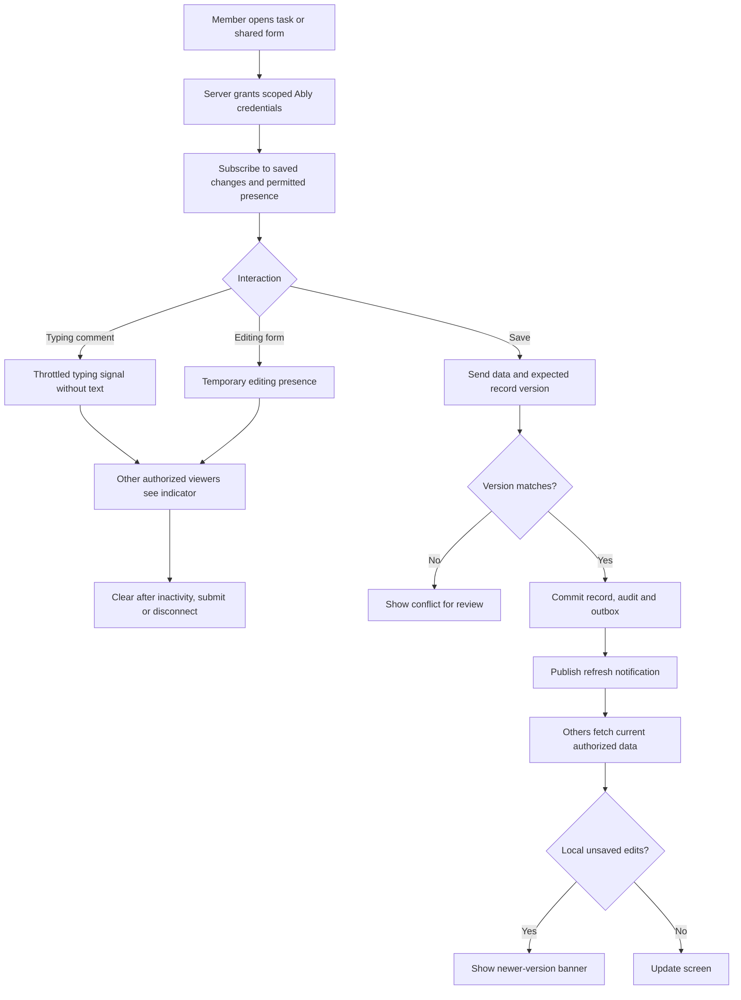

Presence does not lock forms, save unfinished text, or grant write access. Lost realtime connections trigger resubscription and state refresh. If Ably fails, committed edits remain saved; clients show degraded live updates. Section 9 contains the detailed server/database/Ably sequence.

## 31. Vendor discovery and simple expenses

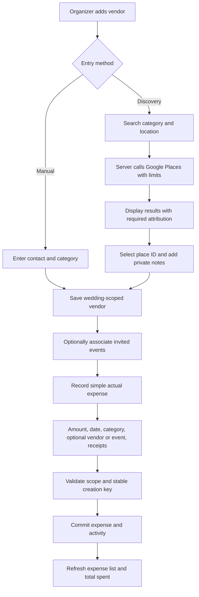

An actual 5,000-rupee advance is one 500,000-paise expense. A later actual 15,000-rupee expenditure is another entry. The system totals actual spending but does not create a contract, booking, instalment schedule, or unpaid-balance ledger. Shared charges are recorded once without eventId. Expense edits use optimistic versions; removal excludes the row from totals while preserving activity.

Discovery is an external search integration, not a vendor marketplace. Save googlePlaceId and independently authored organizer data. Do not permanently copy provider names, addresses, ratings, photos or reviews into manual fields to bypass storage restrictions. Fetch details for attributed display; only cache content as expressly permitted by current provider terms. Place IDs are exempt from the general caching restriction. [Google Places policies](https://developers.google.com/maps/documentation/places/web-service/policies)

Use a server adapter, authenticated family access, bounded result pages, restricted API keys, configured request fields, rate limits and billing alerts. No vendor booking or payment is submitted to Google. If the provider is unavailable, manual entry and saved organizer notes remain usable. Verify applicable API configuration and attribution before launch.

## 32. Photo-upload routes and recovery

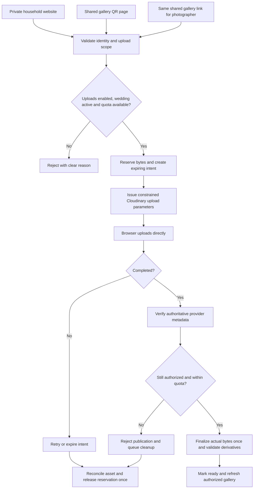

Each intent has an expiry and unique finalization identity. Browser completion and provider callbacks converge on one version-checked transition. Reserved bytes become used bytes once. Expired or failed intents release reservations once after checking for in-flight assets; late arrivals are rejected and cleaned up. Cleanup retries must not double-release quota. Reconciliation detects provider assets and reservations stranded by timeouts.

The shared gallery link exposes authorized gallery viewing and enabled uploads. A gallery session never authorizes private receipts, RSVP or event details. Capture galleryTokenVersion in shared-token upload intents and recheck it at finalization; household/member uploads use their respective grants. Finalization rechecks archive/revocation even when the provider accepted bytes. See section 10 for the upload sequence and protected media delivery options. The original-download delivery path remains a required deployment validation gate.

## 33. Archive lifecycle

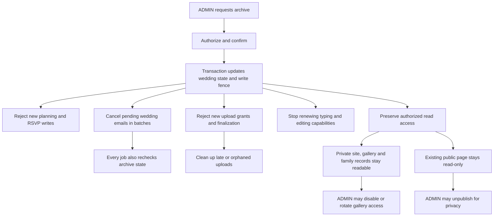

Already dispatched email cannot reliably be recalled. Existing realtime credentials may persist until their bounded expiry, while server writes are denied immediately. Account-recovery emails remain eligible. Previously published public content stays readable unless the ADMIN unpublishes; archiving does not publish any new information.

## 34. Flow-to-implementation checklist

| Flow | Persistent state | Completion evidence |
|---|---|---|
| Registration/login | User, auth token, session | Valid login works; expired/replayed tokens fail. |
| Wedding creation | Wedding, membership, slug | One membership and unique unpublished public page. |
| Public publication | Reviewed snapshot | Anonymous response contains only chosen fields. |
| Invitations | Campaign, delivery intents, jobs | Correct household link; retries preserve delivery identity. |
| RSVP | Household response, maxGuests, audit | One answer applies across invited events; capacity and version checks. |
| Task/form save | Versioned record, audit, outbox | Authorized viewers receive refresh notification. |
| Typing/editing | Temporary Ably presence | Correct member identity, expiry, no unfinished text. |
| Vendor/expense | Saved vendor/place ID, simple expense | Correct scope, retry-safe creation and spending totals. |
| Shared gallery | Wedding token/settings and gallery sessions | Valid link permits viewing/enabled uploads; rotation invalidates old sessions. |
| Photo contribution | Intent, quota reservation, asset | One-time finalization and abandoned-quota recovery. |
| Archive | Wedding state, audit | Mutations stop; authorized reads continue. |

Diagrams show intended behavior, not evidence of tested implementation. Provider plans, protected-media delivery, recovery drills, and operating limits still require validation before production sign-off.

## 35. Scaffold implementation boundary — October 15, 2026

Phase 0A implements only the root Next.js/TypeScript application shell, explicit Node.js runtime, npm, Tailwind tokens, server-only APP_ORIGIN validation, unavailable page, environment exclusions and setup/status documentation. Installed versions and verification evidence are recorded in package.json/package-lock.json and Implementation Status. No provider SDKs, database driver/collections, business APIs, jobs, authentication, migrations or deployment are implemented.

The architecture section 18 Phase 0 technical gates remain Phase 0B work before dependent feature releases; a local scaffold build does not validate Vercel/provider behavior. Use bounded functions rather than persistent workers; one deployment may have many execution instances. Use no provider credentials or network font downloads for the shell. Stitch exports are now available. The October 16 homepage adds static marketing content, local licensed fonts/images, an SVG brand mark and small client components for navigation/account availability. No API, persistence or integration boundary changes. See Implementation Status for current evidence.

API section 24 persistence clarifications are incorporated into Database Design v2.2 as design only. No database migration ran. Initial gallery/uploads are disabled. Event drafts require core API fields; private website content saves directly without a separate publication action. Preserve strict public snapshot publication. See Decision Record for approved product resolutions and open implementation gates.
